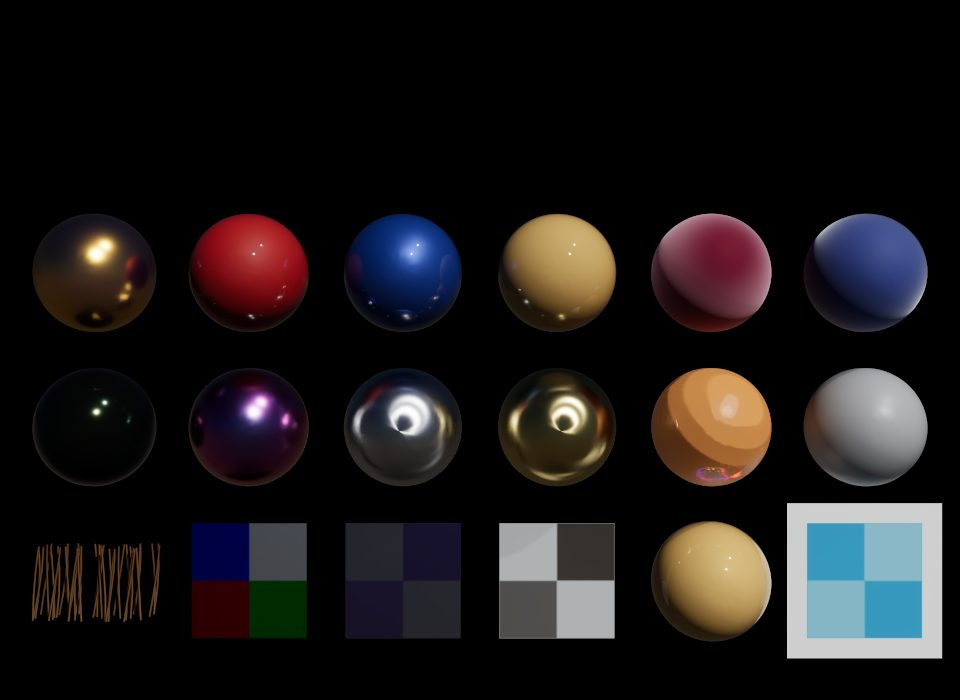
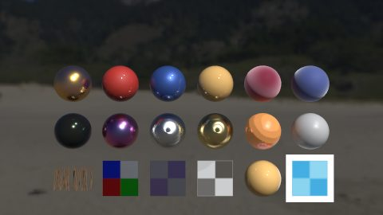
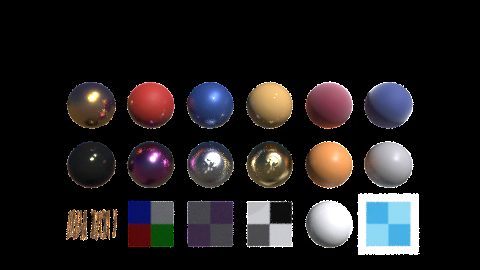
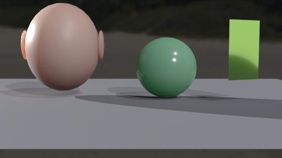
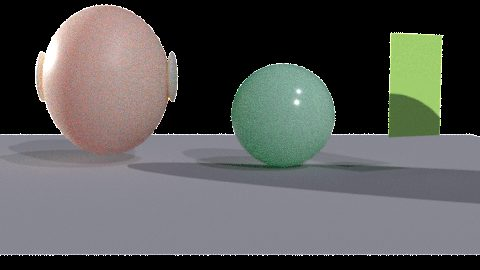
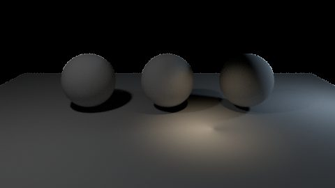
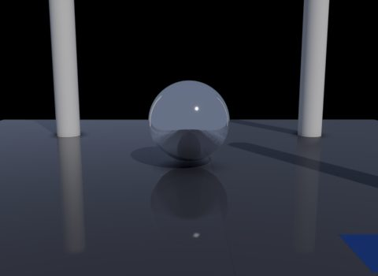
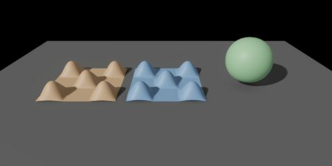
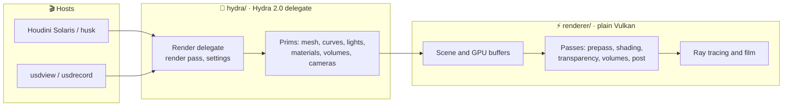

<div align="center">

<p align="center">
  
</p>

<h1>Eldr</h1>

<p><b>A GPU raster renderer for OpenUSD. Final VFX frames to EXR in seconds, with Karma as the look it aims for.</b></p>

<p align="center">
  <!-- Maintenance -->
  
  &nbsp;&nbsp;
  <!-- License -->
  <a href="LICENSE"></a>
  &nbsp;&nbsp;
  <!-- Docs -->
  <a href="https://tntman.github.io/eldr/"></a>
  &nbsp;&nbsp;
  <!-- Platform -->
  
  &nbsp;&nbsp;
  <!-- Vulkan -->
  
  &nbsp;&nbsp;
  <!-- OpenUSD -->
  
  &nbsp;&nbsp;
  <!-- Houdini -->
  
  &nbsp;&nbsp;
  <!-- Last Commit -->
  
  &nbsp;&nbsp;
  <!-- Stars -->
  
</p>

<p><a href="https://tntman.github.io/eldr/"><b>Documentation</b></a> · <a href="docs/guide/getting-started.md">Getting started</a> · <a href="docs/settings.md">Settings</a> · <a href="docs/guide/showcase.md">Showcase scenes</a></p>

</div>

<!-- TABLE OF CONTENTS -->
## Table of Contents

- [About](#about)
- [Gallery](#gallery)
- [Features](#features)
- [How It Works](#how-it-works)
- [Architecture](#architecture)
- [Installation](#installation)
- [Usage](#usage)
- [Environment Variables](#environment-variables)
- [Development](#development)
- [License](#license)

<!-- ABOUT -->
## About

Eldr is a Hydra 2.0 render delegate written on plain Vulkan. It plugs into Houdini's Solaris viewport and husk, and into OpenUSD's usdview and usdrecord, and renders the same USD stage Karma does: UsdLux lights, MaterialX and UsdPreviewSurface materials, OpenVDB volumes, UsdSkel crowds, cameras with depth of field and motion blur, and AOVs with light groups and Cryptomatte.

It is a raster renderer built for offline VFX, not a game engine. A still frame keeps adding samples (the *film*) until it converges, so shadows, depth of field and motion blur resolve exactly, and a final frame takes seconds instead of minutes. Ray-traced shadows, reflections, refraction, GI and caustics are there when the GPU supports them, and are off by default: the default render never starts ray tracing.

Karma is the reference. Each feature ships a showcase scene with `eldr_default`, `eldr_final` and `karma` render settings, and the test suite compares Eldr against Karma renders of the same scenes.

The display name is **Eldr** everywhere; the plugin id is `HdVkRendererPlugin`, and scripts and husk accept either.

<!-- GALLERY -->
## Gallery

Same scene, same camera: Eldr's final settings on the left, Karma on the right.

| Eldr | Karma |
|---|---|
|  |  |
|  |  |
|  |  |

A few features, off and on:

| | Off | On |
|---|---|---|
| **Ray-traced and screen-space reflections** |  |  |
| **Volumetric fog** |  |  |
| **Caustics** |  |  |
| **Motion blur** |  |  |
| **Displacement** |  |  |

Every picture comes from a folder in [`showcase/`](showcase/README.md); the [user guide](docs/guide/getting-started.md) names the folder and settings prim under each one.

<!-- FEATURES -->
## Features

| Area | What you get | Not yet |
|---|---|---|
| **Film and sampling** | Converging film with Sobol and blue-noise sample dimensions, adaptive sampling per 16x16 tile, Karma's per-component quality (`karma:object:diffusequality` and friends), Intel OIDN denoise with albedo and normal guides, tiled rendering for very large frames (`eldr:tileSize`) | Path-traced reference mode (use Karma) |
| **Lights** | Sphere, rect, disk, cylinder, distant and dome lights; textured area lights; IES profiles; light linking and shadow linking; light shapes shown as in Karma (`renderlightgeo`); emissive meshes as lights; HDRI sun extraction; hundreds of lights through screen-space clusters | Light functions, dome portals, IES types A and B |
| **Shadows** | Cascaded sun shadows, local-light atlas, PCSS soft shadows that converge exactly, coloured shadows through glass and volumes, ray-traced shadows (`eldr:rtShadows`) | Virtual shadow maps |
| **Global illumination** | GTAO, screen-space GI, ray-traced GI probes, final gather (`eldr:gi`, `eldr:finalGather`) | Infinite-bounce GI without ray tracing |
| **Reflections and refraction** | Screen-space reflections with back-face depth (measured thickness), planar mirrors, probes, ray-traced reflections with Karma's reflect limit, screen-space and ray-traced refraction with nested media and Beer-Lambert absorption, photon caustics | Refraction through planar water |
| **Materials** | MaterialX `standard_surface`, OpenPBR, glTF PBR and UsdPreviewSurface; pbrlib BSDF graphs and Houdini's Lama layering as Karma renders them; material graphs compiled whole into per-pixel programs; Karma's own nodes (ramps, hex tiling, Voronoi); textures with UDIM and BC7 compression | Burley subsurface (a per-channel Gaussian today), coat normal |
| **Volumes** | OpenVDB and VDB sequences, NanoVDB on the GPU, single and multiple scattering, volume self-shadowing from every light, mutual volume shadows, motion blur from `vel` | Karma's Pyro Shader |
| **Geometry** | Meshes, OpenSubdiv subdivision, displacement, curves (tubes and ribbons), points, point instancers with LOD, UsdSkel crowds with deferred skinning | Vector displacement's tangential part |
| **Camera** | Depth of field, motion blur from time samples and velocities, lens distortion, Karma's lens shaders, exposure from the camera | |
| **Output** | Render products and vars, LPE AOVs, light groups, Cryptomatte, linear beauty for husk, holdouts and mattes | `elementId` AOV |
| **Houdini** | Eldr tab on Render Settings, Render Geometry Settings and light LOPs (same Do Nothing / Set / Block menus as Karma's), viewport stats panel, husk wrapper for crowds | |

The full list, with settings, costs and the [known limitations](docs/features.md#known-limitations), is in [docs/features.md](docs/features.md). [docs/comparison.md](docs/comparison.md) compares Eldr with EEVEE and Unreal feature by feature.

<!-- HOW IT WORKS -->
## How It Works

1. **Sync.** Hydra 2.0 hands Eldr the stage through its scene index. Meshes, curves, instancers, lights, materials, volumes and cameras become GPU buffers; MaterialX graphs compile into material programs; UsdSkel poses once per skeleton and shutter time.
2. **Prepass and lighting.** A depth prepass, culling on the GPU, light clusters, shadow maps and the GI probes run once per sample.
3. **Shading.** One forward pass shades every surface: lights, shadows, dome, SSR, SSGI, AO, then transparency, refraction, subsurface and volumes in their own passes.
4. **Ray tracing (when on).** Shadows, reflections, refraction, GI and caustics trace against a TLAS of the scene, on GPUs with Vulkan ray tracing.
5. **Film.** Each sample jitters the pixel, the lens, the light shapes and the shutter time; the film averages them until the image converges, then denoises if asked.
6. **Output.** The viewport gets the image through GL interop or a readback; husk and usdrecord get linear EXR render products and AOVs.

<!-- ARCHITECTURE -->
## Architecture



`renderer/` is a Vulkan renderer that never includes a USD header; `hydra/` translates USD into it. Houdini-only code lives in the optional Houdini module, so Eldr itself has no Houdini dependency. Shaders are GLSL in `renderer/shaders/`, compiled to SPIR-V at build time.

<!-- INSTALLATION -->
## Installation

Eldr needs Windows, a GPU with Vulkan 1.3 and a current driver, and either Houdini 22 (22.0.466) or OpenUSD 26.08. A GPU with Vulkan ray tracing is optional: without it Eldr skips the effects marked **[RT]** in the [settings](docs/settings.md).

> [!NOTE]
> There is no binary release yet. Eldr builds from source against your Houdini or USD install; see [docs/houdini.md](docs/houdini.md#build).

1. Build the Houdini plugin (below). The build writes `build-h22/houdini/eldr.json`, a Houdini package.
2. Copy `eldr.json` to `Documents/houdini22.0/packages/`, or set `HOUDINI_PACKAGE_DIR` to `build-h22/houdini`.
3. Start Houdini, go to a LOP network and pick **Eldr** in the viewport's renderer menu or on a Render Settings LOP.
4. Render Settings and light LOPs made before the install get Eldr's tab from **Rebuild Renderer-Specific Parameters**.

<!-- USAGE -->
## Usage

In Solaris, pick Eldr in the viewport. While the camera moves you see a fast image; when it stops, the film refines it to **Film Samples** (64) and stops. From a Houdini command shell, husk renders a frame or a sequence:

```powershell
husk -R Eldr -s /Render/eldr_final -f 1 -n 24 -o render/beauty.$F4.exr showcase\2026-10-30_07_light_shapes\scene.usda
```

Without Houdini, `usdenv.cmd` sets up the plugin paths for USD's own tools:

```powershell
usdenv usdview --renderer Eldr showcase\2026-10-30_07_light_shapes\scene.usda
usdenv usdrecord --renderer Eldr --renderSettingsPrimPath /Render/eldr_final --disableCameraLight scene.usda out.png
```

A final render is a Render Settings prim with the expensive settings ticked one by one; there are no quality presets. Every `eldr:` setting has an on/off for A/B tests.

| Topic | Page |
|---|---|
| First render, install, husk, usdview | [Getting started](docs/guide/getting-started.md) |
| Draft vs final, the Eldr tab | [Rendering in Solaris](docs/guide/solaris.md) |
| Lights, shadows, dome | [Lights](docs/guide/lights.md) |
| MaterialX, textures, Karma nodes | [Materials](docs/guide/materials.md), [MaterialX reference](docs/materialx.md) |
| Ray-traced effects | [Ray tracing](docs/guide/ray-tracing.md) |
| AOVs, light groups, Cryptomatte | [AOVs](docs/guide/aovs.md) |
| Crowds, memory, large frames | [Performance](docs/guide/performance.md) |
| Eldr next to Karma | [Eldr and Karma](docs/guide/karma.md) |
| Every setting: default, effect, cost | [Settings](docs/settings.md) |

<!-- ENVIRONMENT VARIABLES -->
## Environment Variables

| Variable | Description |
|---|---|
| `HDVK_TIMING` | `1` prints startup and per-pass GPU times (per tile for tiled renders); `2` writes a CSV row per frame to `HDVK_TIMING_CSV` |
| `HDVK_PIPELINE_CACHE_DIR` | Moves the shader pipeline cache and the compressed-texture cache (default `%LOCALAPPDATA%\Eldr`) |
| `HDVK_NO_RAY_TRACING` | `1` behaves as if the GPU had no ray tracing |
| `HDVK_RT_EARLY_COMPILE` | `0` compiles ray tracing pipelines on first trace instead of on background threads |
| `HDVK_NO_STATS` | `1` reports only the renderer name to the host's stats (for comparison) |
| `HD_ENABLE_DEFERRED_SKINNING` | `1` lets Eldr pose UsdSkel crowds on the GPU (set by the husk wrapper `$ELDR_HUSK`) |
| `USD_ROOT`, `USD_VENV`, `HDVK_BUILD` | Read by `usdenv.cmd` to find USD, its Python and the Eldr build |

<!-- DEVELOPMENT -->
## Development

Building needs Visual Studio 2022 (x64), CMake with Ninja, the Vulkan SDK (glslc), and Houdini 22.0.466 or OpenUSD 26.08 built with OpenVDB. Intel OIDN 2.x is optional (for `eldr:denoise`); sccache is used when found.

```powershell
# Houdini build (Solaris, husk)
cmake -S . -B build-h22 -G Ninja -DCMAKE_BUILD_TYPE=Release -DHDVK_HOUDINI=ON "-DHOUDINI_ROOT=C:/Program Files/Side Effects Software/Houdini 22.0.466"
cmake --build build-h22

# OpenUSD build (usdview, usdrecord, tests)
cmake -S . -B build -G Ninja -DCMAKE_BUILD_TYPE=Release
cmake --build build

# Tests share the GPU: always one at a time
ctest --test-dir build -j1 -L fast
```

The test suite has about 55 ctests: renderer unit checks (`vkrtest`), Hydra and USD round trips, Karma golden references, a reflection and refraction scenario suite (`tests/scenes/scenarios`) and the docs check that every setting is documented. `tests/compare_renderers.py` renders any scene with Eldr, Karma and Blender EEVEE side by side ([docs/testing.md](docs/testing.md)). The documentation site builds from `docs/` with `docs/site/build.py` and publishes to GitHub Pages on every push.

<!-- LICENSE -->
## License

Eldr is licensed under the [Apache License 2.0](LICENSE).

`third_party/nanovdb` holds NanoVDB's `PNanoVDB.h` from OpenVDB (MPL-2.0, unmodified). OpenUSD, Houdini, Vulkan, Intel OIDN and MaterialX keep their own licences.
