<div align="center">

<p align="center">
  
</p>

<h1>Eldr</h1>

<p><b>A GPU raster renderer for OpenUSD and MaterialX. Final VFX frames to EXR in seconds, with Karma as the look it aims for.</b></p>

<p align="center">
  <!-- Maintenance -->
  
  &nbsp;&nbsp;
  <!-- License -->
  <a href="LICENSE"></a>
  &nbsp;&nbsp;
  <!-- Docs -->
  <a href="https://tntman.github.io/eldr/"></a>
  &nbsp;&nbsp;
  <!-- Platform -->
  
  &nbsp;&nbsp;
  <!-- Vulkan -->
  
  &nbsp;&nbsp;
  <!-- OpenUSD -->
  
  &nbsp;&nbsp;
  <!-- Houdini -->
  
  &nbsp;&nbsp;
  <!-- Last Commit -->
  
  &nbsp;&nbsp;
  <!-- Stars -->
  
</p>

<p><a href="https://tntman.github.io/eldr/"><b>Documentation</b></a> · <a href="docs/guide/getting-started.md">Getting started</a> · <a href="docs/settings.md">Settings</a> · <a href="docs/guide/showcase.md">Showcase scenes</a></p>

</div>

<!-- TABLE OF CONTENTS -->
## Table of Contents

- [About](#about)
- [Gallery](#gallery)
- [Features](#features)
- [Eldr vs EEVEE and Unreal](#eldr-vs-eevee-and-unreal)
- [How It Works](#how-it-works)
- [Architecture](#architecture)
- [Installation](#installation)
- [Usage](#usage)
- [Environment Variables](#environment-variables)
- [Development](#development)
- [Credits](#credits)
- [License](#license)

<!-- ABOUT -->
## About

Eldr is a Hydra 2.0 render delegate written on plain Vulkan. It plugs into Houdini's Solaris viewport and husk, and into OpenUSD's usdview and usdrecord, and renders the same USD stage Karma does: UsdLux lights, full MaterialX shading (standard_surface, OpenPBR, glTF PBR, pbrlib BSDF graphs, Houdini's Lama and Karma nodes, node graphs compiled into GPU programs) and UsdPreviewSurface, OpenVDB volumes, UsdSkel crowds, cameras with depth of field and motion blur, and AOVs with light groups and Cryptomatte.

It is a raster renderer built for offline VFX, not a game engine. A still frame keeps adding samples (the *film*) until it converges, so shadows, depth of field and motion blur resolve exactly, and a final frame takes seconds instead of minutes. Ray-traced shadows, reflections, refraction, GI and caustics are there when the GPU supports them, and are off by default: the default render never starts ray tracing.

Karma is the reference. Each feature ships a showcase scene with `eldr_default`, `eldr_final` and `karma` render settings, and the test suite compares Eldr against Karma renders of the same scenes.

The display name is **Eldr** everywhere; the plugin id is `HdVkRendererPlugin`, and scripts and husk accept either.

<!-- GALLERY -->
## Gallery

*Hardware: AMD Ryzen 9 3950X (16 cores, 32 threads), 48 GB RAM, NVIDIA GeForce GTX 1080 Ti 11 GB (driver 582.78; no RT cores, so Eldr's ray tracing runs through its compute fallback), Windows 11 Pro, Houdini 22.0.466. Karma CPU runs on the Ryzen, Karma XPU on the GTX 1080 Ti (with the CPU).*

Every scene renders four ways with husk: ● **Eldr raster + SSGI**, every effect that works without ray tracing (screen-space GI, reflections and refraction, planar mirrors, ambient occlusion, subsurface, soft shadow maps, denoising, 256 film samples: `tests/scenes/cornell/eldr_default.usda`); ◆ **Eldr ray traced** (reflections, refraction, shadows, GI, final gather, caustics, denoising, 256 film samples: `tests/scenes/cornell/eldr_final.usda`); ▲ **Karma XPU** and ■ **Karma CPU** with the scene's Karma settings. Karma CPU is the brightness reference.

<picture>
  <source media="(prefers-color-scheme: dark)" srcset="docs/images/gallery/times_dark.svg">
  
</picture>

<picture>
  <source media="(prefers-color-scheme: dark)" srcset="docs/images/gallery/brightness_dark.svg">
  
</picture>

| Scene | Samples (Eldr / Karma) | Eldr raster + SSGI | Eldr ray traced | Karma XPU | Karma CPU | Brightness vs Karma CPU (raster / ray traced / XPU) |
|---|---|---:|---:|---:|---:|---|
| [Global illumination](docs/gallery.md#global-illumination) | 256 / 512 | 684 ms <sub>+ < 0.1 s</sub> | 2.8 s <sub>+ < 0.1 s</sub> | 14.7 s <sub>+ 1.4 s</sub> | 47.3 s <sub>+ 720 ms</sub> | 0.75× / 1.02× / 1.02× |
| [Clearcoat](docs/gallery.md#clearcoat) | 256 / 512 | 763 ms <sub>+ < 0.1 s</sub> | 3.2 s <sub>+ < 0.1 s</sub> | 11.3 s <sub>+ 1.3 s</sub> | 36.8 s <sub>+ 740 ms</sub> | 0.86× / 1.01× / 1.02× |
| [Complex caustics](docs/gallery.md#complex-caustics) | 256 / 2048 | 2.0 s <sub>+ < 0.1 s</sub> | 8.2 s <sub>+ 100 ms</sub> | 203.9 s <sub>+ 1.6 s</sub> | 565.9 s <sub>+ 1.1 s</sub> | 0.20× / 1.06× / 0.96× |
| [Depth of field](docs/gallery.md#depth-of-field) | 256 / 512 | 711 ms <sub>+ < 0.1 s</sub> | 2.7 s <sub>+ 100 ms</sub> | 15.3 s <sub>+ 1.3 s</sub> | 48.6 s <sub>+ 730 ms</sub> | 0.70× / 1.02× / 1.02× |
| [Displacement](docs/gallery.md#displacement) | 256 / 512 | 779 ms <sub>+ < 0.1 s</sub> | 3.8 s <sub>+ 100 ms</sub> | 11.1 s <sub>+ 1.8 s</sub> | 34.2 s <sub>+ 1.2 s</sub> | 0.86× / 1.03× / 1.02× |
| [Emissive surface lighting](docs/gallery.md#emissive-surface-lighting) | 256 / 1024 | 779 ms <sub>+ < 0.1 s</sub> | 3.1 s <sub>+ < 0.1 s</sub> | 35.6 s <sub>+ 1.1 s</sub> | 109.1 s <sub>+ 560 ms</sub> | 0.93× / 1.00× / 1.02× |
| [Camera exposure](docs/gallery.md#camera-exposure) | 256 / 512 | 687 ms <sub>+ < 0.1 s</sub> | 2.8 s <sub>+ < 0.1 s</sub> | 17.4 s <sub>+ 1.3 s</sub> | 56.4 s <sub>+ 730 ms</sub> | 0.75× / 1.02× / 1.02× |
| [Glass and caustics](docs/gallery.md#glass-and-caustics) | 256 / 512 | 951 ms <sub>+ < 0.1 s</sub> | 3.7 s <sub>+ 100 ms</sub> | 17.9 s <sub>+ 1.4 s</sub> | 54.1 s <sub>+ 830 ms</sub> | 0.75× / 1.03× / 1.02× |
| [Glossy materials](docs/gallery.md#glossy-materials) | 256 / 512 | 1.1 s <sub>+ 100 ms</sub> | 3.2 s <sub>+ 100 ms</sub> | 9.0 s <sub>+ 1.3 s</sub> | 29.4 s <sub>+ 740 ms</sub> | 0.90× / 1.02× / 1.02× |
| [Hair](docs/gallery.md#hair) | 256 / 512 | 722 ms <sub>+ < 0.1 s</sub> | 3.6 s <sub>+ 100 ms</sub> | 15.5 s <sub>+ 1.4 s</sub> | 49.3 s <sub>+ 790 ms</sub> | 0.72× / 1.03× / 1.02× |
| [Height fog](docs/gallery.md#height-fog) | 256 / 512 | 687 ms <sub>+ < 0.1 s</sub> | 2.8 s <sub>+ < 0.1 s</sub> | 14.8 s <sub>+ 1.3 s</sub> | 47.5 s <sub>+ 730 ms</sub> | 0.75× / 1.02× / 1.02× |
| [Holdout](docs/gallery.md#holdout) | 256 / 512 | 707 ms <sub>+ < 0.1 s</sub> | 3.1 s <sub>+ < 0.1 s</sub> | 17.1 s <sub>+ 1.3 s</sub> | 46.9 s <sub>+ 750 ms</sub> | 0.73× / 1.03× / 1.02× |
| [IES profile](docs/gallery.md#ies-profile) | 256 / 512 | 674 ms <sub>+ < 0.1 s</sub> | 2.8 s <sub>+ < 0.1 s</sub> | 19.8 s <sub>+ 1.4 s</sub> | 65.0 s <sub>+ 780 ms</sub> | 0.48× / 0.94× / 1.07× |
| [Instances, points, curves](docs/gallery.md#instances-points-curves) | 256 / 512 | 862 ms <sub>+ < 0.1 s</sub> | 3.3 s <sub>+ 100 ms</sub> | 15.0 s <sub>+ 1.3 s</sub> | 48.6 s <sub>+ 730 ms</sub> | 0.73× / 1.03× / 1.02× |
| [Lens shift](docs/gallery.md#lens-shift) | 256 / 512 | 611 ms <sub>+ < 0.1 s</sub> | 2.3 s <sub>+ < 0.1 s</sub> | 10.6 s <sub>+ 1.3 s</sub> | 33.6 s <sub>+ 720 ms</sub> | 0.66× / 1.02× / 1.02× |
| [Light groups](docs/gallery.md#light-groups) | 256 / 512 | 1.2 s <sub>+ < 0.1 s</sub> | 3.4 s <sub>+ < 0.1 s</sub> | 28.9 s <sub>+ 1.6 s</sub> | 67.6 s <sub>+ 1.0 s</sub> | 0.91× / 1.02× / 1.02× |
| [Light linking](docs/gallery.md#light-linking) | 256 / 512 | 760 ms <sub>+ < 0.1 s</sub> | 2.9 s <sub>+ < 0.1 s</sub> | 23.8 s <sub>+ 1.6 s</sub> | 62.4 s <sub>+ 1.0 s</sub> | 0.88× / 1.02× / 1.02× |
| [Textured area light](docs/gallery.md#textured-area-light) | 256 / 512 | 1.0 s <sub>+ < 0.1 s</sub> | 3.7 s <sub>+ 100 ms</sub> | 14.8 s <sub>+ 1.5 s</sub> | 60.2 s <sub>+ 820 ms</sub> | 0.78× / 1.03× / 1.03× |
| [Sheen, thin film, anisotropy](docs/gallery.md#sheen-thin-film-anisotropy) | 256 / 512 | 824 ms <sub>+ < 0.1 s</sub> | 3.2 s <sub>+ 100 ms</sub> | 15.7 s <sub>+ 1.4 s</sub> | 49.8 s <sub>+ 790 ms</sub> | 0.73× / 1.02× / 1.02× |
| [Motion blur](docs/gallery.md#motion-blur) | 256 / 512 | 729 ms <sub>+ < 0.1 s</sub> | 3.0 s <sub>+ 100 ms</sub> | 15.3 s <sub>+ 1.3 s</sub> | 49.5 s <sub>+ 730 ms</sub> | 0.74× / 1.02× / 1.02× |
| [Orthographic camera](docs/gallery.md#orthographic-camera) | 256 / 512 | 614 ms <sub>+ < 0.1 s</sub> | 2.5 s <sub>+ < 0.1 s</sub> | 14.2 s <sub>+ 1.3 s</sub> | 45.1 s <sub>+ 740 ms</sub> | 0.59× / 1.03× / 1.01× |
| [Post-processing](docs/gallery.md#post-processing) | 256 / 512 | 688 ms <sub>+ < 0.1 s</sub> | 2.8 s <sub>+ < 0.1 s</sub> | 14.8 s <sub>+ 1.3 s</sub> | 47.5 s <sub>+ 730 ms</sub> | 0.75× / 1.02× / 1.02× |
| [Render region](docs/gallery.md#render-region) | 256 / 512 | 259 ms <sub>+ < 0.1 s</sub> | 1.3 s <sub>+ < 0.1 s</sub> | 3.8 s <sub>+ 1.3 s</sub> | 13.2 s <sub>+ 740 ms</sub> | 0.66× / 1.01× / 1.01× |
| [Subdivision surfaces](docs/gallery.md#subdivision-surfaces) | 256 / 512 | 695 ms <sub>+ < 0.1 s</sub> | 3.0 s <sub>+ 100 ms</sub> | 14.8 s <sub>+ 1.3 s</sub> | 47.9 s <sub>+ 760 ms</sub> | 0.74× / 1.02× / 1.02× |
| [Subsurface scattering](docs/gallery.md#subsurface-scattering) | 256 / 512 | 875 ms <sub>+ < 0.1 s</sub> | 3.8 s <sub>+ 100 ms</sub> | 21.9 s <sub>+ 1.4 s</sub> | 55.6 s <sub>+ 790 ms</sub> | 0.69× / 1.03× / 1.02× |
| [UV sets](docs/gallery.md#uv-sets) | 256 / 512 | 816 ms <sub>+ < 0.1 s</sub> | 2.6 s <sub>+ < 0.1 s</sub> | 9.9 s <sub>+ 1.3 s</sub> | 32.3 s <sub>+ 780 ms</sub> | 0.93× / 1.07× / 1.02× |
| [Volumes (OpenVDB)](docs/gallery.md#volumes-openvdb) | 256 / 512 | 1.1 s <sub>+ < 0.1 s</sub> | 4.2 s <sub>+ < 0.1 s</sub> | 24.6 s <sub>+ 1.3 s</sub> | 58.3 s <sub>+ 760 ms</sub> | 0.72× / 0.98× / 1.02× |
| [Glowing panel and bulb](docs/gallery.md#glowing-panel-and-bulb) | 256 / 2048 | 736 ms <sub>+ < 0.1 s</sub> | 2.7 s <sub>+ < 0.1 s</sub> | 7.9 s <sub>+ 1.4 s</sub> | 27.6 s <sub>+ 1.0 s</sub> | 1.23× / 1.13× / 0.94× |
| [Bounce light from a glowing panel](docs/gallery.md#bounce-light-from-a-glowing-panel) | 256 / 2048 | 735 ms <sub>+ < 0.1 s</sub> | 2.7 s <sub>+ 100 ms</sub> | 7.7 s <sub>+ 1.5 s</sub> | 28.0 s <sub>+ 1.0 s</sub> | 1.23× / 1.13× / 0.94× |
| [Chrome ball in a glowing room](docs/gallery.md#chrome-ball-in-a-glowing-room) | 256 / 2048 | 738 ms <sub>+ < 0.1 s</sub> | 2.8 s <sub>+ 100 ms</sub> | 7.8 s <sub>+ 1.4 s</sub> | 27.7 s <sub>+ 1.0 s</sub> | 1.23× / 1.13× / 0.94× |
| [Transparent and presence opacity](docs/gallery.md#transparent-and-presence-opacity) | 256 / 2048 | 1.0 s <sub>+ < 0.1 s</sub> | 3.3 s <sub>+ 100 ms</sub> | 7.9 s <sub>+ 1.5 s</sub> | 29.1 s <sub>+ 1.0 s</sub> | 1.18× / 1.08× / 0.95× |
| [Material lobes](docs/gallery.md#material-lobes) | 256 / 256 | 2.2 s <sub>+ 100 ms</sub> | 4.0 s <sub>+ 100 ms</sub> | 2.1 s <sub>+ 2.1 s</sub> | 8.1 s <sub>+ 1.3 s</sub> | 0.96× / 0.98× / 0.98× |
| [Skin, jade and leaves](docs/gallery.md#skin-jade-and-leaves) | 256 / 256 | 1.7 s <sub>+ 100 ms</sub> | 6.0 s <sub>+ 100 ms</sub> | 18.4 s <sub>+ 2.1 s</sub> | 29.9 s <sub>+ 1.2 s</sub> | 0.95× / 0.94× / 1.01× |
| [Caustics](docs/gallery.md#caustics) | 256 / 256 | 2.0 s <sub>+ < 0.1 s</sub> | 7.5 s <sub>+ 100 ms</sub> | 4.7 s <sub>+ 1.3 s</sub> | 13.9 s <sub>+ 870 ms</sub> | 0.99× / 1.07× / 1.01× |
| [Reflections](docs/gallery.md#reflections) | 256 / 256 | 725 ms <sub>+ 100 ms</sub> | 1.4 s <sub>+ 100 ms</sub> | 430 ms <sub>+ 2.0 s</sub> | 4.3 s <sub>+ 1.2 s</sub> | 1.00× / 1.00× / 1.00× |
| [Curves, points and hair](docs/gallery.md#curves-points-and-hair) | 256 / 256 | 799 ms <sub>+ < 0.1 s</sub> | 1.6 s <sub>+ 100 ms</sub> | 430 ms <sub>+ 1.3 s</sub> | 1.3 s <sub>+ 920 ms</sub> | 1.02× / 1.02× / 1.00× |
| [Light shapes](docs/gallery.md#light-shapes) | 256 / 256 | 1.5 s <sub>+ 100 ms</sub> | 3.1 s <sub>+ < 0.1 s</sub> | 1.9 s <sub>+ 2.2 s</sub> | 6.2 s <sub>+ 1.9 s</sub> | 1.12× / 0.99× / 1.01× |
| [Many lights](docs/gallery.md#many-lights) | 256 / 256 | 11.3 s <sub>+ 100 ms</sub> | 24.2 s <sub>+ 100 ms</sub> | 41.1 s <sub>+ 3.7 s</sub> | 108.2 s <sub>+ 3.5 s</sub> | 1.09× / 1.08× / 1.02× |
| [Volume multiple scattering](docs/gallery.md#volume-multiple-scattering) | 256 / 256 | 5.4 s <sub>+ 100 ms</sub> | 7.4 s <sub>+ 100 ms</sub> | 67.0 s <sub>+ 1.9 s</sub> | 419.0 s <sub>+ 1.0 s</sub> | 0.62× / 1.02× / 1.00× |
| [Displacement shaders](docs/gallery.md#displacement-shaders) | 256 / 256 | 2.1 s <sub>+ < 0.1 s</sub> | 3.2 s <sub>+ 100 ms</sub> | 1.6 s <sub>+ 2.5 s</sub> | 5.1 s <sub>+ 2.2 s</sub> | 1.00× / 0.99× / 0.99× |
| [MaterialX BSDF graphs](docs/gallery.md#materialx-bsdf-graphs) | 256 / 256 | 3.1 s <sub>+ < 0.1 s</sub> | 10.1 s <sub>+ 100 ms</sub> | 5.4 s <sub>+ 1.7 s</sub> | 30.3 s <sub>+ 1.2 s</sub> | 0.98× / 1.00× / 0.91× |
| [MaterialX and Karma nodes](docs/gallery.md#materialx-and-karma-nodes) | 256 / 256 | 2.0 s <sub>+ < 0.1 s</sub> | 3.0 s <sub>+ 100 ms</sub> | 15.9 s <sub>+ 1.7 s</sub> | 6.8 s <sub>+ 1.3 s</sub> | 1.19× / 1.19× / 1.18× |
| [Objects without a material](docs/gallery.md#objects-without-a-material) | 256 / 256 | 2.3 s <sub>+ < 0.1 s</sub> | 4.0 s <sub>+ 100 ms</sub> | 3.7 s <sub>+ 1.4 s</sub> | 5.0 s <sub>+ 900 ms</sub> | 1.01× / 1.02× / 0.99× |
| [Texture colour spaces and UDIMs](docs/gallery.md#texture-colour-spaces-and-udims) | 256 / 256 | 843 ms <sub>+ < 0.1 s</sub> | 2.1 s <sub>+ < 0.1 s</sub> | 15.3 s <sub>+ 1.5 s</sub> | 30.5 s <sub>+ 1.2 s</sub> | 0.98× / 1.03× / 0.96× |
| [Rough glass](docs/gallery.md#rough-glass) | 256 / 32 | 2.1 s <sub>+ 100 ms</sub> | 8.8 s <sub>+ 100 ms</sub> | 11.8 s <sub>+ 2.1 s</sub> | 11.8 s <sub>+ 1.2 s</sub> | 1.00× / 0.97× / 1.10× |
| [Glass, translucency and smoke in order](docs/gallery.md#glass-translucency-and-smoke-in-order) | 256 / 256 | 1.9 s <sub>+ < 0.1 s</sub> | 5.6 s <sub>+ 100 ms</sub> | 19.5 s <sub>+ 1.7 s</sub> | 54.8 s <sub>+ 1.1 s</sub> | 1.05× / 1.04× / 1.03× |
| [Rough mirror floor](docs/gallery.md#rough-mirror-floor) | 256 / 256 | 762 ms <sub>+ 100 ms</sub> | 1.8 s <sub>+ < 0.1 s</sub> | 1.1 s <sub>+ 1.5 s</sub> | 4.3 s <sub>+ 1.1 s</sub> | 1.04× / 1.00× / 1.01× |
| [Screen-space reflections](docs/gallery.md#screen-space-reflections) | 256 / 256 | 1.7 s <sub>+ 100 ms</sub> | 4.5 s <sub>+ 100 ms</sub> | 5.5 s <sub>+ 1.5 s</sub> | 14.9 s <sub>+ 1.1 s</sub> | 1.04× / 1.01× / 1.01× |
| [Ambient occlusion](docs/gallery.md#ambient-occlusion) | 256 / 256 | 882 ms <sub>+ < 0.1 s</sub> | 2.5 s <sub>+ < 0.1 s</sub> | 10.6 s <sub>+ 1.3 s</sub> | 43.5 s <sub>+ 850 ms</sub> | 1.17× / 1.03× / 1.02× |
| [Shadows](docs/gallery.md#shadows) | 256 / 256 | 2.3 s <sub>+ < 0.1 s</sub> | 3.6 s <sub>+ 100 ms</sub> | 1.3 s <sub>+ 1.6 s</sub> | 4.9 s <sub>+ 1.1 s</sub> | 1.01× / 1.02× / 0.99× |
| [Sun from an HDRI](docs/gallery.md#sun-from-an-hdri) | 256 / 256 | 1.6 s <sub>+ 100 ms</sub> | 3.5 s <sub>+ 100 ms</sub> | 3.8 s <sub>+ 2.0 s</sub> | 18.0 s <sub>+ 1.2 s</sub> | 1.00× / 1.03× / 1.02× |
| [A second sun's shadows](docs/gallery.md#a-second-suns-shadows) | 256 / 256 | 4.0 s <sub>+ 100 ms</sub> | 5.6 s <sub>+ 100 ms</sub> | 9.7 s <sub>+ 2.1 s</sub> | 26.5 s <sub>+ 1.2 s</sub> | 0.99× / 0.98× / 1.01× |
| [Light and shadow linking](docs/gallery.md#light-and-shadow-linking) | 256 / 256 | 1.0 s <sub>+ < 0.1 s</sub> | 3.1 s <sub>+ < 0.1 s</sub> | 1.8 s <sub>+ 1.6 s</sub> | 4.2 s <sub>+ 1.0 s</sub> | 1.03× / 1.01× / 1.02× |
| [Colour limit](docs/gallery.md#colour-limit) | 256 / 2048 | 1.4 s <sub>+ < 0.1 s</sub> | 4.8 s <sub>+ 100 ms</sub> | 29.0 s <sub>+ 1.4 s</sub> | 114.0 s <sub>+ 1.0 s</sub> | 1.23× / 1.13× / 0.94× |
| [Velocity motion blur](docs/gallery.md#velocity-motion-blur) | 256 / 256 | 755 ms <sub>+ 100 ms</sub> | 1.6 s <sub>+ 100 ms</sub> | 820 ms <sub>+ 1.3 s</sub> | 3.7 s <sub>+ 930 ms</sub> | 0.96× / 0.99× / 1.02× |
| [Motion blur in reflections](docs/gallery.md#motion-blur-in-reflections) | 256 / 256 | 935 ms <sub>+ 100 ms</sub> | 2.5 s <sub>+ 100 ms</sub> | 3.2 s <sub>+ 1.5 s</sub> | 10.1 s <sub>+ 1.1 s</sub> | 1.05× / 1.01× / 1.01× |
| [Nested instancing](docs/gallery.md#nested-instancing) | 256 / 256 | 6.3 s <sub>+ < 0.1 s</sub> | 11.7 s <sub>+ 100 ms</sub> | 3.4 s <sub>+ 1.3 s</sub> | 11.3 s <sub>+ 900 ms</sub> | 0.97× / 1.02× / 0.99× |
| [Coloured volume shadows](docs/gallery.md#coloured-volume-shadows) | 256 / 256 | 4.3 s <sub>+ 100 ms</sub> | 6.0 s <sub>+ 100 ms</sub> | 8.9 s <sub>+ 2.1 s</sub> | 20.9 s <sub>+ 1.2 s</sub> | 1.00× / 1.00× / 1.19× |
| [Volume motion blur](docs/gallery.md#volume-motion-blur) | 256 / 256 | 10.3 s <sub>+ < 0.1 s</sub> | 15.4 s <sub>+ 100 ms</sub> | 3.9 s <sub>+ 1.7 s</sub> | 9.0 s <sub>+ 1.1 s</sub> | 1.01× / 1.01× / 0.99× |
| [Cryptomatte](docs/gallery.md#cryptomatte) | 256 / 256 | 2.9 s <sub>+ < 0.1 s</sub> | 5.3 s <sub>+ < 0.1 s</sub> | 4.1 s <sub>+ 1.6 s</sub> | 17.9 s <sub>+ 1.2 s</sub> | 0.99× / 1.00× / 1.02× |
| [AOVs and light groups](docs/gallery.md#aovs-and-light-groups) | 256 / 256 | 2.6 s <sub>+ < 0.1 s</sub> | 6.3 s <sub>+ 100 ms</sub> | 100.7 s <sub>+ 2.1 s</sub> | 18.5 s <sub>+ 1.4 s</sub> | 0.97× / 0.97× / 1.02× |
| [Tiled rendering](docs/gallery.md#tiled-rendering) | 256 / 2048 | 5.6 s <sub>+ < 0.1 s</sub> | 17.5 s <sub>+ 100 ms</sub> | 186.0 s <sub>+ 1.8 s</sub> | 846.4 s <sub>+ 1.2 s</sub> | 0.69× / 0.63× / 1.01× |

[docs/gallery.md](docs/gallery.md) has the methodology.

### Cornell box: one feature per scene

The CC0 Cornell box (`tests/scenes/cornell`) plus one small variant layer, rendered at 512 × 512, then the showcase's Cornell boxes lit only by glowing surfaces (Karma at 2048 samples).

#### Global illumination

The CC0 Cornell box with its measured camera and a RectLight matching the ceiling light.


#### Clearcoat

Preview Surface clearcoat: red lacquer (clearcoat 1 over a rough red base, left) next to the same base without a coat (right).


#### Complex caustics

Complex caustics: a wine glass and a rippled glass slab under a small sphere light, seen from above. The bowl focuses a bright cusp into its shadow and the ripples a web on the floor.

*Note:* Eldr raster + SSGI has no ray tracing and so no caustics: the casters' glass casts a dark shadow, and screen-space GI misses the light bounced off the ceiling, out of view. Eldr ray traced traces photons from the light, so the web and the glass's ring are sharp where Karma's caustics, traced from the camera, are still noisy.


#### Depth of field

Thin-lens depth of field focused on the tall box (USD lens units: tenths of a scene unit).

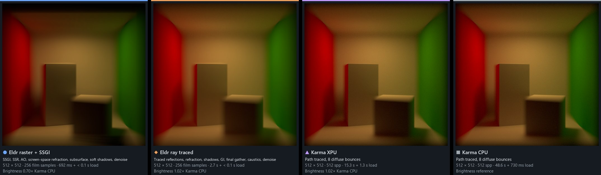

#### Displacement

Preview Surface displacement on a single quad: blurred checker bumps, 0.6 m high.


#### Emissive surface lighting

The ceiling light is the asset's emissive quad instead of a RectLight: an emissive surface lights the room.


#### Camera exposure

Camera exposure of +1 stop.


#### Glass and caustics

A clear glass ball under the ceiling light: refraction, and the caustic it focuses on the floor.


#### Glossy materials

Glossy metal on the tall box and a glossy dielectric ball.

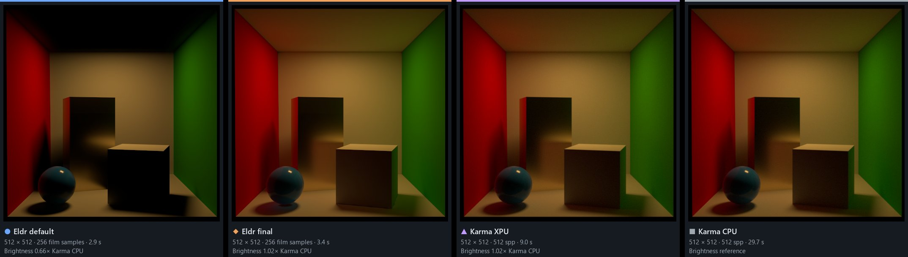

#### Hair

A patch of 900 hair curves on the short box, brown, shaded as hair.

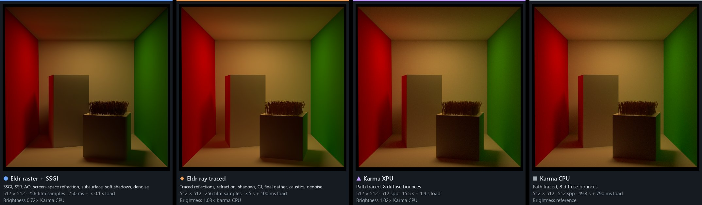

#### Height fog

Unreal's height fog settings (`unreal:`) on the base scene; Eldr and Karma ignore them.


#### Holdout

A holdout ball (Karma's Matte mode): cut out of the image as black with alpha 0, its shadow still on the floor.

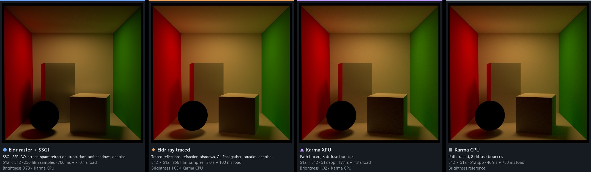

#### IES profile

The ceiling light replaced by a point light with an IES profile.


#### Instances, points, curves

A PointInstancer, Points and a cubic BasisCurves helix, with per-instance and per-curve colours.


#### Lens shift

Horizontal and vertical aperture offsets (lens shift).


#### Light groups

Two light groups, the ceiling light and a warm lamp, written as their own AOVs; the gallery shows the beauty.


#### Light linking

A warm light linked only to the tall box and a cool one only to the short box; the ceiling light lights everything.


#### Textured area light

The ceiling light shows a four-colour texture, which tints the walls, the floor and a chrome ball.


#### Sheen, thin film, anisotropy

Three material lobes on balls along the front: velvet sheen, thin-film iridescence and brushed anisotropic metal.


#### Motion blur

A ball crossing the box during a half-frame shutter.

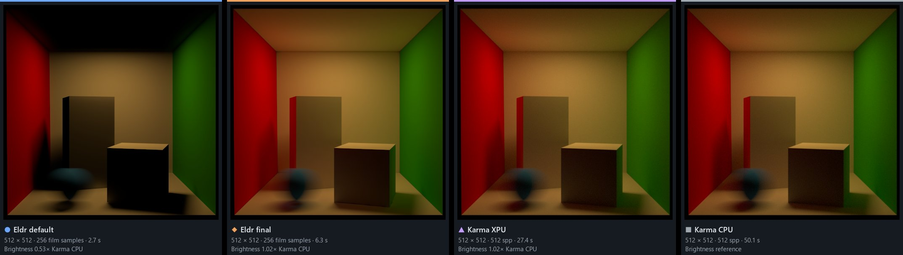

#### Orthographic camera

Orthographic projection with a 6.2 m window.


#### Post-processing

Unreal's post-processing settings (`unreal:`) on the base scene; Eldr and Karma ignore them and render the linear image.


#### Render region

A render region: dataWindowNDC (0.25, 0.15)-(0.75, 0.65) renders only that part of the frame.


#### Subdivision surfaces

A Catmull-Clark cube (USD's default scheme) with a red GeomSubset on two faces.


#### Subsurface scattering

Subsurface scattering: a jade ball on the floor and a wax ball on the short box.


#### UV sets

Two UV sets: a checker reads st1 (four times st, so 32 x 32 cells) while a left-to-right metallic ramp reads st.


#### Volumes (OpenVDB)

A fog sphere (OpenVDB, density field) in the middle of the box.

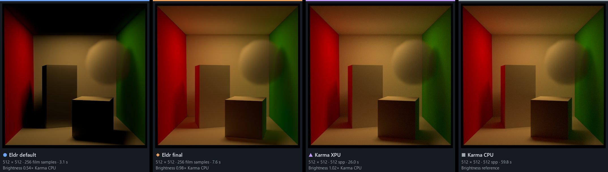

#### Glowing panel and bulb

A glowing panel under the ceiling and a small bulb on the floor are the only lights: they light the room and cast shadows from the box and the chrome ball. (`showcase/2026-10-28_03_emissive_lights`)


#### Bounce light from a glowing panel

A glowing panel lights the room; the walls pick up light and colour from each other. (`showcase/2026-10-28_04_gi_final_gather`)


#### Chrome ball in a glowing room

A glowing panel and bulb light the room; the chrome ball reflects all of it, including what is off screen. (`showcase/2026-10-28_09_traced_reflections`)


#### Transparent and presence opacity

Two 30% opaque dark metal quads under a glowing panel: the left one "transparent" keeps its highlight, the right one "presence" fades completely. (`showcase/2026-10-29_01_opacity_mode`)

*Note:* The right quad fades with its opacity, as UsdPreviewSurface's "presence" mode asks; Karma renders both quads alike, with the full highlight.


### Feature scenes

Showcase scenes (`showcase/`), one feature each, rendered at their own resolution.


*Clearcoat, sheen, fuzz, thin film, anisotropic highlights, hair and toon shading, rendered by Eldr (`showcase/2026-10-30_22_material_lobes`).*

#### Material lobes

Clearcoat, sheen, fuzz, thin film, anisotropic highlights, hair and toon shading. (`showcase/2026-10-30_22_material_lobes`)


#### Skin, jade and leaves

Light scatters under the surface of skin, jade and leaves. (`showcase/2026-10-30_13_subsurface`)


#### Caustics

Light focused through glass lands as a bright patch on other surfaces. (`showcase/2026-10-29_13_caustics`)


#### Reflections

A ball on a mirror-like floor reflects as a ball, with its highlights, and reflections reflect again up to a limit. (`showcase/2026-11-04_01_reflections`)


#### Curves, points and hair

Every curve type as tubes or ribbons, points as spheres or discs, and hair shading. (`showcase/2026-10-30_19_curves_points`)


#### Light shapes

Sun, sphere, rect, disk and tube lights give highlights of their own shape, and lights set to show their shape appear to the camera. (`showcase/2026-10-30_07_light_shapes`)


#### Many lights

Hundreds of small lights are shaded cheaply: each pixel is lit only by the lights that reach it. (`showcase/2026-10-30_06_many_lights`)


#### Volume multiple scattering

Light bounces more than once inside smoke, set with Karma's Volume Limit. (`showcase/2026-10-29_26_volume_multiple_scattering`)


#### Displacement shaders

Preview Surface displacement on a single quad: blurred checker bumps, 0.6 m high. (`showcase/2026-10-30_18_displacement`)


#### MaterialX BSDF graphs

Surfaces built from MaterialX BSDF nodes (mix, layer, add, multiply), Lama and glTF materials render like Karma. (`showcase/2026-10-31_05_bsdf_graphs`)

*Note:* Karma XPU leaves these surfaces grey: it doesn't render MaterialX BSDF graphs or Lama.


#### MaterialX and Karma nodes

MaterialX compositing nodes, glTF, Disney and unlit surfaces, and Karma's ramp, hex-tiled and Voronoi nodes. (`showcase/2026-10-29_16_materialx_nodes`)

*Note:* The dodge swatch (top row, fifth) follows MaterialX's own formula, as Storm does; Karma's differs. Karma XPU leaves the glTF and Disney surfaces grey.

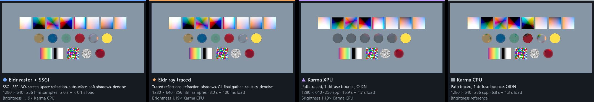

#### Objects without a material

Objects without a material look as they do in Karma: dim, with a faint white highlight. (`showcase/2026-10-31_02_karma_default_material`)


#### Texture colour spaces and UDIMs

Textures in ACEScg and Rec.709, UDIM tiles, and sharp textures at grazing angles. (`showcase/2026-10-30_21_textures_colour`)


#### Rough glass

More light paths through rough glass give a smoother result without more film samples. (`showcase/2026-10-31_01_refraction_quality`)

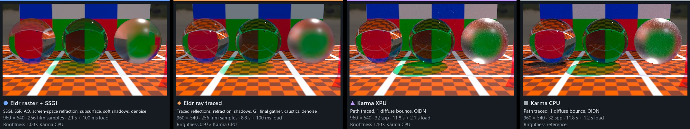

#### Glass, translucency and smoke in order

Glass, translucent meshes and smoke are layered in depth order, so what is behind a pane shows through it. (`showcase/2026-10-29_09_transparency_order`)

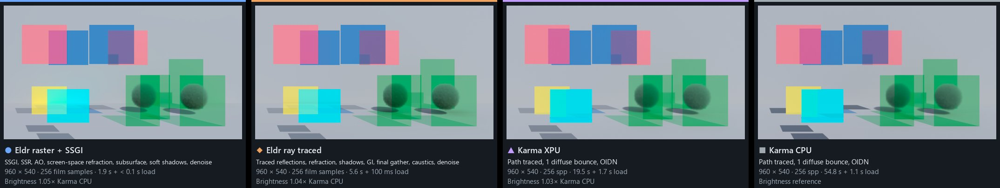

#### Rough mirror floor

A rough mirror floor blurs its reflection by its roughness. (`showcase/2026-10-29_03_planar_reflection_blur`)


#### Screen-space reflections

Reflections of what is on screen, blurrier on rougher surfaces. (`showcase/2026-10-30_11_screen_space_reflections`)

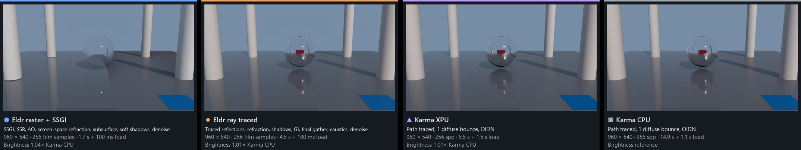

#### Ambient occlusion

The dome's light is darkened in corners and gaps. (`showcase/2026-10-30_09_ambient_occlusion`)


#### Shadows

Shadows can be soft or hard, from shadow maps, or traced. (`showcase/2026-10-30_10_shadow_modes`)

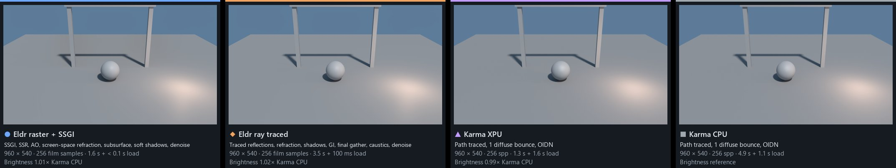

#### Sun from an HDRI

The sun in an HDRI becomes a distant light that casts crisp shadows. (`showcase/2026-10-30_08_dome_sun`)


#### A second sun's shadows

A second sun, such as the one in an HDRI, casts its own shadows. (`showcase/2026-10-30_26_further_sun_shadows`)


#### Light and shadow linking

A light can skip objects, and its shadows can skip casters. (`showcase/2026-10-29_15_light_linking`)


#### Colour limit

Karma's colour limit clamps how bright emitters and their bounced light can get; a full-HDR option keeps the emitters unclamped for comp. (`showcase/2026-10-29_17_colour_limit`)


#### Velocity motion blur

Objects that only author velocities blur along them when velocity blur is on, as in Karma. (`showcase/2026-10-28_02_velocity_blur`)

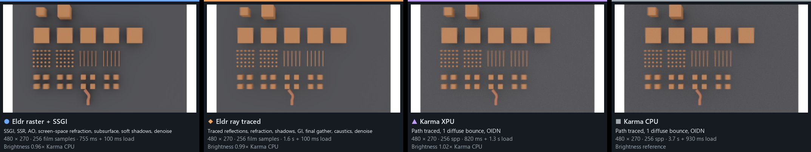

#### Motion blur in reflections

Reflections blur with motion blur, like the objects they show. (`showcase/2026-10-29_10_reflection_motion_blur`)

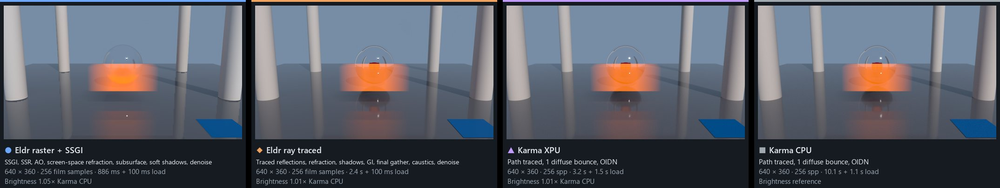

#### Nested instancing

Nested point instancers and native instances render fast, and tiny instances can be skipped. (`showcase/2026-10-30_20_instancing`)

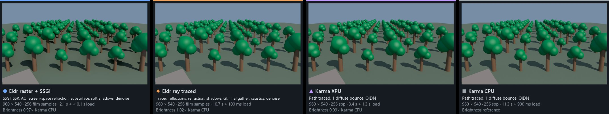

#### Coloured volume shadows

Coloured smoke casts coloured shadows. (`showcase/2026-10-29_05_coloured_volume_shadows`)


#### Volume motion blur

Smoke blurs along its velocity field, as Karma's volume motion blur. (`showcase/2026-10-29_18_volume_motion_blur`)


#### Cryptomatte

The EXR carries Cryptomatte layers for objects and materials, with soft or hard edges. (`showcase/2026-10-30_15_cryptomatte`)


The Cryptomatte layers of the same EXRs, each id a colour weighted by its coverage: soft, anti-aliased edges where objects meet. Eldr names objects by prim path (`CryptoObject`) and materials by material path (`CryptoMaterial`), as Karma's Cryptomatte does.

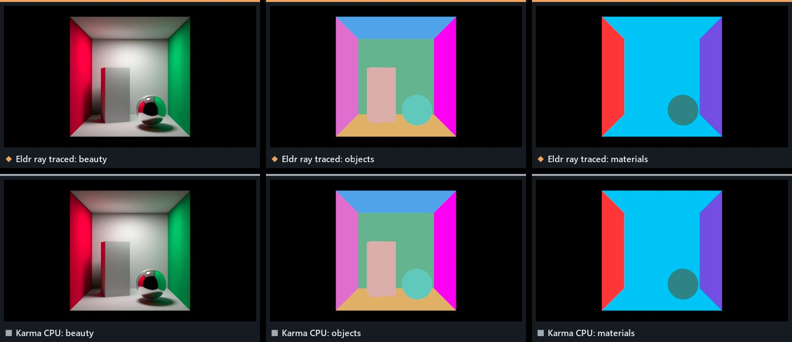

#### AOVs and light groups

The render vars a Karma Render Settings node writes (light groups, diffuse and glossy splits, transmission, subsurface, coat, volume, shadow mattes) come out of Eldr by the same names. (`showcase/2026-10-29_06_karma_aovs`)


Its passes, Eldr ray traced (left of each pair) next to Karma CPU (right), from one EXR each: the diffuse and specular splits (`C<RD>.*L`, `C<RG>.*L`), the light refracted through the glass ball (`C<TG>.*L`), the two light groups (`C.*<L.'ceiling'>`, `C.*<L.'lamp'>`), normal (`ray:hitN`, shown as 0.5 + N / 2), depth (`ray:hitPz`, near is bright) and albedo (`CDA`). Eldr's light groups hold the group's direct light; Karma's add its bounced light.

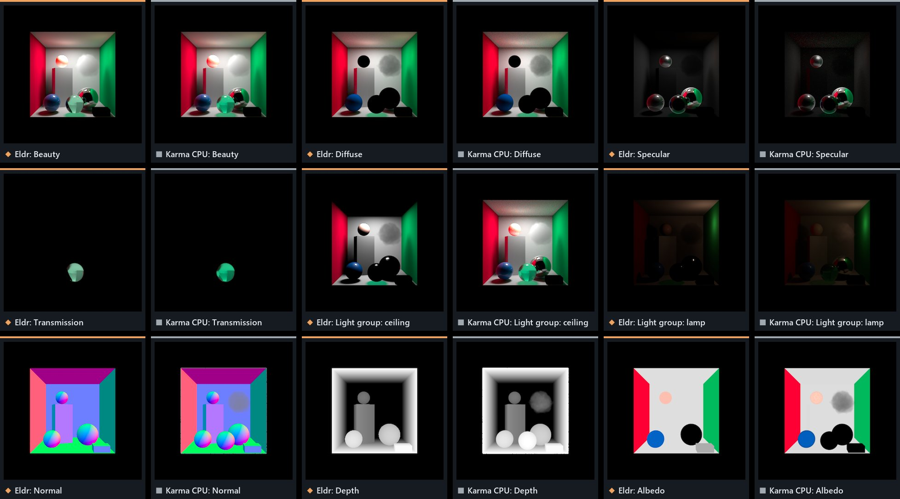

#### Tiled rendering

husk and usdrecord render very large images tile by tile, so GPU memory follows the tile size, not the image. (`showcase/2026-11-02_01_tiles`)


The tiled image (12 tiles of 512 pixels) against the whole image at once, and their difference ten times brighter: no seams along the tile edges, only a little noise and the chrome ball's reflection, which screen-space reflections find on screen in the whole image and the reflection probe supplies in a tile (traced reflections are the same either way).


The same scene (ray tracing off) at growing sizes with its `tiles` settings and 2048-pixel tiles (peak GPU memory above what was in use before the render, sampled by nvidia-smi). The screen-size buffers, about 170 bytes a pixel, stay at the tile's size; only the whole image's bloom, exposure and tonemapping grow with it, about 27 bytes a pixel. A whole 12000 × 12000 image would need about 24 GB.

| Image | Rendered | Peak GPU memory | Time |
|---|---|---:|---:|
| 1920 × 1080 | 2048-pixel tiles | 0.5 GB | 911 ms |
| 4096 × 4096 | 2048-pixel tiles | 0.7 GB | 5.0 s |
| 8192 × 8192 | 2048-pixel tiles | 1.9 GB | 19.7 s |
| 12000 × 12000 | 2048-pixel tiles | 3.3 GB | 42.9 s |
| 1920 × 1080 | whole | 0.5 GB | 951 ms |
| 4096 × 4096 | whole | 2.0 GB | 4.6 s |

A few features, off and on (Eldr, `docs/site/render_images.py`):

| | Off | On |
|---|---|---|
| **Ray-traced and screen-space reflections** |  |  |
| **Volumetric fog and light shafts** |  | 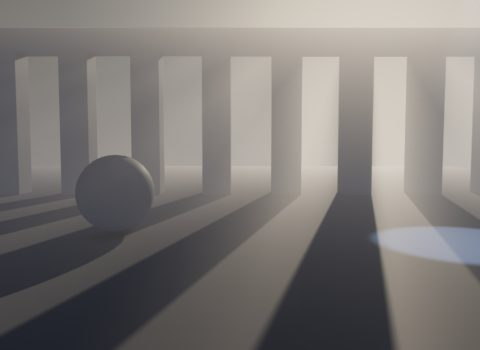 |
| **Caustics** | 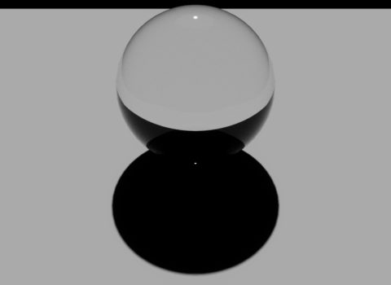 |  |
| **Motion blur** | 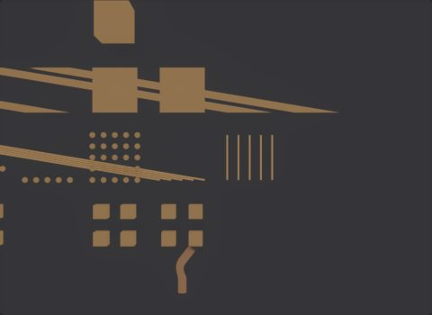 |  |
| **Displacement** |  |  |
| **Ambient occlusion** |  | 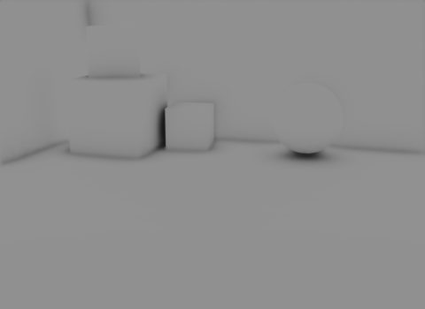 |
| **Subsurface scattering** | 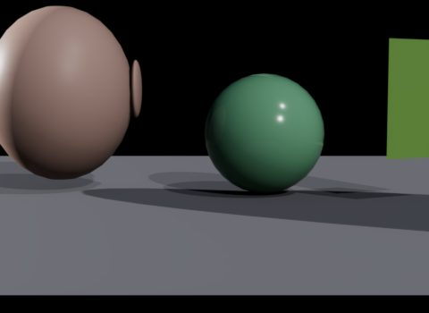 | 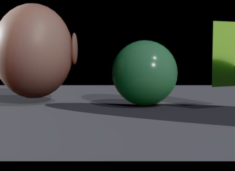 |
| **Clearcoat, sheen, thin film, anisotropy** | 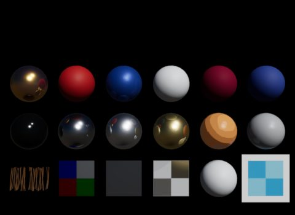 | 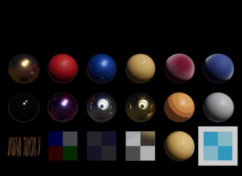 |
| **MaterialX node graphs** | 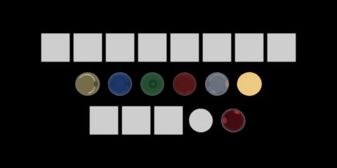 | 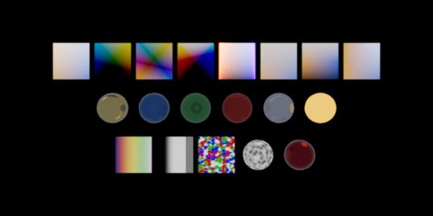 |
| **Glowing surfaces as lights** | 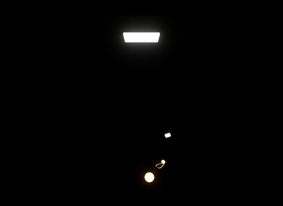 | 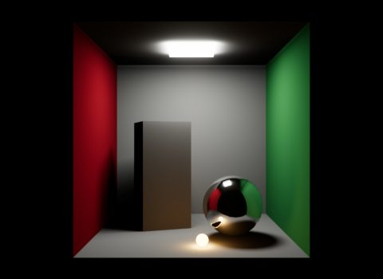 |
| **Final gather (traced bounce light)** |  |  |
| **Traced glass** | 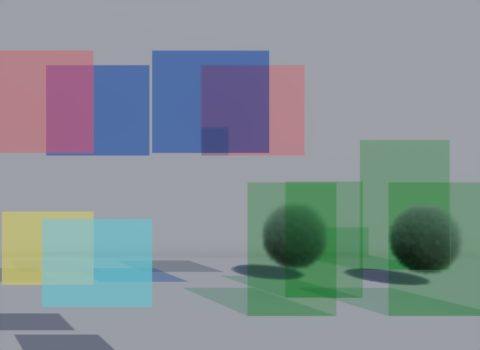 |  |
| **Sun from an HDRI** | 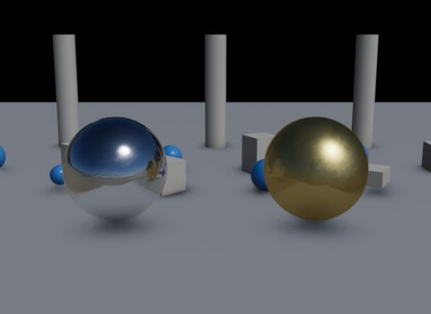 | 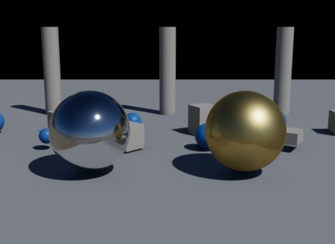 |
| **IES profiles** | 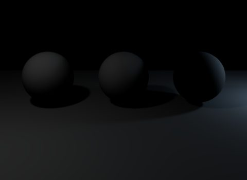 |  |
| **Light linking** | 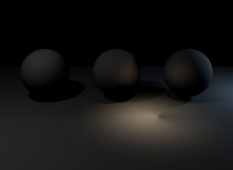 | 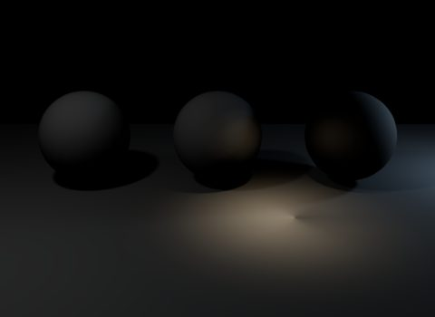 |
| **Soft shadows (PCSS)** | 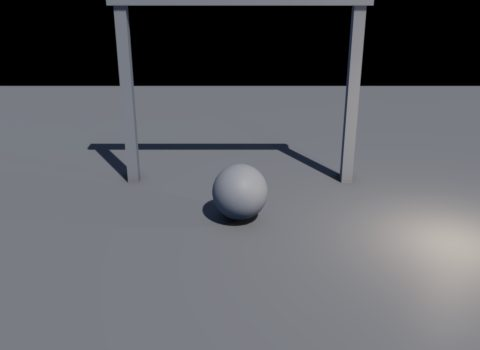 | 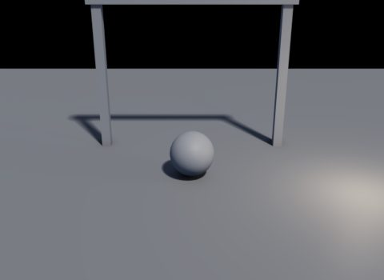 |
| **Coloured volume shadows** | 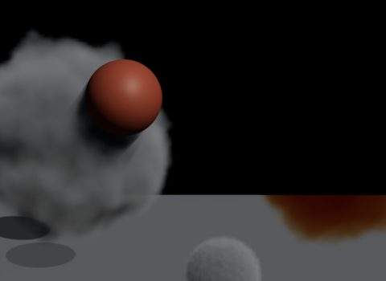 | 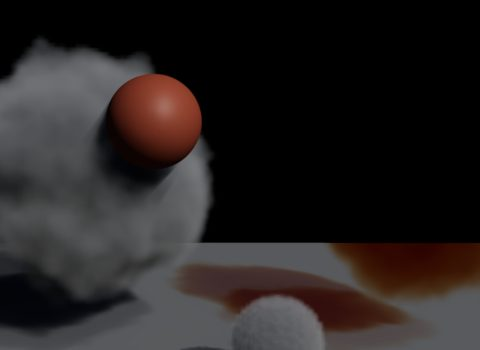 |
| **Volume multiple scattering** | 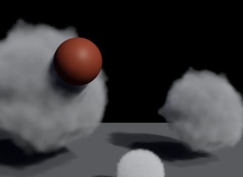 | 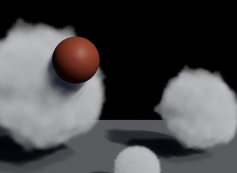 |
| **Volume motion blur** | 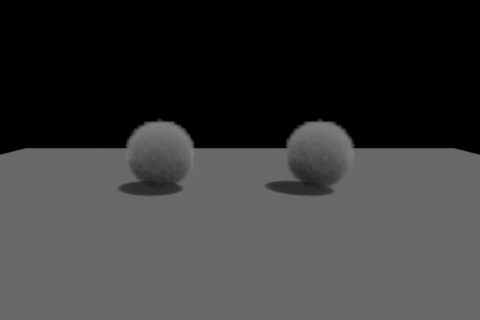 | 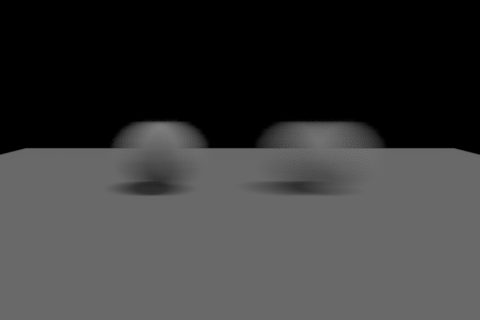 |
| **Depth of field** |  | 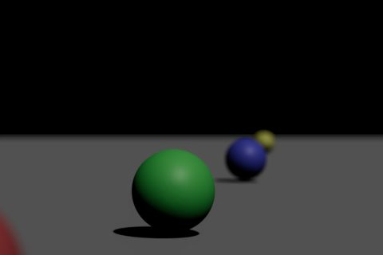 |
| **Lens distortion** |  | 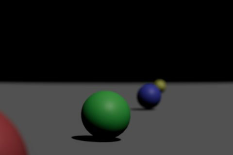 |
| **Camera exposure** | 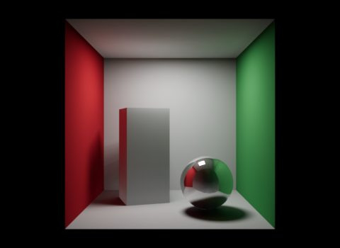 | 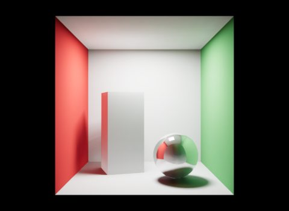 |
| **Reflection probe** |  | 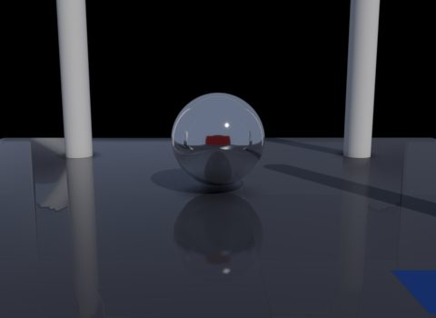 |
| **Holdouts and phantoms** | 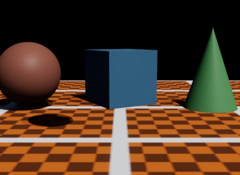 | 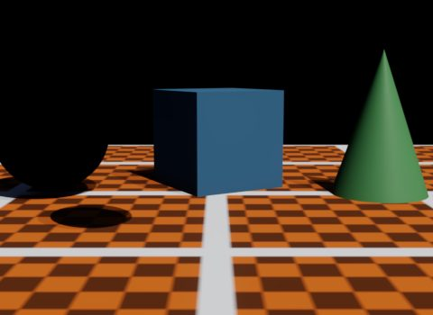 |
| **Colour limit** |  |  |
| **Denoiser (OIDN), 16 samples** |  | 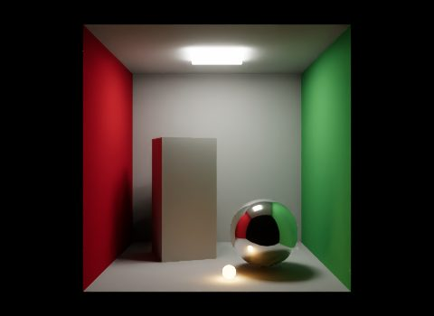 |
| **Effect denoise, 4 samples** |  |  |
| **Bloom** |  |  |
| **Tonemapping (ACES)** |  |  |

Every picture comes from a folder in [`showcase/`](showcase/README.md); the [user guide](docs/guide/getting-started.md) names the folder and settings prim under each one.

<!-- FEATURES -->
## Features

| Area | What you get | Not yet |
|---|---|---|
| **Film and sampling** | Converging film with Sobol and blue-noise sample dimensions, adaptive sampling per 16x16 tile, Karma's per-component quality (`karma:object:diffusequality` and friends), Intel OIDN denoise with albedo and normal guides, tiled rendering for very large frames (`eldr:tileSize`) | Path-traced reference mode (use Karma) |
| **Lights** | Sphere, rect, disk, cylinder, distant and dome lights; textured area lights; IES profiles; light linking and shadow linking; light shapes shown as in Karma (`renderlightgeo`); emissive meshes as lights; HDRI sun extraction; hundreds of lights through screen-space clusters | Light functions, dome portals, IES types A and B |
| **Shadows** | Cascaded sun shadows, local-light atlas, PCSS soft shadows that converge exactly, coloured shadows through glass and volumes, ray-traced shadows (`eldr:rtShadows`) | Virtual shadow maps |
| **Global illumination** | GTAO, screen-space GI, ray-traced GI probes, final gather (`eldr:gi`, `eldr:finalGather`) | Infinite-bounce GI without ray tracing |
| **Reflections and refraction** | Screen-space reflections with back-face depth (measured thickness), planar mirrors, probes, ray-traced reflections with Karma's reflect limit, screen-space and ray-traced refraction with nested media and Beer-Lambert absorption, photon caustics | Refraction through planar water |
| **Materials** | MaterialX `standard_surface`, OpenPBR, glTF PBR and UsdPreviewSurface; pbrlib BSDF graphs and Houdini's Lama layering as Karma renders them; material graphs compiled whole into per-pixel programs; Karma's own nodes (ramps, hex tiling, Voronoi); textures with UDIM and BC7 compression | Burley subsurface (a per-channel Gaussian today), coat normal |
| **Volumes** | OpenVDB and VDB sequences, NanoVDB on the GPU, single and multiple scattering, volume self-shadowing from every light, mutual volume shadows, motion blur from `vel` | Karma's Pyro Shader |
| **Geometry** | Meshes, OpenSubdiv subdivision, displacement, curves (tubes and ribbons), points, point instancers with LOD, UsdSkel crowds with deferred skinning | Vector displacement's tangential part |
| **Camera** | Depth of field, motion blur from time samples and velocities, lens distortion, Karma's lens shaders, exposure from the camera | |
| **Output** | Render products and vars, LPE AOVs, light groups, Cryptomatte, linear beauty for husk, holdouts and mattes | `elementId` AOV |
| **Houdini** | Eldr tab on Render Settings, Render Geometry Settings and light LOPs (same Do Nothing / Set / Block menus as Karma's), viewport stats panel, husk wrapper for crowds | |

The full list, with settings, costs and the [known limitations](docs/features.md#known-limitations), is in [docs/features.md](docs/features.md). [docs/comparison.md](docs/comparison.md) compares Eldr with EEVEE and Unreal feature by feature.

<!-- COMPARISON -->
## Eldr vs EEVEE and Unreal
✅ production-ready · 🟡 partial (see note) · ❌ missing


EEVEE is Blender 5.2; its and Unreal's columns come from their docs and are indicative. *(interactive)* marks rows that matter mostly for games or live work.

<details open>
<summary><b>Rendering core</b></summary>

| Feature | Eldr | EEVEE | Unreal 5 | Notes |
|---|---|---|---|---|
| Native USD / Hydra render delegate | ✅ | ❌ | 🟡 | Unreal imports USD stages; Blender only has a separate Hydra Storm add-on. |
| Converging final frames (sample accumulation) | ✅ | ✅ | ✅ | Eldr: film. Unreal: Movie Render Queue. |
| Per-effect low-discrepancy sampling | ✅ | ✅ | ✅ | Eldr: Sobol and blue-noise sample dimensions. |
| Per-component sample quality (Karma's diffuse/reflect/light quality) | ✅ | 🟡 | ✅ | Eldr: `eldr:*Quality` or Karma's names, global (from the render settings), not per object. EEVEE: shadow rays and steps. Unreal: Lumen final gather and reflection quality. |
| Adaptive sampling | ✅ | ❌ | ❌ | Eldr stops when 99.9% of pixels converged; 16x16 tiles that stopped skip shading and per-pixel rays (not under refraction, subsurface or post depth of field). Not with motion blur time samples. |
| Denoiser for the final image | ✅ | ✅ (OIDN, OptiX) | 🟡 | Eldr: Intel Open Image Denoise (OIDN) on the CPU (`eldr:denoise`), albedo and normal guides, once per converged film. Unreal: its path tracer only. |
| Path-traced reference mode | ❌ | ✅ (Cycles) | ✅ | Eldr: use Karma in Houdini for ground truth. |
| Background shader compile and pipeline cache | ✅ | ✅ | ✅ | |

</details>

<details>
<summary><b>Lights and shadows</b></summary>

| Feature | Eldr | EEVEE | Unreal 5 | Notes |
|---|---|---|---|---|
| Sphere, rect, disk, cylinder, distant and dome lights | ✅ | ✅ | ✅ | |
| Textured area lights | ✅ | ❌ | ✅ | Eldr: rect and disk lights, oriented per UsdLux. |
| IES profiles | ✅ | ❌ | ✅ | Eldr: UsdLux `shaping:ies:*`, type C. |
| Light linking | ✅ | ✅ | 🟡 | Unreal has lighting channels. Eldr: UsdLux light and shadow links, 32 collections, not on domes. |
| Light functions / gobos | ❌ | ❌ | ✅ | |
| Light shapes visible to the camera | ✅ | ✅ | ✅ | Eldr: a light shows its shape when `renderlightgeo` is on, as in Karma; `eldr:lightShapesVisible` is the master switch. |
| Soft shadows that converge exactly | ✅ | ✅ | ✅ | Eldr jitters the light shape per film sample (`eldr:shadowJitter`). |
| Virtual shadow maps | ❌ | ✅ | ✅ | Eldr uses cascades and an atlas; ray-traced shadows cover final frames. |
| Ray-traced shadows | ✅ | ❌ | ✅ | Eldr: `eldr:rtShadows` or `eldr:rtShadowsAuto`; sun plus up to 15 lights (`eldr:rtShadowLights`), one ray per light and film sample, exact penumbra. |
| Ray-traced shadows through glass and volumes | ✅ | ❌ | 🟡 | Eldr: tinted by glass, marched through volumes (`eldr:rtTranslucentShadows`). |
| Coloured shadows through glass | ✅ | 🟡 | ✅ | Eldr: shadow maps and ray-traced shadows alike. |
| Volumes casting shadows | ✅ | ✅ | ✅ | Eldr: sun and local lights. |
| Volumes shadowing each other | ✅ | ✅ | 🟡 | Eldr: sun, local lights and the dome's light from its pole (`eldr:volumeMutualShadows`). EEVEE: one shared froxel grid. |
| Sun extracted from an HDRI dome | ✅ | ✅ | ❌ | |

</details>

<details>
<summary><b>Global illumination and reflections</b></summary>

| Feature | Eldr | EEVEE | Unreal 5 | Notes |
|---|---|---|---|---|
| Dynamic probe GI | ✅ | 🟡 | ✅ | Eldr: ray-traced light probes (DDGI) that move off walls, plus a per-pixel final gather (`eldr:finalGather`). EEVEE: baked irradiance volumes. Unreal: Lumen. |
| Screen-space GI | ✅ | ✅ | ✅ | Eldr: horizon or visibility-bitmask screen-space GI (SSGI). |
| GI at Lumen quality (surface cache, many bounces) | ❌ | ❌ | ✅ | |
| Diffuse bounce limit like Karma's | ✅ | ❌ | 🟡 | Unreal: its path tracer only. Eldr's GI follows `eldr:diffuseLimit`, unset Karma's `karma:object:diffuselimit` (default 1). Cornell box, Eldr final over Karma's mean: x1.00 at limit 1, x1.00 at 2, x1.02 at 8 (docs/testing.md). |
| Screen-space reflections with a denoiser | ✅ | ✅ | ✅ | |
| Ray-traced reflections | ✅ | ❌ | ✅ | |
| Authored reflection probes | ✅ | ✅ | ✅ | Eldr: up to 8, from flagged meshes. |
| Planar mirrors | 🟡 | ✅ | ✅ | Eldr: up to 4, blurred by roughness (`eldr:planarBlur`), no contact hardening. EEVEE's planars are glossy too. |

</details>

<details>
<summary><b>Transparency, volumes and atmosphere</b></summary>

| Feature | Eldr | EEVEE | Unreal 5 | Notes |
|---|---|---|---|---|
| Order-independent transparency | ✅ | ❌ | 🟡 | |
| Refraction through several layers, back faces, TIR | ✅ | 🟡 | ✅ | Screen space by default; traced with `eldr:rtRefraction`. |
| Ray-traced refraction (off-screen content) | ✅ | ❌ | 🟡 | Eldr: `eldr:rtRefraction`; glass behind glass, materials evaluated at every hit. |
| Ray-traced refraction through displaced glass | ✅ | ❌ | ❌ | Eldr: rippled water bends the rays (`eldr:rtRefractionDisplacement`). |
| Holdouts and mattes | ✅ | ✅ | ✅ | |
| OpenVDB / NanoVDB volumes | ✅ | ✅ | ✅ | Eldr: `UsdVolVolume` with MaterialX or `kma_volume` materials, coloured extinction. Not Karma's Pyro Shader graph. |
| Houdini SOP volumes (no files) | ✅ | ❌ | ❌ | Eldr: VDB and Houdini volumes from a SOP Import LOP, in the Houdini build. |
| Froxel fog (grid aligned to the camera view) | ✅ | ✅ | ✅ | |
| Physical sky and atmosphere | ❌ | 🟡 | ✅ | EEVEE has a sky texture. |
| Volumetric clouds | ❌ | ❌ | ✅ | |

</details>

<details>
<summary><b>Materials and geometry</b></summary>

| Feature | Eldr | EEVEE | Unreal 5 | Notes |
|---|---|---|---|---|
| MaterialX, OpenPBR, standard_surface | ✅ | ❌ | 🟡 | Blender uses its own node system; Unreal imports MaterialX into Substrate. |
| GGX multiple-scattering energy compensation | ✅ | ✅ | ✅ | Eldr: `eldr:multiScatter` (on) for standard_surface and OpenPBR; UsdPreviewSurface is single-scatter, as Karma's. |
| Textured lobe inputs (coat, film, transmission, SSS) | ✅ | ✅ | ✅ | |
| Subsurface scattering | ✅ | ✅ | ✅ | |
| Hair rendered as strands | 🟡 | ✅ | ✅ | Eldr: tubes or camera-facing ribbons with a hair BSDF. |
| Displacement, including from graphs | ✅ | ✅ | ✅ | Unreal: Nanite tessellation. |
| Displacement seen by ray tracing, incl. per-instance graphs | ✅ | ❌ | 🟡 | Eldr: acceleration structures built from displaced vertices; graphs that differ per instance get one per instance (the 256 largest on screen). |
| Subdivision surfaces | ✅ | ✅ | 🟡 | Eldr: uniform levels per mesh, from the host, the mesh, or its size on screen (`eldr:screenDicing`) (Karma's dicing quality); no per-face adaptive dicing. |
| Per-object ray visibility (camera, shadow, reflections) | 🟡 | ✅ | ✅ | Eldr: Karma's render visibility; reflections and GI only when ray traced, screen-space effects see what the camera sees. |
| LOD with crossfade | ✅ | ❌ | ✅ | Unreal: Nanite. |
| Virtual geometry (Nanite-style) | ❌ | ❌ | ✅ | *(interactive)* |
| Texture streaming | ❌ | ❌ | ✅ | Needed for very large assets. |
| Ptex | ❌ | ❌ | ❌ | Not planned. |

</details>

<details>
<summary><b>Camera and motion</b></summary>

| Feature | Eldr | EEVEE | Unreal 5 | Notes |
|---|---|---|---|---|
| Depth of field from lens samples | ✅ | ✅ | ✅ | Eldr adds a residual post blur at low sample counts. |
| Motion blur from shutter time samples | ✅ | ✅ | ✅ | Eldr: smooth blur between time samples (`eldr:motionBlurResidual`); not adaptive. Traced and planar reflections blur too, probes don't. |
| Deformation blur (point caches, skinning, blend shapes) | ✅ | ✅ | 🟡 | Eldr: skinned joints and blend shapes blur in time samples, from the shutter's samples in a single frame (sampled motion). |
| Motion blur on a single frame | ✅ | ✅ | ✅ | Eldr: Hydra transform and point samples. |
| OpenCV lens distortion | ✅ | ❌ | 🟡 | |
| Physical camera exposure (EV, ISO, shutter, f-stop) | ✅ | 🟡 | ✅ | Eldr: UsdGeomCamera's exposure attributes, as Karma (beauty and light AOVs, colour limit after exposure; Karma's ratios within 0.1% without the limit). EEVEE: one exposure value in colour management. |
| Upscaling while interactive | 🟡 | ❌ | ✅ | Eldr has its own temporal anti-aliasing (TAA) upscaler; Unreal has TSR and DLSS. *(interactive)* |

</details>

<details>
<summary><b>Output and pipeline</b></summary>

| Feature | Eldr | EEVEE | Unreal 5 | Notes |
|---|---|---|---|---|
| Multi-layer EXR with AOVs | ✅ | ✅ | ✅ | |
| Light-split AOVs that sum to the beauty | ✅ | ✅ | 🟡 | Eldr: Karma's LPE names. |
| Per-AOV sample filter (min, max, closest, nearest, box, Gauss) | ✅ | ❌ | ❌ | Eldr: Karma's Render Var "Sample Blending" or `driver:parameters:aov:eldr:filter`, film only. |
| Cryptomatte with soft edges (3 layers, 6 ranks) | ✅ | 🟡 | ❌ | Eldr: coverage from the film's samples, Karma's `<var>00..02` layout. EEVEE: hard edges. |
| Cryptomatte | ✅ | ✅ | ✅ | |
| UsdRenderSettings and render products | ✅ | ❌ | ❌ | Eldr honours resolution, pixel aspect and data window. |
| Houdini Solaris | ✅ | ❌ | ❌ | Eldr: Houdini 22 build renders in the Solaris viewport, hython and husk (husk needs Indie or above), with its own Render Settings and Render Geometry Settings tabs. |
| usdview integration | ✅ | ❌ | ❌ | |

</details>

The same table, with notes kept up to date, is in [docs/comparison.md](docs/comparison.md).

<!-- HOW IT WORKS -->
## How It Works

1. **Sync.** Hydra 2.0 hands Eldr the stage through its scene index. Meshes, curves, instancers, lights, materials, volumes and cameras become GPU buffers; MaterialX graphs compile into material programs; UsdSkel poses once per skeleton and shutter time.
2. **Prepass and lighting.** A depth prepass, culling on the GPU, light clusters, shadow maps and the GI probes run once per sample.
3. **Shading.** One forward pass shades every surface: lights, shadows, dome, SSR, SSGI, AO, then transparency, refraction, subsurface and volumes in their own passes.
4. **Ray tracing (when on).** Shadows, reflections, refraction, GI and caustics trace against a TLAS of the scene, on GPUs with Vulkan ray tracing.
5. **Film.** Each sample jitters the pixel, the lens, the light shapes and the shutter time; the film averages them until the image converges, then denoises if asked.
6. **Output.** The viewport gets the image through GL interop or a readback; husk and usdrecord get linear EXR render products and AOVs.

<!-- ARCHITECTURE -->
## Architecture


`renderer/` is a Vulkan renderer that never includes a USD header; `hydra/` translates USD into it. Houdini-only code lives in the optional Houdini module, so Eldr itself has no Houdini dependency. Shaders are GLSL in `renderer/shaders/`, compiled to SPIR-V at build time.

<!-- INSTALLATION -->
## Installation

Eldr needs Windows, a GPU with Vulkan 1.3 and a current driver, and either Houdini 22 (22.0.466) or OpenUSD 26.08. A GPU with Vulkan ray tracing is optional: without it Eldr skips the effects marked **[RT]** in the [settings](docs/settings.md).

> [!NOTE]
> There is no binary release yet. Eldr builds from source against your Houdini or USD install; see [docs/houdini.md](docs/houdini.md#build).

1. Build the Houdini plugin (below). The build writes `build-h22/houdini/eldr.json`, a Houdini package.
2. Copy `eldr.json` to `Documents/houdini22.0/packages/`, or set `HOUDINI_PACKAGE_DIR` to `build-h22/houdini`.
3. Start Houdini, go to a LOP network and pick **Eldr** in the viewport's renderer menu or on a Render Settings LOP.
4. Render Settings and light LOPs made before the install get Eldr's tab from **Rebuild Renderer-Specific Parameters**.

<!-- USAGE -->
## Usage

In Solaris, pick Eldr in the viewport. While the camera moves you see a fast image; when it stops, the film refines it to **Film Samples** (64) and stops. From a Houdini command shell, husk renders a frame or a sequence:

```powershell
husk -R Eldr -s /Render/eldr_final -f 1 -n 24 -o render/beauty.$F4.exr showcase\2026-10-30_07_light_shapes\scene.usda
```

Without Houdini, `usdenv.cmd` sets up the plugin paths for USD's own tools:

```powershell
usdenv usdview --renderer Eldr showcase\2026-10-30_07_light_shapes\scene.usda
usdenv usdrecord --renderer Eldr --renderSettingsPrimPath /Render/eldr_final --disableCameraLight scene.usda out.png
```

A final render is a Render Settings prim with the expensive settings ticked one by one; there are no quality presets. Every `eldr:` setting has an on/off for A/B tests.

| Topic | Page |
|---|---|
| First render, install, husk, usdview | [Getting started](docs/guide/getting-started.md) |
| A scene from empty to a final EXR, step by step | [Tutorial](docs/guide/tutorial.md) |
| Draft vs final, the Eldr tab | [Rendering in Solaris](docs/guide/solaris.md) |
| Lights, shadows, dome | [Lights](docs/guide/lights.md) |
| MaterialX, textures, Karma nodes | [Materials](docs/guide/materials.md), [MaterialX reference](docs/materialx.md) |
| Ray-traced effects | [Ray tracing](docs/guide/ray-tracing.md) |
| AOVs, light groups, Cryptomatte | [AOVs](docs/guide/aovs.md) |
| Crowds, memory, large frames | [Performance](docs/guide/performance.md) |
| Eldr next to Karma | [Eldr and Karma](docs/guide/karma.md) |
| Every setting: default, effect, cost | [Settings](docs/settings.md) |
| Something looks wrong | [Troubleshooting](docs/guide/troubleshooting.md), [FAQ](docs/guide/faq.md) |

<!-- ENVIRONMENT VARIABLES -->
## Environment Variables

| Variable | Description |
|---|---|
| `HDVK_TIMING` | `1` prints startup and per-pass GPU times (per tile for tiled renders); `2` writes a CSV row per frame to `HDVK_TIMING_CSV` |
| `HDVK_PIPELINE_CACHE_DIR` | Moves the shader pipeline cache and the compressed-texture cache (default `%LOCALAPPDATA%\Eldr`) |
| `HDVK_NO_RAY_TRACING` | `1` behaves as if the GPU had no ray tracing |
| `HDVK_RT_EARLY_COMPILE` | `0` compiles ray tracing pipelines on first trace instead of on background threads |
| `HDVK_OIDN_DEVICE` | Where Denoise runs: `cpu` (default), `cuda` or `default` |
| `HDVK_DEBUG_AOVS` | `1` prints the AOVs the host binds, and every 60 frames what restarted the film |
| `HDVK_NO_STATS` | `1` reports only the renderer name to the host's stats (for comparison) |
| `HD_ENABLE_DEFERRED_SKINNING` | `1` lets Eldr pose UsdSkel crowds on the GPU (set by the husk wrapper `$ELDR_HUSK`) |
| `USD_ROOT`, `USD_VENV`, `HDVK_BUILD` | Read by `usdenv.cmd` to find USD, its Python and the Eldr build |

The full list, with what the Houdini package sets and the debug variables, is in [docs/environment.md](docs/environment.md).

<!-- DEVELOPMENT -->
## Development

Building needs Visual Studio 2022 (x64), CMake with Ninja, the Vulkan SDK (glslc), and Houdini 22.0.466 or OpenUSD 26.08 built with OpenVDB. Intel OIDN 2.x is optional (for `eldr:denoise`); `-DHDVK_SCCACHE=ON` uses sccache.

```powershell
# Houdini build (Solaris, husk)
cmake -S . -B build-h22 -G Ninja -DCMAKE_BUILD_TYPE=Release -DHDVK_HOUDINI=ON "-DHOUDINI_ROOT=C:/Program Files/Side Effects Software/Houdini 22.0.466"
cmake --build build-h22

# OpenUSD build (usdview, usdrecord, tests)
cmake -S . -B build -G Ninja -DCMAKE_BUILD_TYPE=Release
cmake --build build

# Tests share the GPU: always one at a time
ctest --test-dir build -j1 -L fast
```

The test suite has about 55 ctests: renderer unit checks (`vkrtest`), Hydra and USD round trips, Karma golden references, a reflection and refraction scenario suite (`tests/scenes/scenarios`) and the docs check that every setting is documented. `tests/compare_renderers.py` renders any scene with Eldr, Karma and Blender EEVEE side by side ([docs/testing.md](docs/testing.md)). The documentation site builds from `docs/` with `docs/site/build.py` and publishes to GitHub Pages on every push. The [developer guide](docs/developer.md) has the source layout and the rules for a change.

<!-- CREDITS -->
## Credits

Eldr builds on [OpenUSD](https://openusd.org) and its Hydra framework, [MaterialX](https://materialx.org), [OpenSubdiv](https://github.com/PixarAnimationStudios/OpenSubdiv), [OpenVDB and NanoVDB](https://www.openvdb.org), [Intel Open Image Denoise](https://www.openimagedenoise.org) and the [Vulkan SDK](https://vulkan.lunarg.com). SideFX's Karma is the reference look, and the test suite compares against it and Blender's EEVEE.

<!-- LICENSE -->
## License

Eldr is licensed under the [Apache License 2.0](LICENSE).

`third_party/nanovdb` holds NanoVDB's `PNanoVDB.h` from OpenVDB (MPL-2.0, unmodified). OpenUSD, Houdini, Vulkan, Intel OIDN and MaterialX keep their own licences.

Banner rendered in Intel Sponza (Frank Meinl, Anton Kaplanyan, Intel Sample Library, 2022) with the add-on packages by the Sponza Add-on Package Crew; CC BY 4.0. Rendered with Eldr by `docs/site/banner.py`.
