# Gallery

Every scene is the CC0 Cornell box (`tests/scenes/cornell`) plus one small variant layer, rendered with husk at 512 x 512: Eldr with the scene's render settings as authored (*Eldr default*), Eldr with the final settings of `tests/scenes/cornell/eldr_final.usda` (*Eldr final*: ray-traced reflections, refraction and shadows, GI, final gather, caustics, denoising, 256 film samples) and Karma CPU with the scene's settings (512 path-traced samples, 8 diffuse bounces). `python tests/render_gallery.py` renders them again.

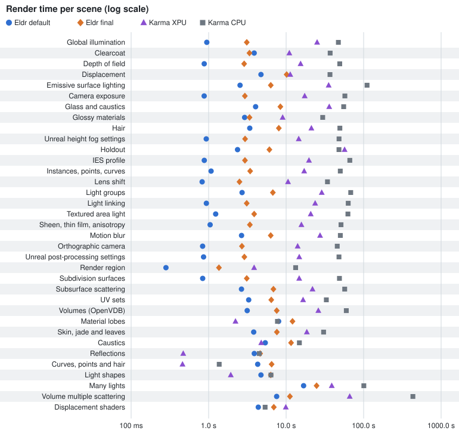

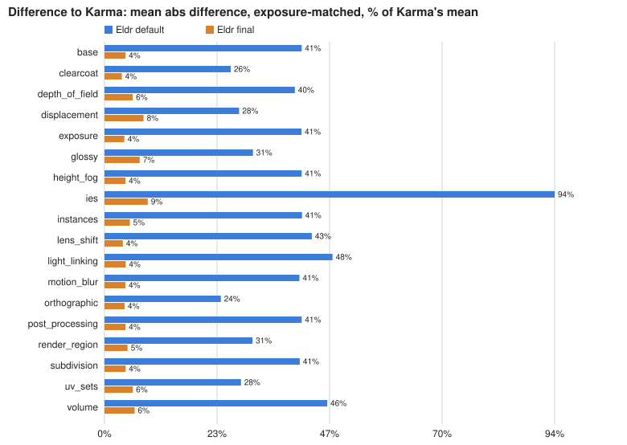

| Scene | Eldr default | Eldr final | Karma | Eldr default vs Karma | Eldr final vs Karma |
|---|---:|---:|---:|---|---|
| [base](#base) | 3.0 s (0.1 s, 0.9 ms) | 6.1 s (2.9 s, 9.8 ms) | 61.6 s | x0.52, 43% (41%) | x1.07, 7% (4%) |
| [clearcoat](#clearcoat) | 3.1 s (0.1 s, 0.9 ms) | 6.6 s (3.3 s, 11.0 ms) | 47.4 s | x0.63, 35% (26%) | x1.04, 5% (4%) |
| [depth_of_field](#depth_of_field) | 3.0 s (0.1 s, 0.9 ms) | 6.0 s (2.9 s, 9.5 ms) | 68.4 s | x0.52, 44% (40%) | x1.06, 8% (6%) |
| [displacement](#displacement) | 3.1 s (0.1 s, 0.7 ms) | 5.9 s (2.7 s, 9.0 ms) | 48.1 s | x0.63, 37% (28%) | x1.09, 11% (8%) |
| [exposure](#exposure) | 3.1 s (0.1 s, 0.7 ms) | 6.0 s (2.9 s, 9.7 ms) | 68.7 s | x0.52, 43% (41%) | x1.07, 7% (4%) |
| [glossy](#glossy) | 3.1 s (0.1 s, 1.1 ms) | 6.7 s (3.4 s, 11.5 ms) | 35.4 s | x0.65, 31% (31%) | x1.16, 16% (7%) |
| [height_fog](#height_fog) | 3.0 s (0.1 s, 0.8 ms) | 6.0 s (2.9 s, 9.8 ms) | 54.3 s | x0.52, 43% (41%) | x1.07, 7% (4%) |
| [ies](#ies) | 2.9 s (0.1 s, 0.7 ms) | 6.0 s (2.9 s, 9.8 ms) | 71.0 s | x0.35, 62% (94%) | x0.98, 9% (9%) |
| [instances](#instances) | 3.1 s (0.1 s, 1.1 ms) | 6.7 s (3.4 s, 11.5 ms) | 53.5 s | x0.52, 43% (41%) | x1.08, 8% (5%) |
| [lens_shift](#lens_shift) | 2.9 s (0.1 s, 0.6 ms) | 5.6 s (2.5 s, 8.2 ms) | 38.5 s | x0.49, 44% (43%) | x1.07, 6% (4%) |
| [light_linking](#light_linking) | 3.0 s (0.1 s, 0.9 ms) | 6.2 s (3.1 s, 10.4 ms) | 71.3 s | x0.60, 39% (48%) | x1.05, 6% (4%) |
| [motion_blur](#motion_blur) | 3.1 s (0.1 s, 0.9 ms) | 6.4 s (3.2 s, 10.7 ms) | 56.6 s | x0.52, 43% (41%) | x1.07, 7% (4%) |
| [orthographic](#orthographic) | 2.9 s (0.1 s, 0.7 ms) | 5.8 s (2.7 s, 8.9 ms) | 51.0 s | x0.58, 38% (24%) | x1.07, 7% (4%) |
| [post_processing](#post_processing) | 2.9 s (0.1 s, 0.7 ms) | 6.0 s (2.9 s, 9.8 ms) | 53.4 s | x0.52, 43% (41%) | x1.07, 7% (4%) |
| [render_region](#render_region) | 2.9 s (0.1 s, 0.3 ms) | 4.3 s (1.3 s, 3.9 ms) | 17.9 s | x0.57, 38% (31%) | x1.06, 7% (5%) |
| [subdivision](#subdivision) | 3.1 s (0.1 s, 0.7 ms) | 6.3 s (3.1 s, 10.4 ms) | 53.2 s | x0.52, 43% (41%) | x1.07, 7% (4%) |
| [uv_sets](#uv_sets) | 3.2 s (0.1 s, 0.9 ms) | 6.1 s (2.8 s, 9.4 ms) | 40.1 s | x0.66, 31% (28%) | x1.10, 9% (6%) |
| [volume](#volume) | 3.1 s (0.2 s, 2.2 ms) | 7.6 s (4.3 s, 14.8 ms) | 67.2 s | x0.53, 44% (46%) | x1.01, 7% (6%) |

Times are husk wall clock at 512 x 512, including startup and scene load; in brackets Eldr's time in its render pass and the GPU time of one film sample. *vs Karma* is the mean luminance ratio, then the mean absolute difference as rendered and, in brackets, after scaling the image to Karma's mean luminance (exposure-matched), both as a percentage of Karma's mean luminance.

## Methodology

| | |
|---|---|
| Machine | Windows, NVIDIA GTX 1080 Ti (Eldr); Karma CPU on the same machine |
| Resolution | 512 x 512, every scene |
| Eldr default | The scene's `/Render/Settings` as authored, `husk -R HdVkRendererPlugin` |
| Eldr final | The same with `tests/scenes/cornell/eldr_final.usda` sublayered over it |
| Karma | `BRAY_HdKarma`, the scene's settings: 512 path-traced samples, 8 diffuse bounces |
| Time | husk wall clock per run, startup and scene load included. In brackets (Eldr): time in its render pass and GPU time of one film sample, from `HDVK_TIMING=2` |
| Brightness | Mean luminance against Karma's (x1.00: as bright as Karma) |
| Difference | Mean absolute difference, % of Karma's mean luminance, as rendered and exposure-matched |
| Regenerate | `python tests/render_gallery.py [outdir] [--only base,glossy] [--force]` (renders, pictures, this page and README.md's gallery) |

## base

Gallery base scene: the CC0 Cornell box (cornell-box.usda, unchanged) with the canonical Cornell camera, its ceiling light as a UsdLux RectLight of the same size and radiance, and render settings shared by hdUE and Karma.

*In Eldr:* the default settings have no bounced light (GI is off unless asked for), so the ceiling and shadowed sides are black; the final settings add GI and final gather.

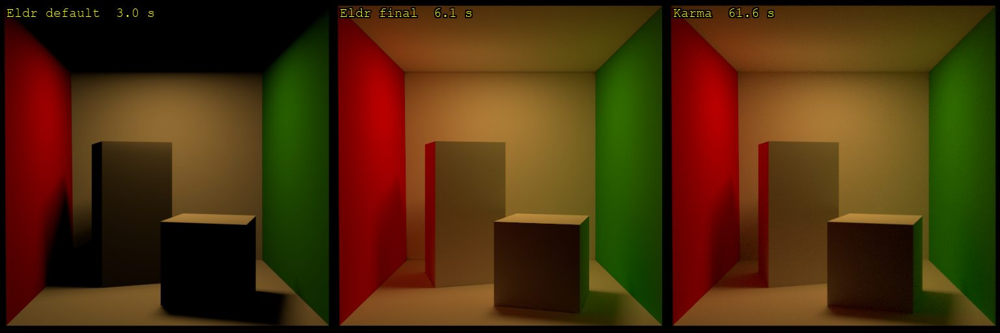

## clearcoat

Preview Surface clearcoat: red lacquer (clearcoat 1 over a rough red base, left) next to the same base without a coat (right).

*In Eldr:* the coat shows the light's highlight but not the room's reflection Karma's coat shows.

## depth_of_field

Thin-lens depth of field focused on the tall box (USD lens units: tenths of a scene unit).

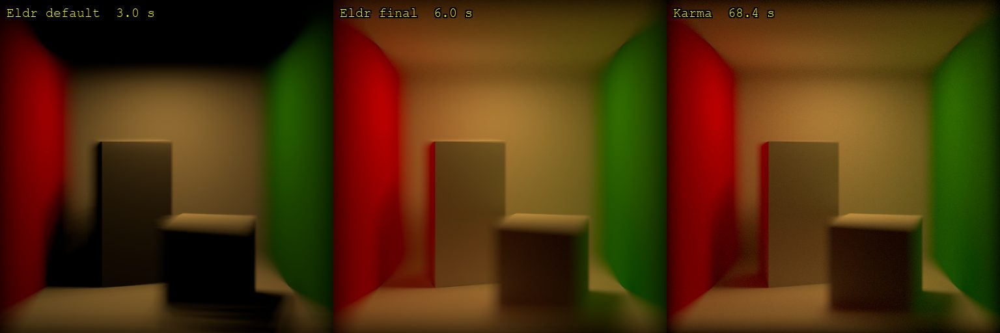

## displacement

Preview Surface displacement on a single quad: blurred checker bumps, 0.6 m high, diced and displaced by hdUE.

*In Eldr:* displacement moves the mesh's vertices and Eldr doesn't dice meshes, so this four-vertex quad shows only the bumped shading, not the bumps Karma dices.

## exposure

Camera exposure of +1 stop.

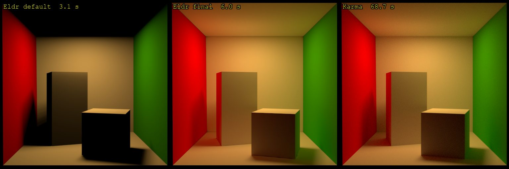

## glossy

Glossy metal on the tall box and a glossy dielectric ball.

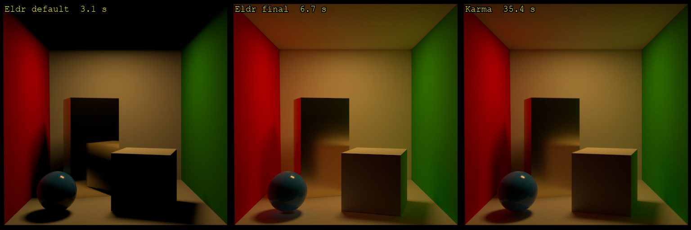

## height_fog

UE's Exponential Height Fog with Volumetric Fog filling the box, lit by the ceiling light (hdUE only: Karma has no height fog).

*In Eldr:* Eldr and Karma ignore the `unreal:` fog settings: the image is the base scene.

## ies

The ceiling light replaced by a point light with an IES profile.

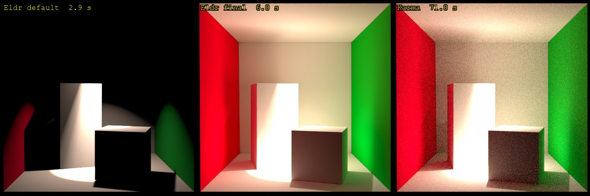

## instances

A PointInstancer, Points and a cubic BasisCurves helix, with per-instance and per-curve colours.

*In Eldr:* the cubes have no material and Eldr doesn't read the instancer's per-instance displayColor, so they render grey.

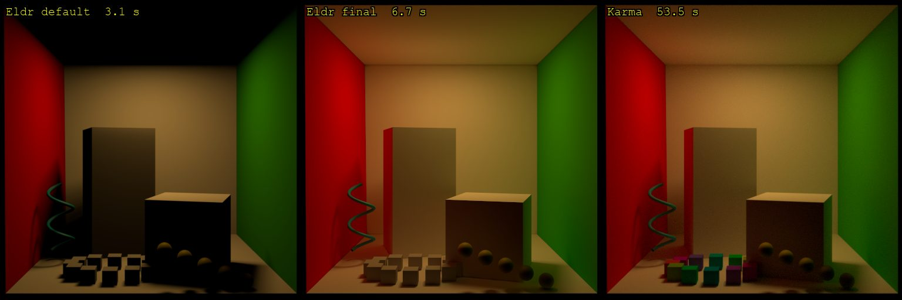

## lens_shift

Horizontal and vertical aperture offsets (lens shift).

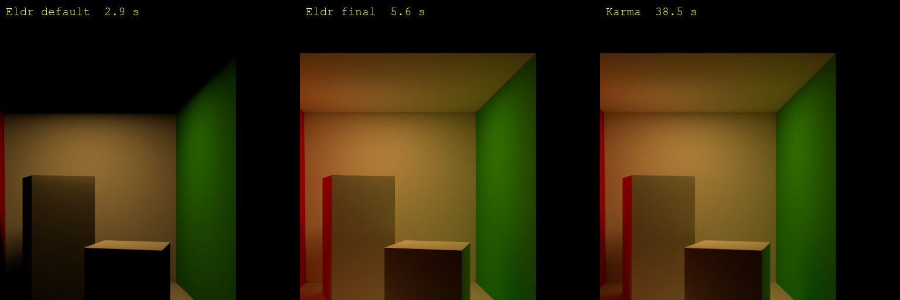

## light_linking

A warm light linked only to the tall box and a cool one only to the short box; the ceiling light lights everything. Lumen still bounces the linked lights onto every surface: UE’s lighting channels only restrict direct light.

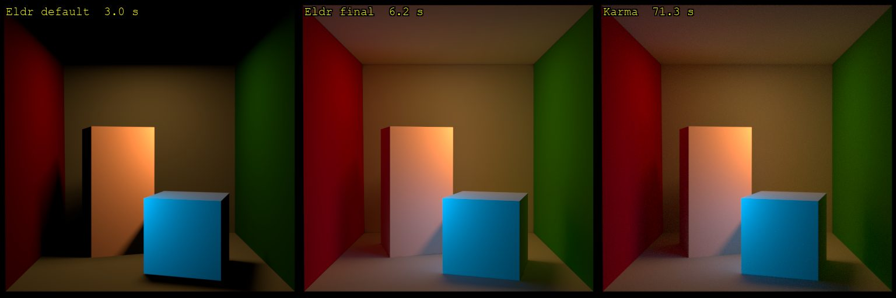

## motion_blur

A ball crossing the box during a half-frame shutter.

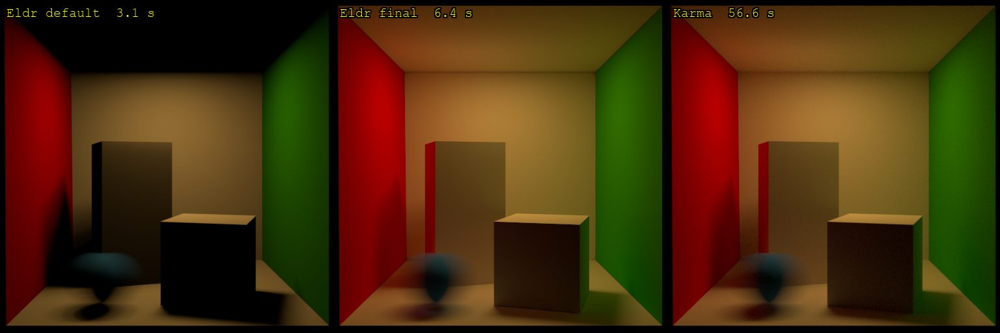

## orthographic

Orthographic projection with a 6.2 m window.

## post_processing

UE's tonemapper (+2.5 stops), bloom, vignette, chromatic aberration, lens flares, film grain and a warm grade on the hdUE beauty; Karma renders the linear image.

*In Eldr:* Eldr and Karma ignore the `unreal:` post-processing settings and render the linear image.

## render_region

A render region: dataWindowNDC (0.25, 0.15)-(0.75, 0.65) renders only that part of the 512 x 512 frame, as husk tiles do.

## subdivision

A Catmull-Clark cube (USD default scheme) with a red GeomSubset on two faces, refined to level 3 in hdUE.

*In Eldr:* Eldr refines the Catmull-Clark cube with OpenSubdiv; `unreal:subdivisionLevel` is hdUE's own.

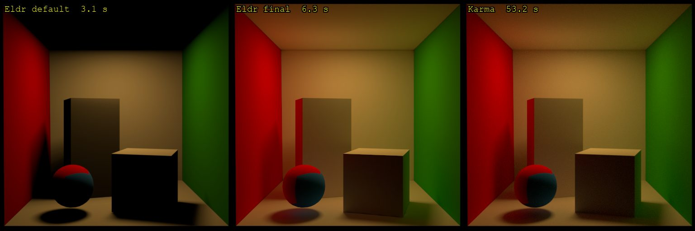

## uv_sets

Two UV sets: a checker reads st1 (four times st, so 32 x 32 cells) while a left-to-right metallic ramp reads st.

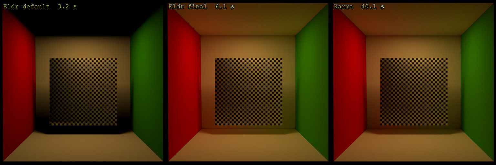

## volume

A fog sphere (OpenVDB, density field) in the middle of the box.

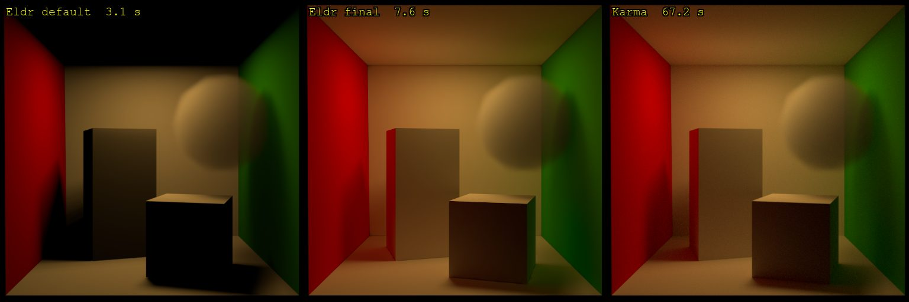
