# Gallery

*Hardware: AMD Ryzen 9 3950X (16 cores, 32 threads), 48 GB RAM, NVIDIA GeForce GTX 1080 Ti 11 GB (driver 582.78; no RT cores, so Eldr's ray tracing runs through its compute fallback), Windows 11 Pro, Houdini 22.0.466. Karma CPU runs on the Ryzen, Karma XPU on the GTX 1080 Ti (with the CPU).*

Every scene renders four ways with husk: ● **Eldr raster + SSGI**, every effect that works without ray tracing (screen-space GI, reflections and refraction, planar mirrors, ambient occlusion, subsurface, soft shadow maps, denoising, 256 film samples: `tests/scenes/cornell/eldr_default.usda`); ◆ **Eldr ray traced** (reflections, refraction, shadows, GI, final gather, caustics, denoising, 256 film samples: `tests/scenes/cornell/eldr_final.usda`); ▲ **Karma XPU** and ■ **Karma CPU** with the scene's Karma settings. Karma CPU is the brightness reference.

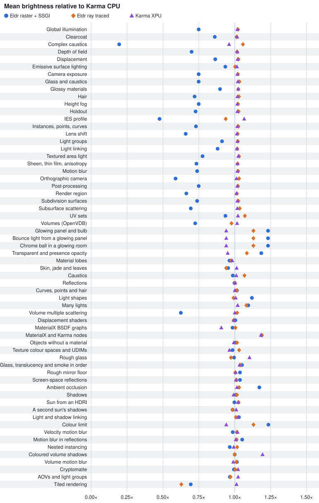

| Scene | Samples (Eldr / Karma) | Eldr raster + SSGI | Eldr ray traced | Karma XPU | Karma CPU | Brightness vs Karma CPU (raster / ray traced / XPU) |
|---|---|---:|---:|---:|---:|---|
| [Global illumination](#global-illumination) | 256 / 512 | 684 ms + < 0.1 s | 2.8 s + < 0.1 s | 14.7 s + 1.4 s | 47.3 s + 720 ms | 0.75× / 1.02× / 1.02× |
| [Clearcoat](#clearcoat) | 256 / 512 | 763 ms + < 0.1 s | 3.2 s + < 0.1 s | 11.3 s + 1.3 s | 36.8 s + 740 ms | 0.86× / 1.01× / 1.02× |
| [Complex caustics](#complex-caustics) | 256 / 2048 | 2.0 s + < 0.1 s | 8.2 s + 100 ms | 203.9 s + 1.6 s | 565.9 s + 1.1 s | 0.20× / 1.06× / 0.96× |
| [Depth of field](#depth-of-field) | 256 / 512 | 711 ms + < 0.1 s | 2.7 s + 100 ms | 15.3 s + 1.3 s | 48.6 s + 730 ms | 0.70× / 1.02× / 1.02× |
| [Displacement](#displacement) | 256 / 512 | 779 ms + < 0.1 s | 3.8 s + 100 ms | 11.1 s + 1.8 s | 34.2 s + 1.2 s | 0.86× / 1.03× / 1.02× |
| [Emissive surface lighting](#emissive-surface-lighting) | 256 / 1024 | 779 ms + < 0.1 s | 3.1 s + < 0.1 s | 35.6 s + 1.1 s | 109.1 s + 560 ms | 0.93× / 1.00× / 1.02× |
| [Camera exposure](#camera-exposure) | 256 / 512 | 687 ms + < 0.1 s | 2.8 s + < 0.1 s | 17.4 s + 1.3 s | 56.4 s + 730 ms | 0.75× / 1.02× / 1.02× |
| [Glass and caustics](#glass-and-caustics) | 256 / 512 | 951 ms + < 0.1 s | 3.7 s + 100 ms | 17.9 s + 1.4 s | 54.1 s + 830 ms | 0.75× / 1.03× / 1.02× |
| [Glossy materials](#glossy-materials) | 256 / 512 | 1.1 s + 100 ms | 3.2 s + 100 ms | 9.0 s + 1.3 s | 29.4 s + 740 ms | 0.90× / 1.02× / 1.02× |
| [Hair](#hair) | 256 / 512 | 722 ms + < 0.1 s | 3.6 s + 100 ms | 15.5 s + 1.4 s | 49.3 s + 790 ms | 0.72× / 1.03× / 1.02× |
| [Height fog](#height-fog) | 256 / 512 | 687 ms + < 0.1 s | 2.8 s + < 0.1 s | 14.8 s + 1.3 s | 47.5 s + 730 ms | 0.75× / 1.02× / 1.02× |
| [Holdout](#holdout) | 256 / 512 | 707 ms + < 0.1 s | 3.1 s + < 0.1 s | 17.1 s + 1.3 s | 46.9 s + 750 ms | 0.73× / 1.03× / 1.02× |
| [IES profile](#ies-profile) | 256 / 512 | 674 ms + < 0.1 s | 2.8 s + < 0.1 s | 19.8 s + 1.4 s | 65.0 s + 780 ms | 0.48× / 0.94× / 1.07× |
| [Instances, points, curves](#instances-points-curves) | 256 / 512 | 862 ms + < 0.1 s | 3.3 s + 100 ms | 15.0 s + 1.3 s | 48.6 s + 730 ms | 0.73× / 1.03× / 1.02× |
| [Lens shift](#lens-shift) | 256 / 512 | 611 ms + < 0.1 s | 2.3 s + < 0.1 s | 10.6 s + 1.3 s | 33.6 s + 720 ms | 0.66× / 1.02× / 1.02× |
| [Light groups](#light-groups) | 256 / 512 | 1.2 s + < 0.1 s | 3.4 s + < 0.1 s | 28.9 s + 1.6 s | 67.6 s + 1.0 s | 0.91× / 1.02× / 1.02× |
| [Light linking](#light-linking) | 256 / 512 | 760 ms + < 0.1 s | 2.9 s + < 0.1 s | 23.8 s + 1.6 s | 62.4 s + 1.0 s | 0.88× / 1.02× / 1.02× |
| [Textured area light](#textured-area-light) | 256 / 512 | 1.0 s + < 0.1 s | 3.7 s + 100 ms | 14.8 s + 1.5 s | 60.2 s + 820 ms | 0.78× / 1.03× / 1.03× |
| [Sheen, thin film, anisotropy](#sheen-thin-film-anisotropy) | 256 / 512 | 824 ms + < 0.1 s | 3.2 s + 100 ms | 15.7 s + 1.4 s | 49.8 s + 790 ms | 0.73× / 1.02× / 1.02× |
| [Motion blur](#motion-blur) | 256 / 512 | 729 ms + < 0.1 s | 3.0 s + 100 ms | 15.3 s + 1.3 s | 49.5 s + 730 ms | 0.74× / 1.02× / 1.02× |
| [Orthographic camera](#orthographic-camera) | 256 / 512 | 614 ms + < 0.1 s | 2.5 s + < 0.1 s | 14.2 s + 1.3 s | 45.1 s + 740 ms | 0.59× / 1.03× / 1.01× |
| [Post-processing](#post-processing) | 256 / 512 | 688 ms + < 0.1 s | 2.8 s + < 0.1 s | 14.8 s + 1.3 s | 47.5 s + 730 ms | 0.75× / 1.02× / 1.02× |
| [Render region](#render-region) | 256 / 512 | 259 ms + < 0.1 s | 1.3 s + < 0.1 s | 3.8 s + 1.3 s | 13.2 s + 740 ms | 0.66× / 1.01× / 1.01× |
| [Subdivision surfaces](#subdivision-surfaces) | 256 / 512 | 695 ms + < 0.1 s | 3.0 s + 100 ms | 14.8 s + 1.3 s | 47.9 s + 760 ms | 0.74× / 1.02× / 1.02× |
| [Subsurface scattering](#subsurface-scattering) | 256 / 512 | 875 ms + < 0.1 s | 3.8 s + 100 ms | 21.9 s + 1.4 s | 55.6 s + 790 ms | 0.69× / 1.03× / 1.02× |
| [UV sets](#uv-sets) | 256 / 512 | 816 ms + < 0.1 s | 2.6 s + < 0.1 s | 9.9 s + 1.3 s | 32.3 s + 780 ms | 0.93× / 1.07× / 1.02× |
| [Volumes (OpenVDB)](#volumes-openvdb) | 256 / 512 | 1.1 s + < 0.1 s | 4.2 s + < 0.1 s | 24.6 s + 1.3 s | 58.3 s + 760 ms | 0.72× / 0.98× / 1.02× |
| [Glowing panel and bulb](#glowing-panel-and-bulb) | 256 / 2048 | 736 ms + < 0.1 s | 2.7 s + < 0.1 s | 7.9 s + 1.4 s | 27.6 s + 1.0 s | 1.23× / 1.13× / 0.94× |
| [Bounce light from a glowing panel](#bounce-light-from-a-glowing-panel) | 256 / 2048 | 735 ms + < 0.1 s | 2.7 s + 100 ms | 7.7 s + 1.5 s | 28.0 s + 1.0 s | 1.23× / 1.13× / 0.94× |
| [Chrome ball in a glowing room](#chrome-ball-in-a-glowing-room) | 256 / 2048 | 738 ms + < 0.1 s | 2.8 s + 100 ms | 7.8 s + 1.4 s | 27.7 s + 1.0 s | 1.23× / 1.13× / 0.94× |
| [Transparent and presence opacity](#transparent-and-presence-opacity) | 256 / 2048 | 1.0 s + < 0.1 s | 3.3 s + 100 ms | 7.9 s + 1.5 s | 29.1 s + 1.0 s | 1.18× / 1.08× / 0.95× |
| [Material lobes](#material-lobes) | 256 / 256 | 2.2 s + 100 ms | 4.0 s + 100 ms | 2.1 s + 2.1 s | 8.1 s + 1.3 s | 0.96× / 0.98× / 0.98× |
| [Skin, jade and leaves](#skin-jade-and-leaves) | 256 / 256 | 1.7 s + 100 ms | 6.0 s + 100 ms | 18.4 s + 2.1 s | 29.9 s + 1.2 s | 0.95× / 0.94× / 1.01× |
| [Caustics](#caustics) | 256 / 256 | 2.0 s + < 0.1 s | 7.5 s + 100 ms | 4.7 s + 1.3 s | 13.9 s + 870 ms | 0.99× / 1.07× / 1.01× |
| [Reflections](#reflections) | 256 / 256 | 725 ms + 100 ms | 1.4 s + 100 ms | 430 ms + 2.0 s | 4.3 s + 1.2 s | 1.00× / 1.00× / 1.00× |
| [Curves, points and hair](#curves-points-and-hair) | 256 / 256 | 799 ms + < 0.1 s | 1.6 s + 100 ms | 430 ms + 1.3 s | 1.3 s + 920 ms | 1.02× / 1.02× / 1.00× |
| [Light shapes](#light-shapes) | 256 / 256 | 1.5 s + 100 ms | 3.1 s + < 0.1 s | 1.9 s + 2.2 s | 6.2 s + 1.9 s | 1.12× / 0.99× / 1.01× |
| [Many lights](#many-lights) | 256 / 256 | 11.3 s + 100 ms | 24.2 s + 100 ms | 41.1 s + 3.7 s | 108.2 s + 3.5 s | 1.09× / 1.08× / 1.02× |
| [Volume multiple scattering](#volume-multiple-scattering) | 256 / 256 | 5.4 s + 100 ms | 7.4 s + 100 ms | 67.0 s + 1.9 s | 419.0 s + 1.0 s | 0.62× / 1.02× / 1.00× |
| [Displacement shaders](#displacement-shaders) | 256 / 256 | 2.1 s + < 0.1 s | 3.2 s + 100 ms | 1.6 s + 2.5 s | 5.1 s + 2.2 s | 1.00× / 0.99× / 0.99× |
| [MaterialX BSDF graphs](#materialx-bsdf-graphs) | 256 / 256 | 3.1 s + < 0.1 s | 10.1 s + 100 ms | 5.4 s + 1.7 s | 30.3 s + 1.2 s | 0.98× / 1.00× / 0.91× |
| [MaterialX and Karma nodes](#materialx-and-karma-nodes) | 256 / 256 | 2.0 s + < 0.1 s | 3.0 s + 100 ms | 15.9 s + 1.7 s | 6.8 s + 1.3 s | 1.19× / 1.19× / 1.18× |
| [Objects without a material](#objects-without-a-material) | 256 / 256 | 2.3 s + < 0.1 s | 4.0 s + 100 ms | 3.7 s + 1.4 s | 5.0 s + 900 ms | 1.01× / 1.02× / 0.99× |
| [Texture colour spaces and UDIMs](#texture-colour-spaces-and-udims) | 256 / 256 | 843 ms + < 0.1 s | 2.1 s + < 0.1 s | 15.3 s + 1.5 s | 30.5 s + 1.2 s | 0.98× / 1.03× / 0.96× |
| [Rough glass](#rough-glass) | 256 / 32 | 2.1 s + 100 ms | 8.8 s + 100 ms | 11.8 s + 2.1 s | 11.8 s + 1.2 s | 1.00× / 0.97× / 1.10× |
| [Glass, translucency and smoke in order](#glass-translucency-and-smoke-in-order) | 256 / 256 | 1.9 s + < 0.1 s | 5.6 s + 100 ms | 19.5 s + 1.7 s | 54.8 s + 1.1 s | 1.05× / 1.04× / 1.03× |
| [Rough mirror floor](#rough-mirror-floor) | 256 / 256 | 762 ms + 100 ms | 1.8 s + < 0.1 s | 1.1 s + 1.5 s | 4.3 s + 1.1 s | 1.04× / 1.00× / 1.01× |
| [Screen-space reflections](#screen-space-reflections) | 256 / 256 | 1.7 s + 100 ms | 4.5 s + 100 ms | 5.5 s + 1.5 s | 14.9 s + 1.1 s | 1.04× / 1.01× / 1.01× |
| [Ambient occlusion](#ambient-occlusion) | 256 / 256 | 882 ms + < 0.1 s | 2.5 s + < 0.1 s | 10.6 s + 1.3 s | 43.5 s + 850 ms | 1.17× / 1.03× / 1.02× |
| [Shadows](#shadows) | 256 / 256 | 2.3 s + < 0.1 s | 3.6 s + 100 ms | 1.3 s + 1.6 s | 4.9 s + 1.1 s | 1.01× / 1.02× / 0.99× |
| [Sun from an HDRI](#sun-from-an-hdri) | 256 / 256 | 1.6 s + 100 ms | 3.5 s + 100 ms | 3.8 s + 2.0 s | 18.0 s + 1.2 s | 1.00× / 1.03× / 1.02× |
| [A second sun's shadows](#a-second-suns-shadows) | 256 / 256 | 4.0 s + 100 ms | 5.6 s + 100 ms | 9.7 s + 2.1 s | 26.5 s + 1.2 s | 0.99× / 0.98× / 1.01× |
| [Light and shadow linking](#light-and-shadow-linking) | 256 / 256 | 1.0 s + < 0.1 s | 3.1 s + < 0.1 s | 1.8 s + 1.6 s | 4.2 s + 1.0 s | 1.03× / 1.01× / 1.02× |
| [Colour limit](#colour-limit) | 256 / 2048 | 1.4 s + < 0.1 s | 4.8 s + 100 ms | 29.0 s + 1.4 s | 114.0 s + 1.0 s | 1.23× / 1.13× / 0.94× |
| [Velocity motion blur](#velocity-motion-blur) | 256 / 256 | 755 ms + 100 ms | 1.6 s + 100 ms | 820 ms + 1.3 s | 3.7 s + 930 ms | 0.96× / 0.99× / 1.02× |
| [Motion blur in reflections](#motion-blur-in-reflections) | 256 / 256 | 935 ms + 100 ms | 2.5 s + 100 ms | 3.2 s + 1.5 s | 10.1 s + 1.1 s | 1.05× / 1.01× / 1.01× |
| [Nested instancing](#nested-instancing) | 256 / 256 | 6.3 s + < 0.1 s | 11.7 s + 100 ms | 3.4 s + 1.3 s | 11.3 s + 900 ms | 0.97× / 1.02× / 0.99× |
| [Coloured volume shadows](#coloured-volume-shadows) | 256 / 256 | 4.3 s + 100 ms | 6.0 s + 100 ms | 8.9 s + 2.1 s | 20.9 s + 1.2 s | 1.00× / 1.00× / 1.19× |
| [Volume motion blur](#volume-motion-blur) | 256 / 256 | 10.3 s + < 0.1 s | 15.4 s + 100 ms | 3.9 s + 1.7 s | 9.0 s + 1.1 s | 1.01× / 1.01× / 0.99× |
| [Cryptomatte](#cryptomatte) | 256 / 256 | 2.9 s + < 0.1 s | 5.3 s + < 0.1 s | 4.1 s + 1.6 s | 17.9 s + 1.2 s | 0.99× / 1.00× / 1.02× |
| [AOVs and light groups](#aovs-and-light-groups) | 256 / 256 | 2.6 s + < 0.1 s | 6.3 s + 100 ms | 100.7 s + 2.1 s | 18.5 s + 1.4 s | 0.97× / 0.97× / 1.02× |
| [Tiled rendering](#tiled-rendering) | 256 / 2048 | 5.6 s + < 0.1 s | 17.5 s + 100 ms | 186.0 s + 1.8 s | 846.4 s + 1.2 s | 0.69× / 0.63× / 1.01× |

### Methodology

| | |
|---|---|
| Hardware | AMD Ryzen 9 3950X (16 cores, 32 threads), 48 GB RAM, NVIDIA GeForce GTX 1080 Ti 11 GB (driver 582.78; no RT cores, so Eldr's ray tracing runs through its compute fallback), Windows 11 Pro, Houdini 22.0.466. Karma CPU runs on the Ryzen, Karma XPU on the GTX 1080 Ti (with the CPU). |
| Eldr raster + SSGI | `tests/scenes/cornell/eldr_default.usda` over the scene's settings (a showcase's `eldr_default` prim), `husk -R HdVkRendererPlugin`; no ray tracing starts |
| Eldr ray traced | `tests/scenes/cornell/eldr_final.usda` over `/Render/Settings`, or a showcase's `eldr_final` prim |
| Karma | `BRAY_HdKarmaXPU` and `BRAY_HdKarma` with the scene's settings (Cornell box: 512 path-traced samples, 8 diffuse bounces; showcases: their `karma` prim, Path Traced, beauty only, domes visible to the camera as in Eldr) |
| Samples | Karma: Path Traced at a fixed count, the same every pixel (Cornell box 512, showcases 256, scenes lit only by glowing surfaces 2048), denoised with OIDN on the showcases. Eldr: 256 film samples, all taken (adaptive sampling off), denoised with OIDN. Each card shows its count |
| Render time | From each renderer's own log, scene load left out. Eldr: its render passes (`HDVK_TIMING=2`) less the loading inside them. Karma: the frame's wall clock less load and update (`husk -V2`). Both include their denoise |
| Load | The smaller figure after each time (+): Eldr's sync, shader compiles, texture loads, ray tracing pipelines and BVH builds; Karma's load and update. husk's own start-up is in neither |
| Warm cache | Eldr renders each scene twice and times the second: its Vulkan pipeline cache keeps compiled shaders between runs, and a scene's first run compiles them (up to 8 s here, by its materials and features) |
| Brightness | Mean luminance against Karma CPU's (1.00×: as bright as Karma CPU) |
| Regenerate | `hython tests/render_gallery.py [outdir] [--only base,glossy] [--force]` (renders, pictures, this page and README.md's gallery) |

## Cornell box: one feature per scene

The CC0 Cornell box (`tests/scenes/cornell`) plus one small variant layer, rendered at 512 × 512, then the showcase's Cornell boxes lit only by glowing surfaces (Karma at 2048 samples).

### Global illumination

The CC0 Cornell box with its measured camera and a RectLight matching the ceiling light.

### Clearcoat

Preview Surface clearcoat: red lacquer (clearcoat 1 over a rough red base, left) next to the same base without a coat (right).

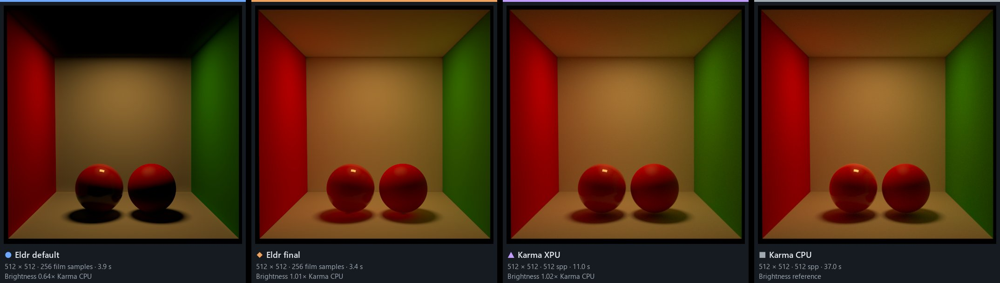

### Complex caustics

Complex caustics: a wine glass and a rippled glass slab under a small sphere light, seen from above. The bowl focuses a bright cusp into its shadow and the ripples a web on the floor.

*Note:* Eldr raster + SSGI has no ray tracing and so no caustics: the casters' glass casts a dark shadow, and screen-space GI misses the light bounced off the ceiling, out of view. Eldr ray traced traces photons from the light, so the web and the glass's ring are sharp where Karma's caustics, traced from the camera, are still noisy.

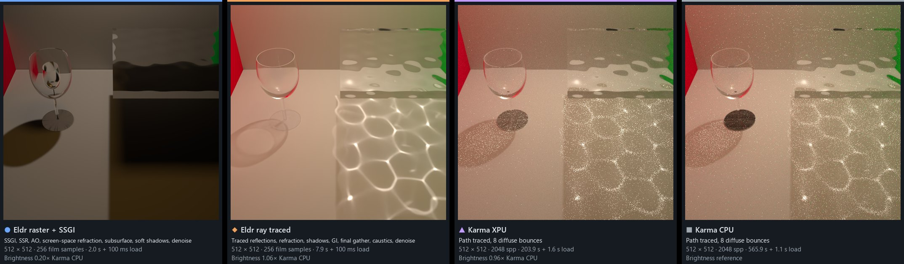

### Depth of field

Thin-lens depth of field focused on the tall box (USD lens units: tenths of a scene unit).

### Displacement

Preview Surface displacement on a single quad: blurred checker bumps, 0.6 m high.

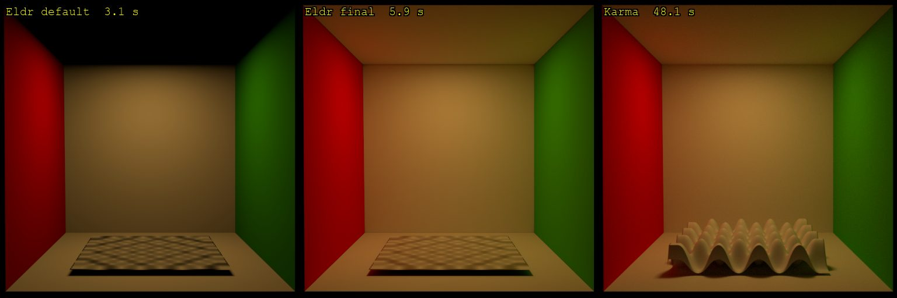

### Emissive surface lighting

The ceiling light is the asset's emissive quad instead of a RectLight: an emissive surface lights the room.

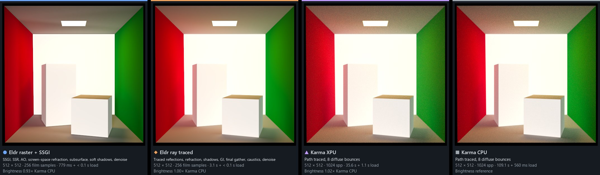

### Camera exposure

Camera exposure of +1 stop.

### Glass and caustics

A clear glass ball under the ceiling light: refraction, and the caustic it focuses on the floor.

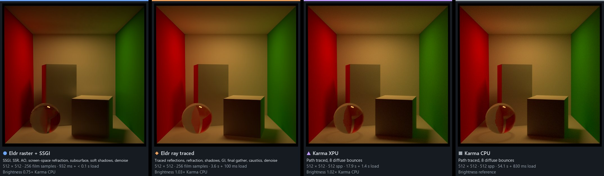

### Glossy materials

Glossy metal on the tall box and a glossy dielectric ball.

### Hair

A patch of 900 hair curves on the short box, brown, shaded as hair.

### Height fog

Unreal's height fog settings (`unreal:`) on the base scene; Eldr and Karma ignore them.

### Holdout

A holdout ball (Karma's Matte mode): cut out of the image as black with alpha 0, its shadow still on the floor.

### IES profile

The ceiling light replaced by a point light with an IES profile.

### Instances, points, curves

A PointInstancer, Points and a cubic BasisCurves helix, with per-instance and per-curve colours.

### Lens shift

Horizontal and vertical aperture offsets (lens shift).

### Light groups

Two light groups, the ceiling light and a warm lamp, written as their own AOVs; the gallery shows the beauty.

### Light linking

A warm light linked only to the tall box and a cool one only to the short box; the ceiling light lights everything.

### Textured area light

The ceiling light shows a four-colour texture, which tints the walls, the floor and a chrome ball.

### Sheen, thin film, anisotropy

Three material lobes on balls along the front: velvet sheen, thin-film iridescence and brushed anisotropic metal.

### Motion blur

A ball crossing the box during a half-frame shutter.

### Orthographic camera

Orthographic projection with a 6.2 m window.

### Post-processing

Unreal's post-processing settings (`unreal:`) on the base scene; Eldr and Karma ignore them and render the linear image.

### Render region

A render region: dataWindowNDC (0.25, 0.15)-(0.75, 0.65) renders only that part of the frame.

### Subdivision surfaces

A Catmull-Clark cube (USD's default scheme) with a red GeomSubset on two faces.

### Subsurface scattering

Subsurface scattering: a jade ball on the floor and a wax ball on the short box.

### UV sets

Two UV sets: a checker reads st1 (four times st, so 32 x 32 cells) while a left-to-right metallic ramp reads st.

### Volumes (OpenVDB)

A fog sphere (OpenVDB, density field) in the middle of the box.

### Glowing panel and bulb

A glowing panel under the ceiling and a small bulb on the floor are the only lights: they light the room and cast shadows from the box and the chrome ball. (`showcase/2026-10-28_03_emissive_lights`)

### Bounce light from a glowing panel

A glowing panel lights the room; the walls pick up light and colour from each other. (`showcase/2026-10-28_04_gi_final_gather`)

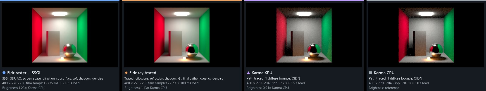

### Chrome ball in a glowing room

A glowing panel and bulb light the room; the chrome ball reflects all of it, including what is off screen. (`showcase/2026-10-28_09_traced_reflections`)

### Transparent and presence opacity

Two 30% opaque dark metal quads under a glowing panel: the left one "transparent" keeps its highlight, the right one "presence" fades completely. (`showcase/2026-10-29_01_opacity_mode`)

*Note:* The right quad fades with its opacity, as UsdPreviewSurface's "presence" mode asks; Karma renders both quads alike, with the full highlight.

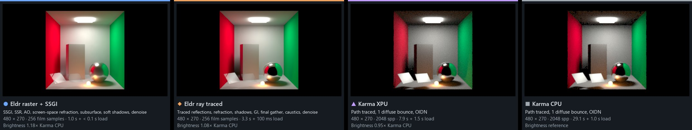

## Feature scenes

Showcase scenes (`showcase/`), one feature each, rendered at their own resolution.

### Material lobes

Clearcoat, sheen, fuzz, thin film, anisotropic highlights, hair and toon shading. (`showcase/2026-10-30_22_material_lobes`)

### Skin, jade and leaves

Light scatters under the surface of skin, jade and leaves. (`showcase/2026-10-30_13_subsurface`)

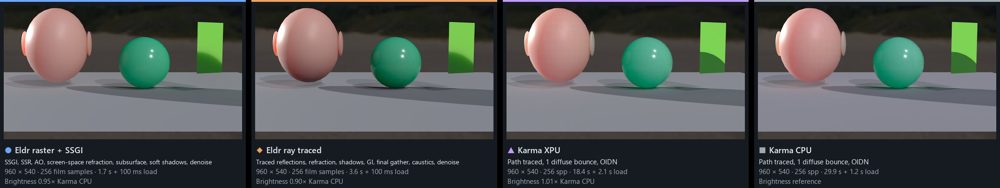

### Caustics

Light focused through glass lands as a bright patch on other surfaces. (`showcase/2026-10-29_13_caustics`)

### Reflections

A ball on a mirror-like floor reflects as a ball, with its highlights, and reflections reflect again up to a limit. (`showcase/2026-11-04_01_reflections`)

### Curves, points and hair

Every curve type as tubes or ribbons, points as spheres or discs, and hair shading. (`showcase/2026-10-30_19_curves_points`)

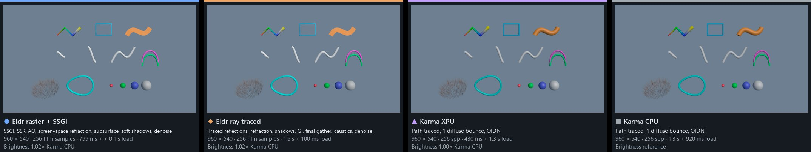

### Light shapes

Sun, sphere, rect, disk and tube lights give highlights of their own shape, and lights set to show their shape appear to the camera. (`showcase/2026-10-30_07_light_shapes`)

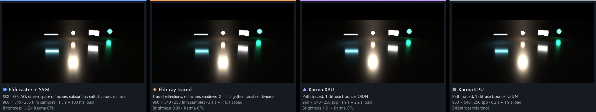

### Many lights

Hundreds of small lights are shaded cheaply: each pixel is lit only by the lights that reach it. (`showcase/2026-10-30_06_many_lights`)

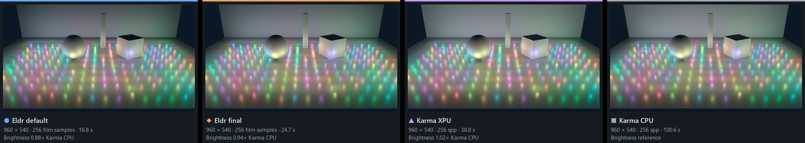

### Volume multiple scattering

Light bounces more than once inside smoke, set with Karma's Volume Limit. (`showcase/2026-10-29_26_volume_multiple_scattering`)

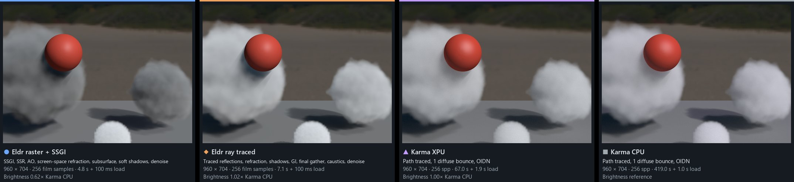

### Displacement shaders

Preview Surface displacement on a single quad: blurred checker bumps, 0.6 m high. (`showcase/2026-10-30_18_displacement`)

### MaterialX BSDF graphs

Surfaces built from MaterialX BSDF nodes (mix, layer, add, multiply), Lama and glTF materials render like Karma. (`showcase/2026-10-31_05_bsdf_graphs`)

*Note:* Karma XPU leaves these surfaces grey: it doesn't render MaterialX BSDF graphs or Lama.

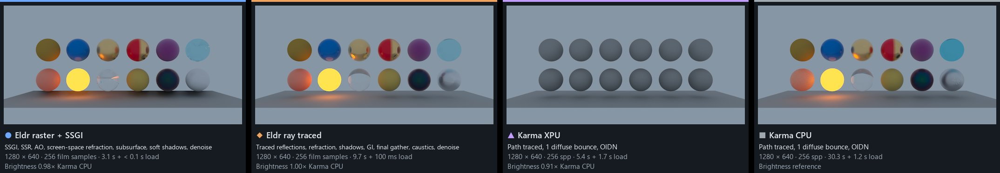

### MaterialX and Karma nodes

MaterialX compositing nodes, glTF, Disney and unlit surfaces, and Karma's ramp, hex-tiled and Voronoi nodes. (`showcase/2026-10-29_16_materialx_nodes`)

*Note:* The dodge swatch (top row, fifth) follows MaterialX's own formula, as Storm does; Karma's differs. Karma XPU leaves the glTF and Disney surfaces grey.

### Objects without a material

Objects without a material look as they do in Karma: dim, with a faint white highlight. (`showcase/2026-10-31_02_karma_default_material`)

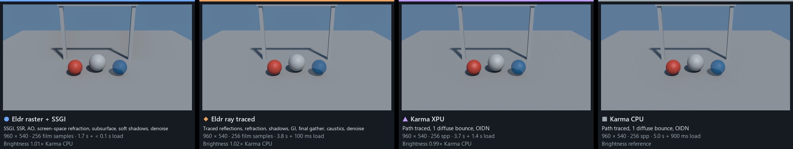

### Texture colour spaces and UDIMs

Textures in ACEScg and Rec.709, UDIM tiles, and sharp textures at grazing angles. (`showcase/2026-10-30_21_textures_colour`)

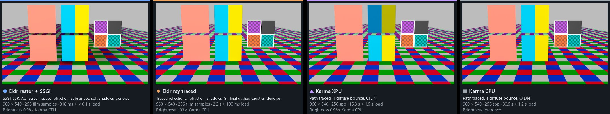

### Rough glass

More light paths through rough glass give a smoother result without more film samples. (`showcase/2026-10-31_01_refraction_quality`)

### Glass, translucency and smoke in order

Glass, translucent meshes and smoke are layered in depth order, so what is behind a pane shows through it. (`showcase/2026-10-29_09_transparency_order`)

### Rough mirror floor

A rough mirror floor blurs its reflection by its roughness. (`showcase/2026-10-29_03_planar_reflection_blur`)

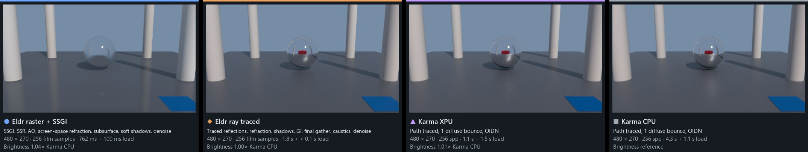

### Screen-space reflections

Reflections of what is on screen, blurrier on rougher surfaces. (`showcase/2026-10-30_11_screen_space_reflections`)

### Ambient occlusion

The dome's light is darkened in corners and gaps. (`showcase/2026-10-30_09_ambient_occlusion`)

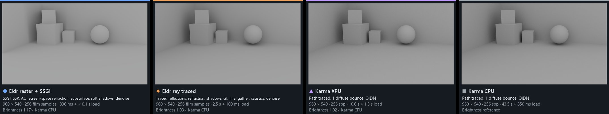

### Shadows

Shadows can be soft or hard, from shadow maps, or traced. (`showcase/2026-10-30_10_shadow_modes`)

### Sun from an HDRI

The sun in an HDRI becomes a distant light that casts crisp shadows. (`showcase/2026-10-30_08_dome_sun`)

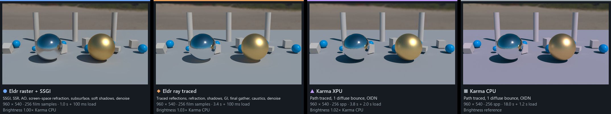

### A second sun's shadows

A second sun, such as the one in an HDRI, casts its own shadows. (`showcase/2026-10-30_26_further_sun_shadows`)

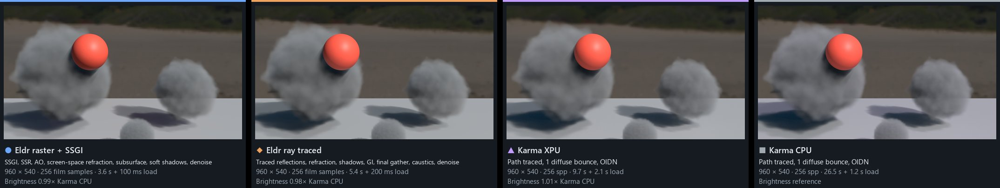

### Light and shadow linking

A light can skip objects, and its shadows can skip casters. (`showcase/2026-10-29_15_light_linking`)

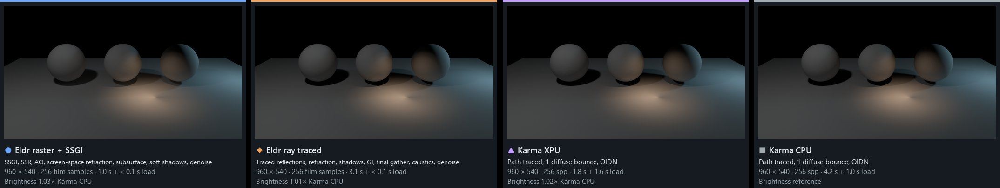

### Colour limit

Karma's colour limit clamps how bright emitters and their bounced light can get; a full-HDR option keeps the emitters unclamped for comp. (`showcase/2026-10-29_17_colour_limit`)

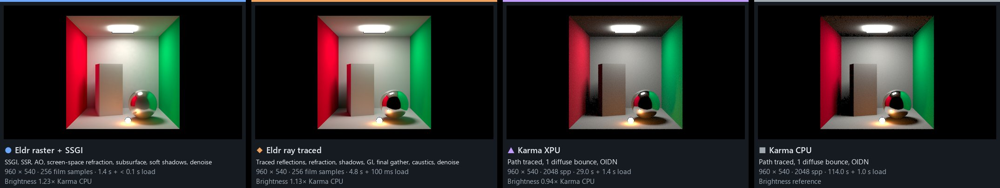

### Velocity motion blur

Objects that only author velocities blur along them when velocity blur is on, as in Karma. (`showcase/2026-10-28_02_velocity_blur`)

### Motion blur in reflections

Reflections blur with motion blur, like the objects they show. (`showcase/2026-10-29_10_reflection_motion_blur`)

### Nested instancing

Nested point instancers and native instances render fast, and tiny instances can be skipped. (`showcase/2026-10-30_20_instancing`)

### Coloured volume shadows

Coloured smoke casts coloured shadows. (`showcase/2026-10-29_05_coloured_volume_shadows`)

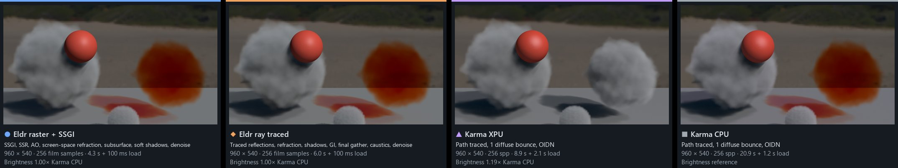

### Volume motion blur

Smoke blurs along its velocity field, as Karma's volume motion blur. (`showcase/2026-10-29_18_volume_motion_blur`)

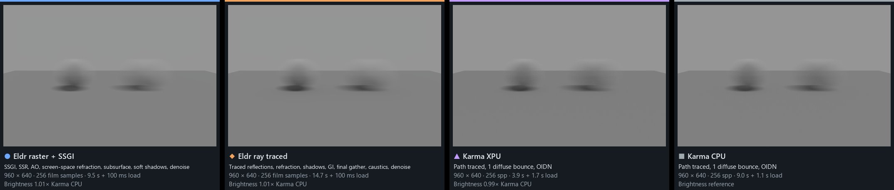

### Cryptomatte

The EXR carries Cryptomatte layers for objects and materials, with soft or hard edges. (`showcase/2026-10-30_15_cryptomatte`)

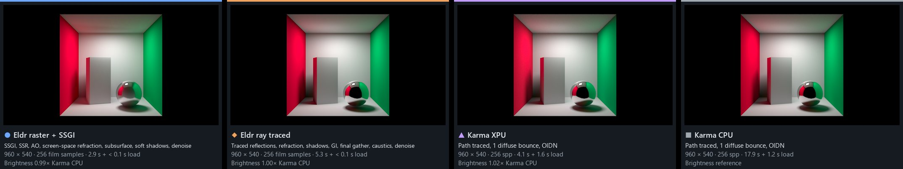

The Cryptomatte layers of the same EXRs, each id a colour weighted by its coverage: soft, anti-aliased edges where objects meet. Eldr names objects by prim path (`CryptoObject`) and materials by material path (`CryptoMaterial`), as Karma's Cryptomatte does.

### AOVs and light groups

The render vars a Karma Render Settings node writes (light groups, diffuse and glossy splits, transmission, subsurface, coat, volume, shadow mattes) come out of Eldr by the same names. (`showcase/2026-10-29_06_karma_aovs`)

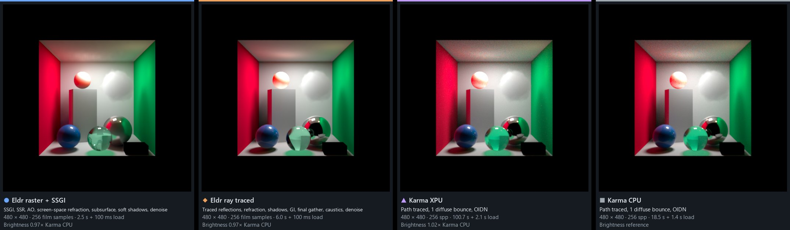

Its passes, Eldr ray traced (left of each pair) next to Karma CPU (right), from one EXR each: the diffuse and specular splits (`C<RD>.*L`, `C<RG>.*L`), the light refracted through the glass ball (`C<TG>.*L`), the two light groups (`C.*<L.'ceiling'>`, `C.*<L.'lamp'>`), normal (`ray:hitN`, shown as 0.5 + N / 2), depth (`ray:hitPz`, near is bright) and albedo (`CDA`). Eldr's light groups hold the group's direct light; Karma's add its bounced light.

### Tiled rendering

husk and usdrecord render very large images tile by tile, so GPU memory follows the tile size, not the image. (`showcase/2026-11-02_01_tiles`)

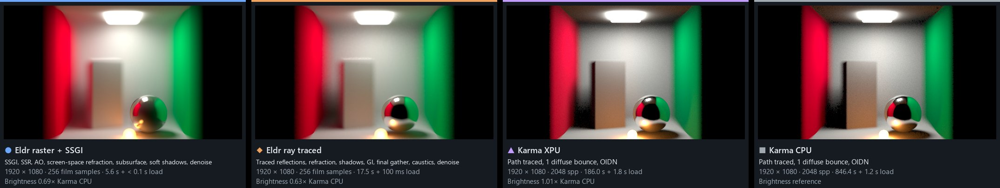

The tiled image (12 tiles of 512 pixels) against the whole image at once, and their difference ten times brighter: no seams along the tile edges, only a little noise and the chrome ball's reflection, which screen-space reflections find on screen in the whole image and the reflection probe supplies in a tile (traced reflections are the same either way).

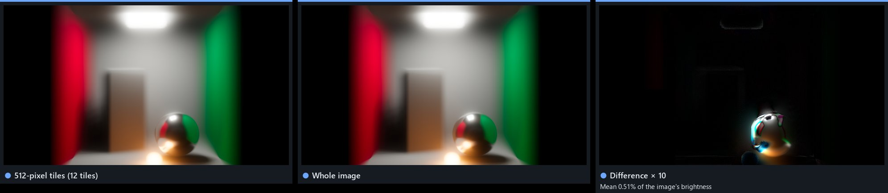

The same scene (ray tracing off) at growing sizes with its `tiles` settings and 2048-pixel tiles (peak GPU memory above what was in use before the render, sampled by nvidia-smi). The screen-size buffers, about 170 bytes a pixel, stay at the tile's size; only the whole image's bloom, exposure and tonemapping grow with it, about 27 bytes a pixel. A whole 12000 × 12000 image would need about 24 GB.

| Image | Rendered | Peak GPU memory | Time |
|---|---|---:|---:|
| 1920 × 1080 | 2048-pixel tiles | 0.5 GB | 911 ms |
| 4096 × 4096 | 2048-pixel tiles | 0.7 GB | 5.0 s |
| 8192 × 8192 | 2048-pixel tiles | 1.9 GB | 19.7 s |
| 12000 × 12000 | 2048-pixel tiles | 3.3 GB | 42.9 s |
| 1920 × 1080 | whole | 0.5 GB | 951 ms |
| 4096 × 4096 | whole | 2.0 GB | 4.6 s |

## Production scenes

Intel's Sponza with its curtains, ivy, cypress, candles, knight, flood and explosion add-ons and a 9,000-agent crowd, rendered with husk at 960 × 540 (the crowd at 1280 × 720): ● **Eldr raster + SSGI**, every effect without ray tracing (`tests/scenes/cornell/eldr_default.usda`); ◆ **Eldr ray traced** (`tests/scenes/cornell/eldr_final.usda`); ▲ **Karma XPU** (256 path-traced samples) and ■ **Karma CPU** (128), both with 4 diffuse bounces and OIDN, stopped after 10 minutes (*time-limited* on the card). Karma CPU is the brightness reference. *Render* and *load* come from each renderer's own log, as in the Methodology above: Eldr's render passes less the loading in them, timed on a second run with a warm shader cache; Karma's wall clock less load and update. *GPU* is the memory Eldr's render took. The layers are in `tests/scenes/production`; `python tests/render_production.py` renders them again.

Hardware: AMD Ryzen 9 3950X (16 cores, 32 threads), 48 GB RAM, NVIDIA GeForce GTX 1080 Ti 11 GB (driver 582.78; no RT cores, so Eldr's ray tracing runs through its compute fallback), Windows 11 Pro, Houdini 22.0.466. Karma CPU runs on the Ryzen, Karma XPU on the GTX 1080 Ti (with the CPU).

### Sponza atrium: sun, sky and bounced light

The courtyard with the curtains, ivy and cypress add-ons: sun-lit stone, sky through the open roof and light bounced into the arcades (15 million triangles).

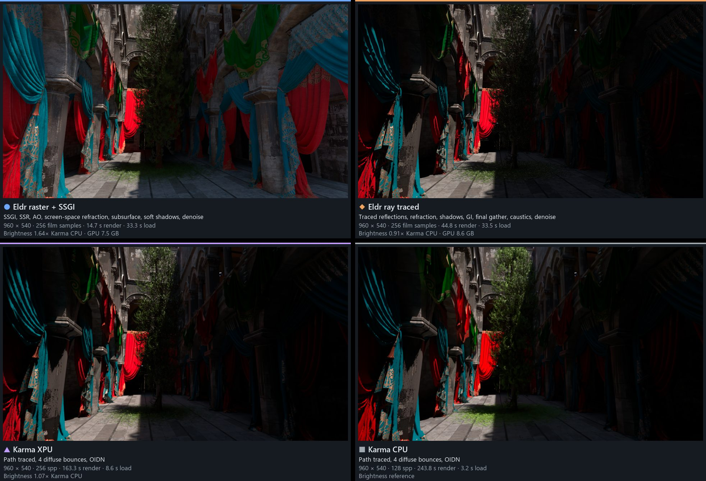

### Sponza arcade: GI through curtains

The ground-floor arcade lit mostly by sunlight bounced off the courtyard floor and through the curtains.

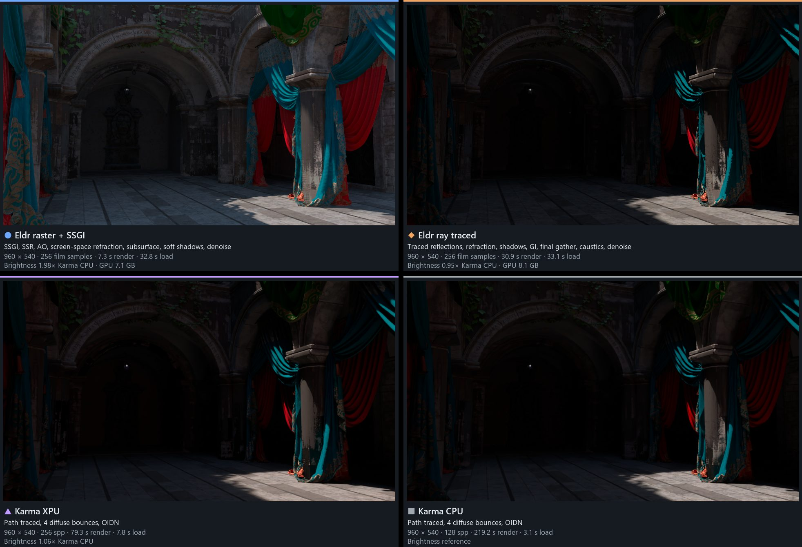

### 10,000 candles: many lights

Sponza at night lit by 10,000 small sphere lights, one per candle flame, and a faint sky; the camera's exposure is -2.5.

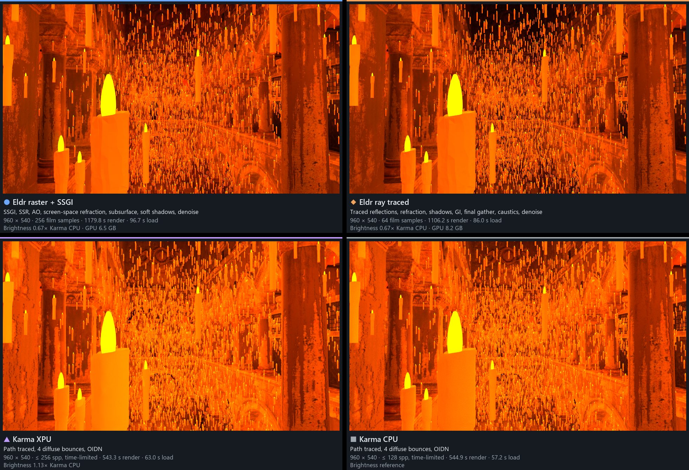

### Knight: animated mesh, motion blur

The knight add-on mid-lunge: deforming meshes from point time samples, blurred over a 180 degree shutter.

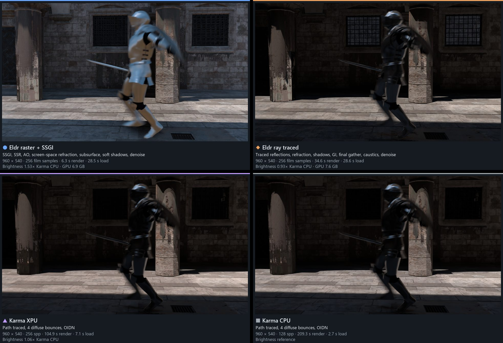

### Flood: water refraction

A FLIP water mesh (1.2 million faces) pouring along the courtyard, in clear water refracting the floor.

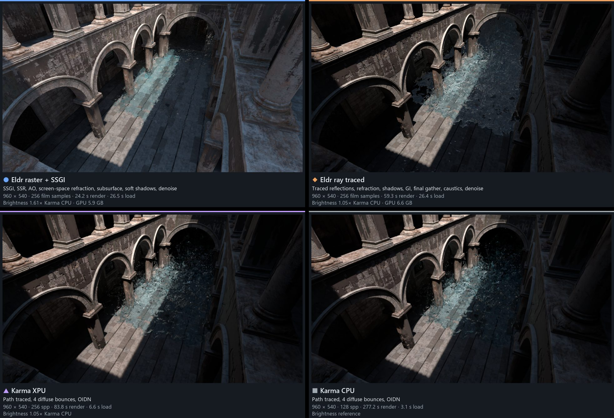

### Explosion: volumes

Two pyro simulations (OpenVDB density and temperature): dark smoke lit by the sun, fire glowing by temperature.

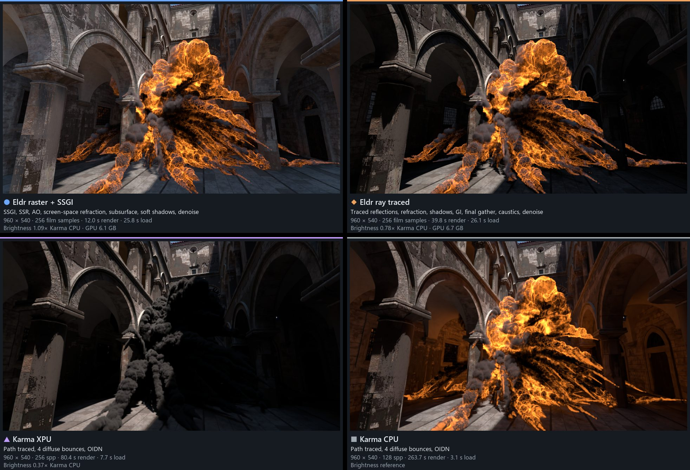

### Crowd: 9,324 skinned agents

9,324 UsdSkel agents (20.7 million triangles) skinned on the GPU, at 1280 x 720. Eldr only.

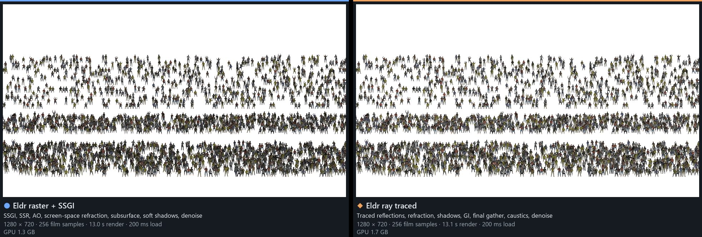

*Intel Sponza (Frank Meinl, Anton Kaplanyan, Intel Sample Library, 2022) and add-ons by the Sponza Add-on Package Crew (Katica Putica, Cristiano Siqueira, Timothy Heath, Justin Prazen, Sebastian Herholz, Bruce Cherniak, Anton Kaplanyan). CC BY 4.0.*
