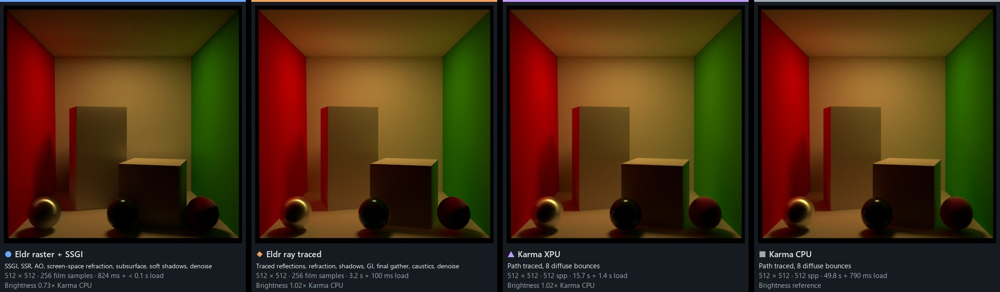
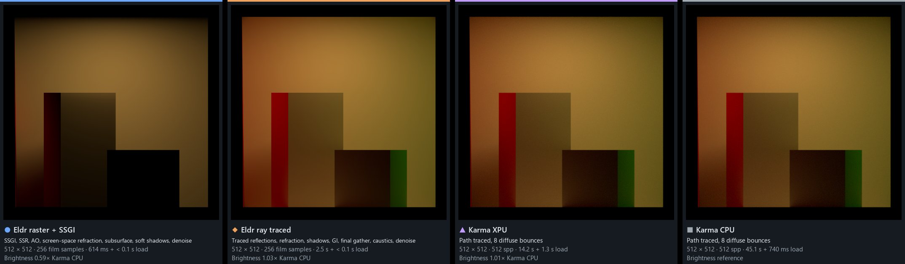
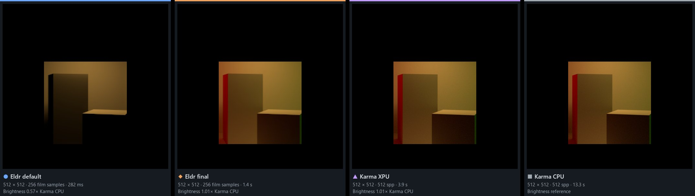
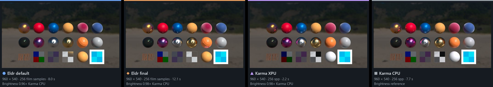
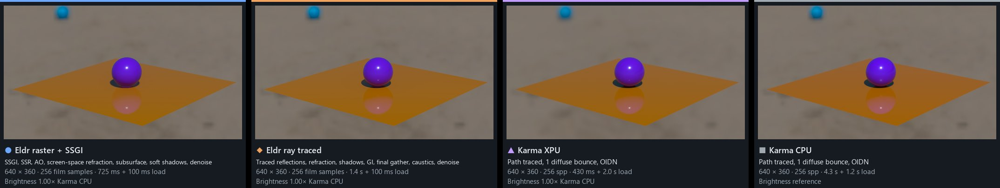
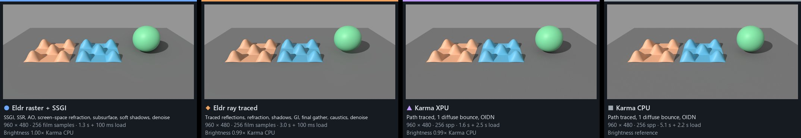

# Gallery

Every scene renders four ways with husk: ● **Eldr default**, every effect that works without ray tracing (screen-space GI, reflections and refraction, planar mirrors, ambient occlusion, subsurface, soft shadow maps, denoising, 256 film samples: `tests/scenes/cornell/eldr_default.usda`); ◆ **Eldr final**, ray traced (reflections, refraction, shadows, GI, final gather, caustics, denoising, 256 film samples: `tests/scenes/cornell/eldr_final.usda`); ▲ **Karma XPU** and ■ **Karma CPU** with the scene's Karma settings. Karma CPU is the brightness reference.

| Scene | Eldr default | Eldr final | Karma XPU | Karma CPU | Brightness vs Karma CPU (default / final / XPU) |
|---|---:|---:|---:|---:|---|
| [Global illumination](#global-illumination) | 947 ms | 3.1 s | 25.1 s | 47.2 s | 0.53× / 1.02× / 1.02× |
| [Clearcoat](#clearcoat) | 3.9 s | 3.4 s | 11.0 s | 37.0 s | 0.64× / 1.01× / 1.02× |
| [Depth of field](#depth-of-field) | 877 ms | 2.9 s | 15.4 s | 49.2 s | 0.53× / 1.01× / 1.02× |
| [Displacement](#displacement) | 4.7 s | 10.2 s | 11.3 s | 36.8 s | 0.63× / 1.02× / 1.02× |
| [Emissive surface lighting](#emissive-surface-lighting) | 2.5 s | 6.3 s | 35.4 s | 110.8 s | 0.78× / 1.00× / 1.02× |
| [Camera exposure](#camera-exposure) | 876 ms | 2.9 s | 17.3 s | 57.3 s | 0.53× / 1.02× / 1.02× |
| [Glass and caustics](#glass-and-caustics) | 4.0 s | 8.4 s | 36.0 s | 55.3 s | 0.53× / 1.03× / 1.02× |
| [Glossy materials](#glossy-materials) | 2.9 s | 3.4 s | 9.0 s | 29.7 s | 0.66× / 1.02× / 1.02× |
| [Hair](#hair) | 3.4 s | 8.0 s | 21.2 s | 49.4 s | 0.54× / 1.03× / 1.02× |
| [Unreal height fog settings](#unreal-height-fog-settings) | 932 ms | 3.0 s | 14.5 s | 48.1 s | 0.53× / 1.02× / 1.02× |
| [Holdout](#holdout) | 2.4 s | 6.1 s | 56.8 s | 48.1 s | 0.53× / 1.03× / 1.02× |
| [IES profile](#ies-profile) | 878 ms | 2.9 s | 19.7 s | 66.4 s | 0.35× / 0.94× / 1.07× |
| [Instances, points, curves](#instances-points-curves) | 1.1 s | 3.4 s | 17.1 s | 50.0 s | 0.53× / 1.02× / 1.02× |
| [Lens shift](#lens-shift) | 825 ms | 2.5 s | 10.6 s | 34.2 s | 0.49× / 1.02× / 1.02× |
| [Light groups](#light-groups) | 2.7 s | 6.7 s | 28.8 s | 68.2 s | 0.61× / 1.02× / 1.02× |
| [Light linking](#light-linking) | 936 ms | 3.1 s | 23.7 s | 63.2 s | 0.60× / 1.02× / 1.02× |
| [Textured area light](#textured-area-light) | 1.2 s | 3.9 s | 20.8 s | 62.7 s | 0.55× / 1.03× / 1.03× |
| [Sheen, thin film, anisotropy](#sheen-thin-film-anisotropy) | 1.0 s | 3.4 s | 15.7 s | 51.1 s | 0.53× / 1.02× / 1.02× |
| [Motion blur](#motion-blur) | 2.7 s | 6.3 s | 27.4 s | 50.1 s | 0.53× / 1.02× / 1.02× |
| [Orthographic camera](#orthographic-camera) | 836 ms | 2.7 s | 14.1 s | 45.7 s | 0.58× / 1.03× / 1.01× |
| [Unreal post-processing settings](#unreal-post-processing-settings) | 860 ms | 2.9 s | 14.8 s | 48.1 s | 0.53× / 1.02× / 1.02× |
| [Render region](#render-region) | 282 ms | 1.4 s | 3.9 s | 13.3 s | 0.57× / 1.01× / 1.01× |
| [Subdivision surfaces](#subdivision-surfaces) | 837 ms | 3.1 s | 14.7 s | 48.8 s | 0.53× / 1.02× / 1.02× |
| [Subsurface scattering](#subsurface-scattering) | 2.7 s | 6.9 s | 21.9 s | 56.9 s | 0.51× / 1.01× / 1.02× |
| [UV sets](#uv-sets) | 3.3 s | 6.4 s | 16.6 s | 33.0 s | 0.68× / 1.06× / 1.02× |
| [Volumes (OpenVDB)](#volumes-openvdb) | 3.1 s | 7.6 s | 26.0 s | 59.8 s | 0.54× / 0.98× / 1.02× |
| [Material lobes](#material-lobes) | 8.0 s | 12.1 s | 2.2 s | 7.7 s | 0.96× / 0.98× / 0.98× |
| [Skin, jade and leaves](#skin-jade-and-leaves) | 3.8 s | 7.6 s | 18.5 s | 30.5 s | 0.95× / 0.94× / 1.01× |
| [Caustics](#caustics) | 5.4 s | 11.6 s | 4.8 s | 14.8 s | 0.99× / 1.07× / 1.01× |
| [Reflections](#reflections) | 3.9 s | 4.6 s | 470 ms | 4.5 s | 1.00× / 1.00× / 1.00× |
| [Curves, points and hair](#curves-points-and-hair) | 4.3 s | 6.5 s | 460 ms | 1.4 s | 1.02× / 1.02× / 1.00× |
| [Light shapes](#light-shapes) | 4.7 s | 6.3 s | 1.9 s | 6.4 s | 1.12× / 0.99× / 1.01× |
| [Many lights](#many-lights) | 16.8 s | 24.7 s | 38.8 s | 100.6 s | 0.88× / 0.94× / 1.02× |
| [Volume multiple scattering](#volume-multiple-scattering) | 7.5 s | 11.2 s | 66.1 s | 432.2 s | 0.63× / 1.02× / 1.00× |
| [Displacement shaders](#displacement-shaders) | 4.4 s | 6.9 s | 9.9 s | 5.4 s | 1.01× / 0.99× / 0.99× |

### Methodology

| | |
|---|---|
| Machine | Windows, NVIDIA GTX 1080 Ti; Karma CPU on the same machine |
| Eldr default | `tests/scenes/cornell/eldr_default.usda` over the scene's settings (a showcase's `eldr_default` prim), `husk -R HdVkRendererPlugin`; no ray tracing starts |
| Eldr final | `tests/scenes/cornell/eldr_final.usda` over `/Render/Settings`, or a showcase's `eldr_final` prim |
| Karma | `BRAY_HdKarmaXPU` and `BRAY_HdKarma` with the scene's settings (Cornell box: 512 path-traced samples, 8 diffuse bounces; showcases: their `karma` prim, Path Traced, beauty only, domes visible to the camera as in Eldr) |
| Samples | Karma: Path Traced at a fixed count, the same every pixel (Cornell box 512, showcases 256), denoised with OIDN on the showcases. Eldr: 256 film samples, all taken (adaptive sampling off), denoised with OIDN. Each card shows its count |
| Render time | From each renderer's own log, scene load left out. Eldr: its render passes (`HDVK_TIMING=2`) less the loading inside them. Karma: the frame's wall clock less load and update (`husk -V2`). Both include their denoise |
| Load | The smaller figure after each time (+): Eldr's sync, shader compiles, texture loads, ray tracing pipelines and BVH builds; Karma's load and update. husk's own start-up is in neither |
| Warm cache | Eldr renders each scene twice and times the second: its Vulkan pipeline cache keeps compiled shaders between runs, and a scene's first run compiles them (up to 8 s here, by its materials and features) |
| Brightness | Mean luminance against Karma CPU's (1.00×: as bright as Karma CPU) |
| Regenerate | `hython tests/render_gallery.py [outdir] [--only base,glossy] [--force]` (renders, pictures, this page and README.md's gallery) |

## Cornell box: one feature per scene

The CC0 Cornell box (`tests/scenes/cornell`) plus one small variant layer, rendered at 512 × 512.

### Global illumination

The CC0 Cornell box with its measured camera and a RectLight matching the ceiling light.

### Clearcoat

Preview Surface clearcoat: red lacquer (clearcoat 1 over a rough red base, left) next to the same base without a coat (right).

### Depth of field

Thin-lens depth of field focused on the tall box (USD lens units: tenths of a scene unit).

### Displacement

Preview Surface displacement on a single quad: blurred checker bumps, 0.6 m high.

### Emissive surface lighting

The ceiling light is the asset's emissive quad instead of a RectLight: an emissive surface lights the room.

### Camera exposure

Camera exposure of +1 stop.

### Glass and caustics

A clear glass ball under the ceiling light: refraction, and the caustic it focuses on the floor.

### Glossy materials

Glossy metal on the tall box and a glossy dielectric ball.

### Hair

A patch of 900 hair curves on the short box, brown, shaded as hair.

### Unreal height fog settings

Unreal's height fog settings (`unreal:`) on the base scene; Eldr and Karma ignore them.

### Holdout

A holdout ball (Karma's Matte mode): cut out of the image as black with alpha 0, its shadow still on the floor.

### IES profile

The ceiling light replaced by a point light with an IES profile.

### Instances, points, curves

A PointInstancer, Points and a cubic BasisCurves helix, with per-instance and per-curve colours.

### Lens shift

Horizontal and vertical aperture offsets (lens shift).

### Light groups

Two light groups, the ceiling light and a warm lamp, written as their own AOVs; the gallery shows the beauty.

### Light linking

A warm light linked only to the tall box and a cool one only to the short box; the ceiling light lights everything.

### Textured area light

The ceiling light shows a four-colour texture, which tints the walls, the floor and a chrome ball.

### Sheen, thin film, anisotropy

Three material lobes on balls along the front: velvet sheen, thin-film iridescence and brushed anisotropic metal.

### Motion blur

A ball crossing the box during a half-frame shutter.

### Orthographic camera

Orthographic projection with a 6.2 m window.

### Unreal post-processing settings

Unreal's post-processing settings (`unreal:`) on the base scene; Eldr and Karma ignore them and render the linear image.

### Render region

A render region: dataWindowNDC (0.25, 0.15)-(0.75, 0.65) renders only that part of the frame.

### Subdivision surfaces

A Catmull-Clark cube (USD's default scheme) with a red GeomSubset on two faces.

### Subsurface scattering

Subsurface scattering: a jade ball on the floor and a wax ball on the short box.

### UV sets

Two UV sets: a checker reads st1 (four times st, so 32 x 32 cells) while a left-to-right metallic ramp reads st.

### Volumes (OpenVDB)

A fog sphere (OpenVDB, density field) in the middle of the box.

## Feature scenes

Showcase scenes (`showcase/`) for major features, rendered at their own resolution.

### Material lobes

Clearcoat, sheen, fuzz, thin film, anisotropic highlights, hair and toon shading. (`showcase/2026-10-30_22_material_lobes`)

### Skin, jade and leaves

Light scatters under the surface of skin, jade and leaves. (`showcase/2026-10-30_13_subsurface`)

### Caustics

Light focused through glass lands as a bright patch on other surfaces. (`showcase/2026-10-29_13_caustics`)

### Reflections

A ball on a mirror-like floor reflects as a ball, with its highlights, and reflections reflect again up to a limit. (`showcase/2026-11-04_01_reflections`)

### Curves, points and hair

Every curve type as tubes or ribbons, points as spheres or discs, and hair shading. (`showcase/2026-10-30_19_curves_points`)

### Light shapes

Sun, sphere, rect, disk and tube lights give highlights of their own shape, and lights set to show their shape appear to the camera. (`showcase/2026-10-30_07_light_shapes`)

### Many lights

Hundreds of small lights are shaded cheaply: each pixel is lit only by the lights that reach it. (`showcase/2026-10-30_06_many_lights`)

### Volume multiple scattering

Light bounces more than once inside smoke, set with Karma's Volume Limit. (`showcase/2026-10-29_26_volume_multiple_scattering`)

### Displacement shaders

Displacement shaders move the surface and cast shadows. (`showcase/2026-10-30_18_displacement`)

