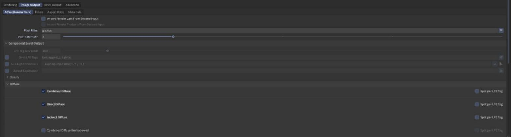
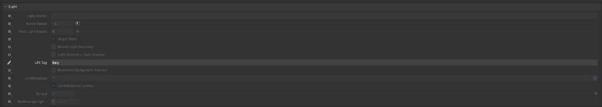
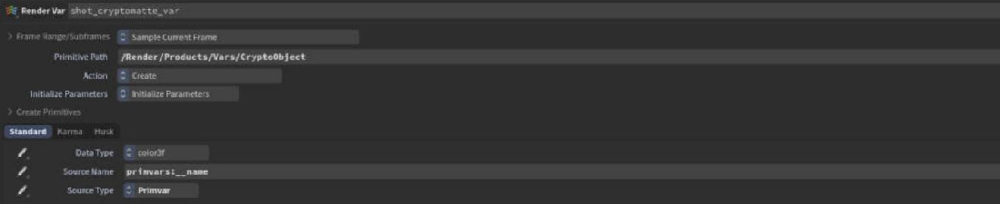
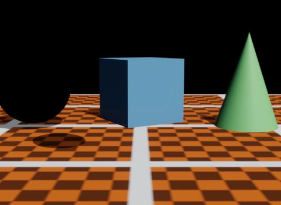
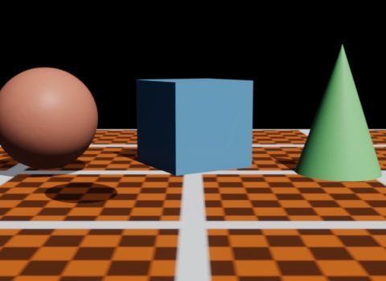
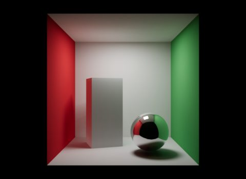
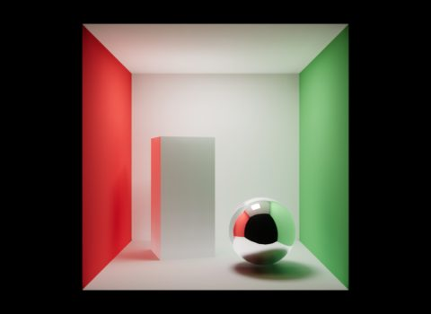

# AOVs and output

Besides the beauty, Eldr writes AOVs (arbitrary output variables: the extra image layers comp needs): light splits (diffuse, glossy, transmission, ...), light groups, data (depth, normals, positions), Cryptomatte and shadow mattes. It uses Karma's names and light path expressions (LPEs, patterns that pick which light paths go into a layer), so **one comp template serves both renderers**.

## Set up AOVs in Solaris

The easiest way is Karma's own UI, which Eldr understands:

1. On a **Karma Render Settings LOP**, tick the AOVs you want on the **Image Output > AOVs** tab (Direct Diffuse, Indirect Diffuse, Albedo, ...). Or add **Render Var LOPs** with a source LPE.
2. Point your Eldr render at the same products: Eldr reads the render vars' `sourceName` and `sourceType`.
3. Render with husk (USD Render ROP). husk writes the EXR with the same layers as Karma's (`C`, `<var>.R/G/B`, `depth.z`, `N.x/y/z`, ...).

> **Tip:** Put a beauty var (`C.*[LO]`, color4f) first in the product. Houdini's viewport only lists the product's vars, so without one there is no colour entry in **Render Outputs**.

## Light splits

The splits add up to the linear beauty: diffuse + glossy + transmission + subsurface + volume + emission = beauty.

| Karma AOV | LPE | Content |
|---|---|---|
| Direct / indirect / combined diffuse | `C<RD>L`, `C<RD>.+L`, `C<RD>.*L` | Diffuse light |
| Direct / indirect / combined glossy | `C<RG>L`, `C<RG>.+L`, `C<RG>.*L` | Reflections, coat included |
| Glossy transmission | `C<TG>.*L` | What glass refracts |
| SSS | `C<TD>.*L` | Subsurface |
| Coat | `C<...'coat'>.*L` | The coat's reflection |
| Volume | `CV.*L` | Volume light |
| Emission | `C.*O` | Emitters |
| Albedo | `CDA` | Diffuse colour |
| Shadow | `shadow;C.*[LO]` | Light the shadows took (a shadow matte) |

Data AOVs: `ray:hitP` (position), `ray:hitN` (normal), `ray:hitPz` (depth), `primvars:st`, `ray:primid`, and Cryptomatte. The [Houdini page](../houdini.md#supported-lpes) has the full list.

## Light groups

1. On each Light LOP, set **LPE Tag** (Karma tab) to a group name, say `key`.
2. On the Karma Render Settings LOP, tick **Per LPE Tag** on the beauty, or add a Render Var with `C.*<L.'key'>`.

Each group holds the direct light of its lights. Up to 8 groups. Indirect light isn't split per light: rebuild the beauty in comp as the groups + indirect diffuse + indirect glossy + transmission + emission + volume.

## Cryptomatte

Add Render Vars with source `primvars:__name` (objects) or `primvars:__materialname` (materials), or tick Cryptomatte on Karma's Render Settings LOP. Eldr writes the layers as Karma does (`<name>00`, `01`, `02`, with the manifest), with soft, filtered edges from the film (**Cryptomatte: Soft Edges and Ranks**).

## Holdouts and shadow mattes

A holdout renders black with zero alpha but keeps its shadows and depth: for objects that the plate replaces. Set **Holdout Mode** on a Render Geometry Settings LOP (Karma's or Eldr's tab). The `holdout_shadow` AOV (`holdouts;shadow;CDL`) holds the shadows that fall on holdouts.

## Per-AOV filters

A Render Var's **Sample Blending** (Karma tab: Minimum, Maximum, Closest, Farthest) sets how its samples become pixels, as in Karma. Colour AOVs default to the beauty's filter, data AOVs to the sample nearest the pixel centre.

## Direct and indirect intensity

**Direct Light Intensity** and **Indirect Light Intensity** scale the light in the final pixel only, for art direction. The AOVs keep the unscaled light.

## EXR files from usdrecord

husk writes EXRs itself. With usdview or usdrecord, Eldr writes each render product as an EXR once the frame has converged (**Write Render Products**): float, zip compressed, same layer names.

## Limitations

- Not filled (they warn and stay black): `unoccluded;` LPEs, per-light variants of single splits, motion vectors, AO.
- Light groups are direct light only (Karma's include indirect).
- All products use the first product's framing.
