# Cameras

Eldr reads the USD camera Houdini's **Camera LOP** writes: focal length, aperture, f-stop, focus distance, shutter and exposure. Depth of field and motion blur are on by default and show as soon as the camera asks for them.

> **Where in Houdini:** **Camera LOP**: *View* tab (focal length, aperture), *Sampling* tab (shutter, f-stop, focus distance), and Houdini 22's exposure parameters. Set the render camera on the Render Settings LOP.

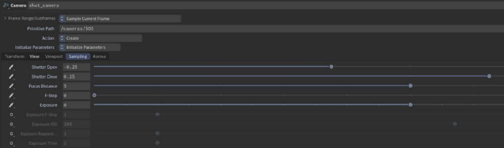

> **Note:** Houdini's and usdview's free viewport cameras have no lens: look through a scene camera to see depth of field and exposure.

## Exposure

The camera's **exposure**, **ISO**, **shutter time**, **f-stop** and **responsivity** scale the image as in Karma (**Camera Exposure**, on): two stops more exposure, four times brighter. Data AOVs (depth, normals, ids) don't change.

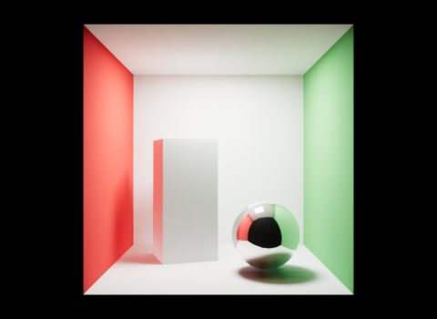
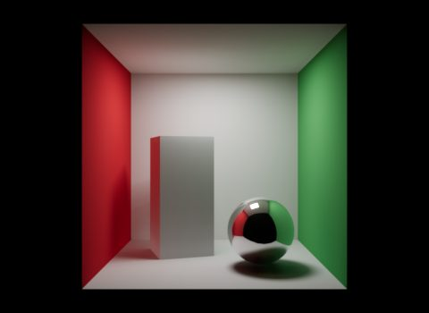

On top of it, **Exposure Compensation** adds stops for the whole render.

## Depth of field

Set **F-Stop** and **Focus Distance** on the camera. In the film, Eldr moves the camera across the lens every sample (**Lens Jitter per Sample**): true bokeh, with correct blur around edges. While you move the camera, a fast post blur stands in.

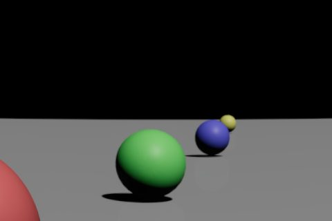

> **Tip:** Strong depth of field needs samples: 128-256 for smooth bokeh.

## Lens distortion

Karma's **Physical Lens** (OpenCV coefficients on the camera's lens shader) distorts Eldr's image the same way, as do the `lensDistortion:*` camera attributes. The frame renders a bit wider and warps afterwards, ids and depth too.

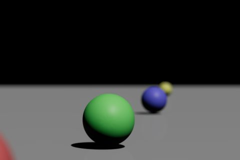

## Motion blur

Open the shutter on the camera (**Shutter Open/Close**, for example -0.25 to 0.25), and moving objects blur. In the film, every sample renders the whole scene at its own shutter time (**Motion Blur Time Samples**), so shadows, reflections, glass and depth of field all blur correctly.

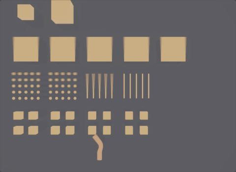
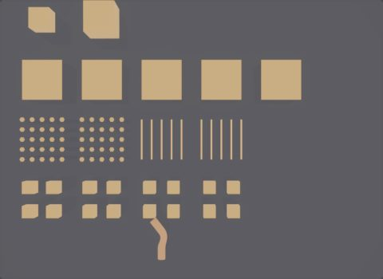

| Moves by | Needs |
|---|---|
| Animated transforms, instances, the camera | Nothing: Eldr reads the transform samples (**Sampled Motion**) |
| Deforming meshes, skinned characters | Nothing (**Deformation Blur**) |
| Point velocities (particles, sims) | **Velocity Blur** on the Render Geometry Settings LOP (Karma's or Eldr's tab) |
| Volumes | Velocity Blur and a `vel` field: see [Volumes](volumes.md#velocity-blur) |

> **Where in Houdini:** Render Geometry Settings LOP > Karma or **Eldr** tab > **Motion**: Enable Motion Blur, Velocity Blur, Instance Velocity Blur.

Motion is linear between frames (box shutter). **Residual Motion Blur** smooths the steps between time samples.

## Tonemapping and bloom

By default the beauty is linear (**Linear Beauty**, on), as Karma's: no tonemap, bloom or auto exposure, Houdini's colour view on top. That is what you want for comp. Turn Linear Beauty off to use Eldr's own look, for example in usdview or for PNG previews:

| Setting | Choices |
|---|---|
| **Tonemapper** | `aces` (default), `agx`, `agxPunchy`, `none` |
| **Bloom Intensity** | 0.04; a glow around bright lights |
| **Auto Exposure** | off; adapts like a camera when on |

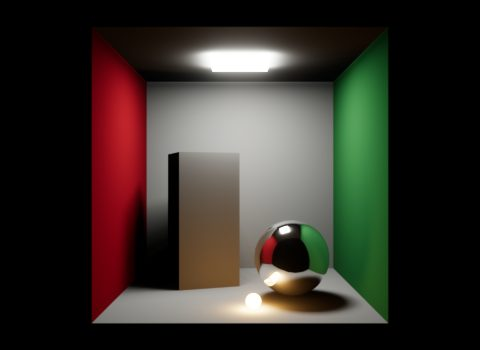
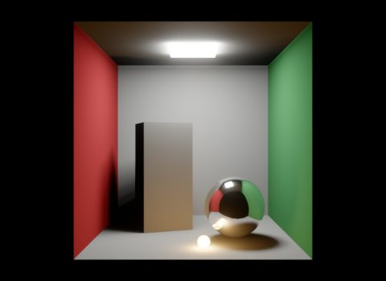
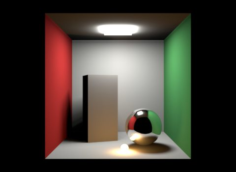
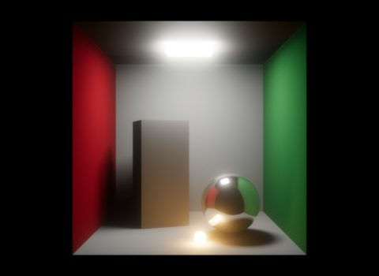

## Limitations

- Box shutter only; motion is linear between frames.
- Karma's lens curvature and chromatic aberration aren't matched.
- More on the [How Eldr works](../features.md#camera) page.
