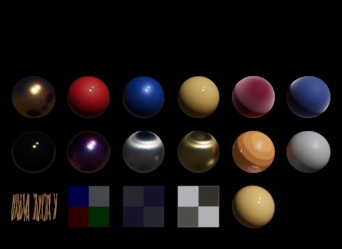
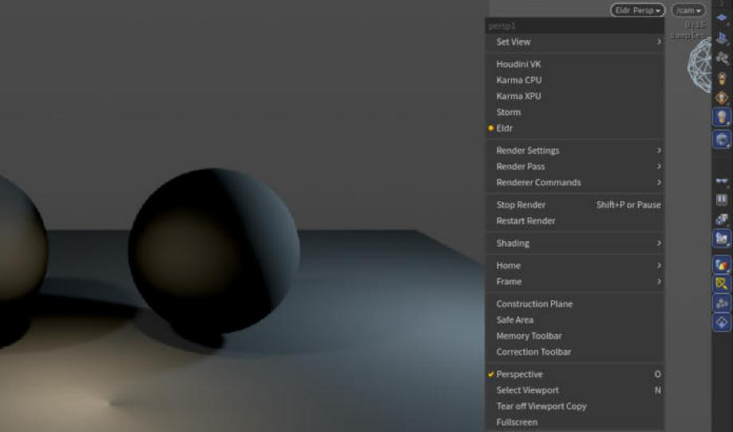
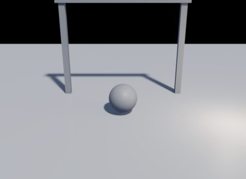

# Getting started

Eldr is a GPU renderer for USD. It plugs into Houdini's Solaris, usdview, usdrecord and husk as a Hydra render delegate, and renders final frames to EXR in seconds. It is built for VFX stills and sequences, with Karma as the look it aims for.



## What you need

- Windows with a Vulkan 1.3 GPU and a current driver.
- Houdini 22 (22.0.466) for Solaris and husk, or OpenUSD 26.08 for usdview and usdrecord.
- Optional: a GPU with Vulkan ray tracing. Eldr renders without it, but it skips the effects marked **[RT]** in the [settings reference](../settings.md) (ray-traced shadows, reflections, refraction, GI, caustics).

> **Note:** Eldr shows up as **Eldr** in every menu. Its plugin id is `HdVkRendererPlugin`; scripts and husk accept either name.

## Install in Houdini

Eldr ships as a Houdini package, `eldr.json`, next to the plugin in the Houdini build folder (`build-h22/houdini`). Building it is described on the [Houdini page](../houdini.md#build).

1. Copy `eldr.json` to `Documents/houdini22.0/packages/`. Or set `HOUDINI_PACKAGE_DIR` to the folder that holds it.
2. Start Houdini and go to the **Solaris** desktop (a LOP network).
3. In the viewport, open the renderer menu at the top right and pick **Eldr**.



The package also sets `$ELDR_HUSK` (a husk wrapper for crowds, see [Crowds and performance](performance.md)) and points Houdini at the stats panel and the parameter files for Eldr's tabs.

> **Tip:** Render Settings LOPs made before Eldr was installed don't have its tab yet. Right-click the node and choose **Rebuild Renderer-Specific Parameters**.

## Your first picture in the viewport

Load a scene (a showcase `scene.usda` with a Sublayer LOP is a good start) and pick Eldr. The viewport renders at once:

- **While you move the camera** you see a fast, slightly soft image at half size.
- **When you stop**, Eldr starts its *film*: it keeps adding samples until it reaches **Film Samples** (64) and stops. The image gets cleaner for a second or two, then stays still.



Your viewport shows linear colour, like Karma's: Houdini's own colour view (OCIO) applies on top, not an Eldr tonemap.

## Your first husk render

husk is Houdini's command-line renderer; the USD Render ROP calls it too. From a Houdini command shell:

```
husk -R Eldr -s /Render/eldr_default -o first.exr showcase\2026-10-30_07_light_shapes\scene.usda
```

- `-R Eldr` picks Eldr, `-s` the render settings prim to use.
- husk waits until the film converged, then writes the EXR (linear, untonemapped, as Karma's).
- Add `-f 1 -n 24` and `$F4` in the file name for a sequence.

> **Note:** husk needs a Houdini licence above Apprentice.

## usdview and usdrecord

Without Houdini, use USD's own tools through `usdenv.cmd` in the Eldr folder (it sets the plugin paths):

```
usdenv usdview --renderer Eldr showcase\2026-10-30_07_light_shapes\scene.usda
usdenv usdrecord --renderer Eldr --camera /cam --renderSettingsPrimPath /Render/eldr_final --disableCameraLight scene.usda out.png
```

In usdview, the **Eldr > Render Settings** menu opens every setting, grouped and searchable; changed ones show in bold. **Eldr > Render Statistics** shows GPU time per pass and memory.

> **Warning:** usdrecord adds a camera headlight unless you pass `--disableCameraLight`. Always pass it when you compare with Karma or husk.

## Try the showcase scenes

The `showcase/` folder holds a small scene for every feature. Each `scene.usda` (and `scene.hip`) has the same three render settings prims plus the feature's own A/B prims:

| Prim | What it is |
|---|---|
| `eldr_default` | Eldr with nothing set: the defaults |
| `eldr_final` | Eldr with the final-render settings ticked (see [Rendering in Solaris](solaris.md)) |
| `karma` | Karma with the same camera, resolution and 256 samples |
| the others | The feature on and off, for before and after |

Every picture in this guide comes from one of them; the caption names the folder and the prim.
