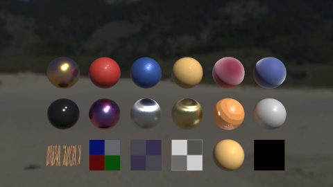
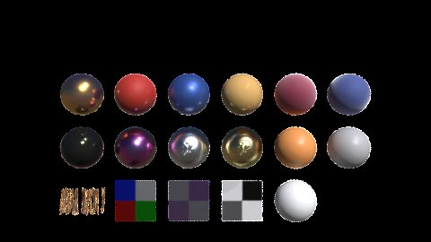
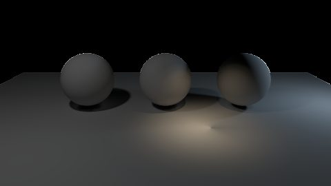
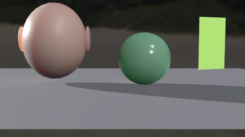
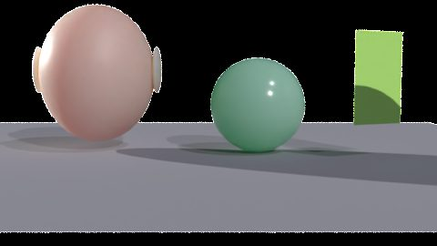

# Eldr and Karma

Karma is the reference look for Eldr: the same scene, lights and materials should give the same picture, only faster. Eldr reads Karma's settings where they mean the same thing, so a scene set up for Karma renders sensibly with Eldr without changes.

## Side by side

Each pair is husk rendering a showcase's `eldr_final` prim with Eldr and its `karma` prim with Karma CPU (256 samples, denoised): same camera, same size, both linear.

## How close it is

Measured on the test scenes against Karma 22.0.466 (linear EXRs):

| Area | Eldr against Karma |
|---|---|
| Direct light from sun, rect, disk and sphere lights | Within 0.5% on a ColorChecker |
| Highlights of sized lights | Within 5% |
| Light linking, IES profiles | Within 3% per region |
| Houdini's 121 basic and quick materials | Median 1.7 dE (barely visible) |
| Camera exposure | Within 0.1% |
| Caustics through a glass ball | 0.90-0.97 of Karma's focused patch |
| Time to converge | 10-25 s where Karma takes about 30 s (step4 and lights scenes, Karma at 32 samples) |

## Karma settings Eldr reads

You can keep using Karma's controls; Eldr's own `eldr:` setting wins when both are set.

| Karma control | Where | Eldr |
|---|---|---|
| Diffuse, Reflection, SSS, Volume and Light Sampling Quality | Karma Render Settings | The quality multipliers |
| Color Limit, Indirect Color Limit | Karma Render Settings | Colour limit and indirect clamp |
| Denoiser | Karma Render Settings | OIDN |
| Holdout Mode, Render Visibility, Motion Blur, Velocity Blur | Render Geometry Settings, Karma tab | Same meaning |
| Dicing Quality, Min/Max Depth | Render Geometry Settings, Karma tab | Same meaning |
| Volume Limit, Volume Velocity Blur Scale | Render Geometry Settings, Karma tab | Same meaning |
| Enable Caustics, Caustics Roughness Clamp | Render Geometry Settings, Karma tab | Caustic casters |
| LPE Tag, Render Light Geometry, Contributes to Caustics | Light LOP, Karma tab | Light groups, visible light shapes, caustic lights |
| Physical Lens | Camera's lens shader | Lens distortion |
| Sample Blending | Render Var, Karma tab | Per-AOV filters |

## Known differences

| Topic | Karma | Eldr |
|---|---|---|
| Bounce light | One diffuse bounce by default | Every bounce (GI): rooms come out brighter. Raise Karma's Diffuse Limit to match |
| Dome in the camera | Hidden unless Render Light Geometry is on | Shown unless it is authored off |
| `displayColor` | Read as sRGB | Linear, as USD defines: a 0.5 grey floor is brighter in Eldr |
| Light groups | Direct and indirect light | Direct light only |
| Subsurface | Random walk | Screen-space blur |
| Shadow AOV | Counts occluded indirect light too | Lights' and the dome's direct shadow only |
| Pyro Shader | Rendered | Not read (density only) |

The full comparison, with the numbers, is on the [Houdini page](../houdini.md#eldr-vs-karma-same-scenes-husk).
