# Lights

Eldr renders the standard USD lights (UsdLux) that Houdini's Light LOPs create: distant (sun), sphere, rect, disk, cylinder and dome lights, with spot cones and IES profiles. Brightness follows USD: colour times intensity times 2 to the power of exposure, so a light set up for Karma is as bright in Eldr.

> **Where in Houdini:** **Light LOP** (or the light tools on the Lights and Cameras shelf). Eldr reads the standard tabs (Base, Shaping, Shadow) and a few of Karma's light parameters (Render Light Geometry, LPE Tag, Contributes to Caustics).

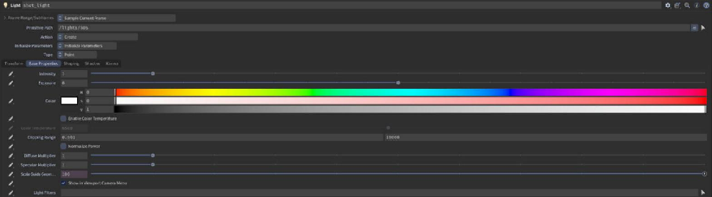

## Light types and shapes

Every light has a size, and the size shows in its highlights: a tube light gives a streak, a rect light a stretched box, a sphere a round spot. The highlights are energy conserving, within 5% of a brute-force reference and of Karma.

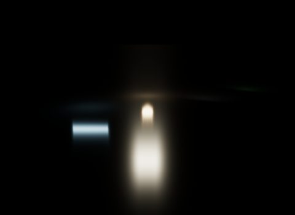
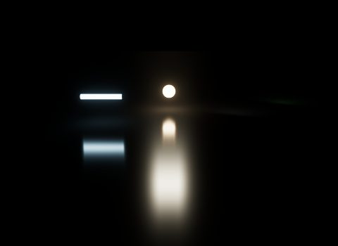

| Light | Notes |
|---|---|
| Distant (sun) | **Angle** gives soft shadows. The first shadow-casting sun gets the high-quality cascaded shadow maps. |
| Sphere | **Treat as Point** for a point light. With a cone (Shaping tab), a spot light. |
| Rect, disk | Light from one side (-Z). A texture on a rect or disk light colours it. |
| Cylinder | Lights from its side only. |
| Dome | An HDRI (lat-long). Lights diffuse and reflections; its sun can become a real shadowed light (below). |

**A light shows its shape to the camera** only when its **Render Light Geometry** is on, as in Karma; unauthored is hidden. **Light Shapes Visible** is the master switch (on by default); turn it off to hide every shape. The dome is drawn in the background unless its Render Light Geometry is off.

> **Showcase:** open `showcase/2026-10-30_07_light_shapes/scene.hip`, compare `eldr_default` vs `eldr_final` vs `karma`, then `shapes` vs `shapesVisible`.

> **Showcase:** open `showcase/2026-10-29_22_light_textures/scene.hip`, compare `eldr_default` vs `eldr_final` vs `karma`, then `lightTextures` vs `lightTexturesOff`.

## Many lights

Eldr sorts local lights into small screen-space clusters, so hundreds of lights cost little. Up to 63 lights can touch one cluster.

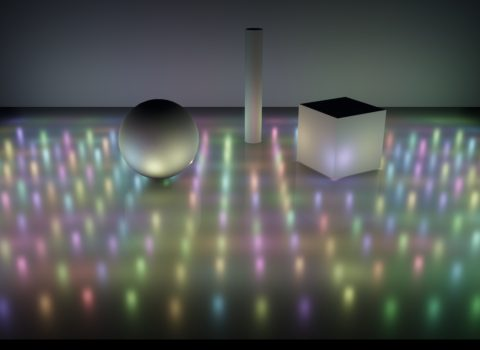

> **Showcase:** open `showcase/2026-10-30_06_many_lights/scene.hip`, compare `eldr_default` vs `eldr_final` vs `karma`, then `lights` vs `clustersOff`, `localLightsOff`.

## Dome lights and the HDRI sun

An HDRI's sun is a few very bright pixels. Eldr can take them out of the dome and turn them into a real distant light with sharp shadows (**Dome Sun Extraction**, on).

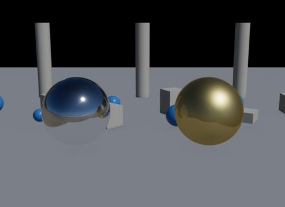
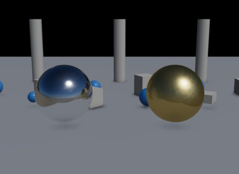

> **Showcase:** open `showcase/2026-10-30_08_dome_sun/scene.hip`, compare `eldr_default` vs `eldr_final` vs `karma`, then `domeSun` vs `domeSunOff`.

## Shadows

Eldr picks a shadow method per light. You can mix them.

| Method | Setting | Looks like | Cost |
|---|---|---|---|
| Shadow maps, soft (PCSS) | **Soft Shadows** (on) | Soft from the light's size, hardening near contact | Cheap |
| Shadow maps, hard | **Soft Shadows** off | Hard edges | Cheapest |
| Jittered maps (default) | **Jittered Light Shape per Sample** (on) | The film moves the map over the light's shape: exact penumbrae once converged | A map per sample |
| Ray-traced | **Ray-Traced Shadows** [RT] | Exact soft shadows, also from off-screen objects | Kitchen about 10 ms per sample |

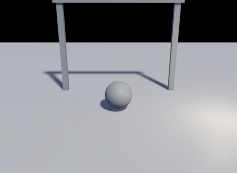

> **Tip:** **Ray-Traced Shadow Lights** says how many lights get traced shadows (4 by default; the final settings use 16). The rest keep maps.

A light's **Shadow > Enable** off makes it cast no shadows.

> **Showcase:** open `showcase/2026-10-30_10_shadow_modes/scene.hip`, compare `eldr_default` vs `eldr_final` vs `karma`, then `maps` (default) vs `pcss` vs `hard` vs `traced`.

> **Showcase:** open `showcase/2026-10-28_07_shadow_cull/scene.hip`, compare `eldr_default` vs `eldr_final` vs `karma`, then `cull05` (default) vs `cull8` vs `cullOff`.

## Emissive surfaces as lights

A small, bright emissive mesh (a light panel, a bulb) becomes a real light with shadows (**Emissive Surfaces as Lights**, on). Large or textured emitters light the scene through GI only.

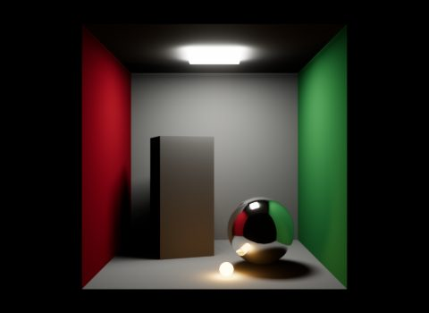
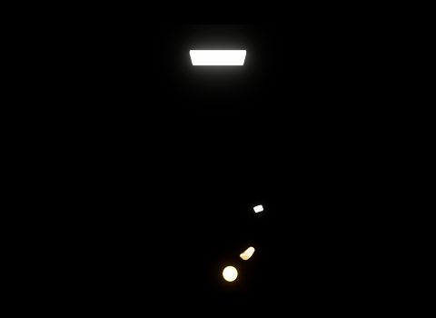

> **Showcase:** open `showcase/2026-10-28_03_emissive_lights/scene.hip`, compare `eldr_default` vs `eldr_final` vs `karma`, then `emissiveLightsOn` vs `emissiveLightsOff`.

## Light linking

Light linking limits what a light lights, and what casts its shadows. Eldr reads the USD collections Houdini's **Light Linker LOP** writes: `collection:lightLink` and `collection:shadowLink`.

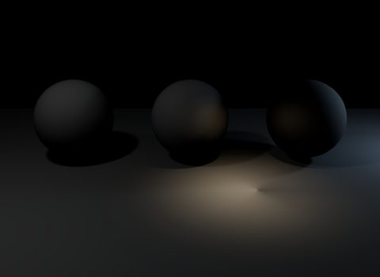
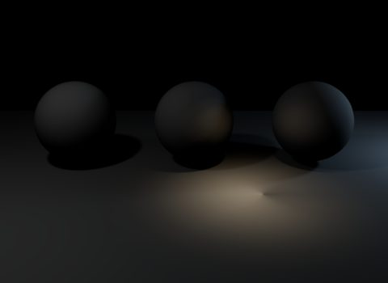

> **Where in Houdini:** **Light Linker LOP**: drag objects into a light's *Lights* or *Shadows* list.

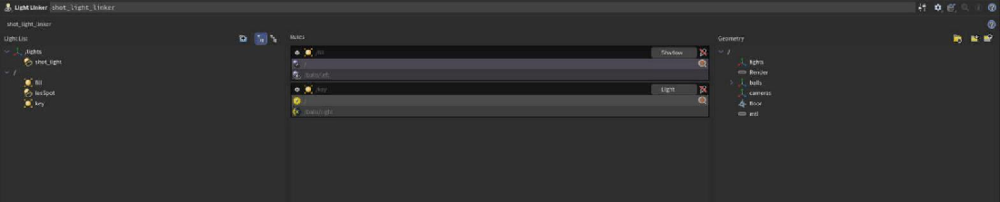

Limits: up to 32 linked collections; domes and fog ignore links.

> **Showcase:** open `showcase/2026-10-29_15_light_linking/scene.hip`, compare `eldr_default` vs `eldr_final` vs `karma`, then `default` vs `noLinking` (`eldr:lightLinking` off), `traced` (the same links with traced shadows).

## IES profiles

An IES file (LM-63) shapes a sphere, rect, disk or cylinder light the way a real fixture spreads its light. Set the file on the light's **Shaping** tab (`shaping:ies:file`); **Angle Scale** and **Normalize** work as in Karma.

The warm spot in the light-linking pictures above has an asymmetric IES profile: its pool leans left. Without the profile it is a plain sphere light:

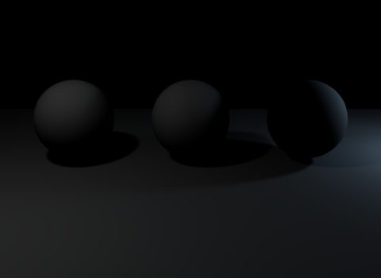

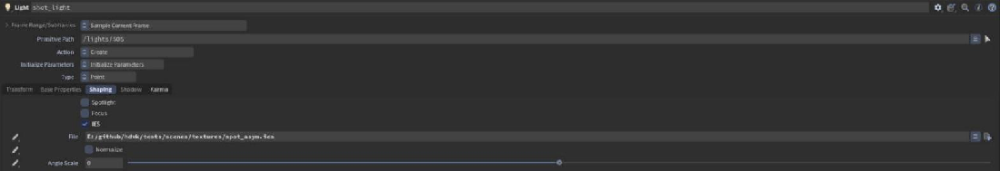

> **Showcase:** open `showcase/2026-10-29_24_ies_profiles/scene.hip`, compare `eldr_default` vs `eldr_final` vs `karma`, then `ies` vs `noIes`.

## Light groups

Give lights a tag in their **LPE Tag** parameter (Karma tab of the Light LOP) and Eldr writes each tag's light into its own AOV. See [AOVs and output](aovs.md#light-groups).

> **Showcase:** open `showcase/2026-10-29_06_karma_aovs/scene.hip`, compare `eldr_default` vs `eldr_final` vs `karma`, then `default` vs `noHoldouts` (`eldr:holdouts` off).

## Very bright lights: colour limit

Karma clamps every sample at its **Color Limit** (20) to fight fireflies; Eldr does the same, so an emitter of 40 seen by the camera shows as 20 in both. For full-HDR emitters in comp, set **Color Limit** to 0.

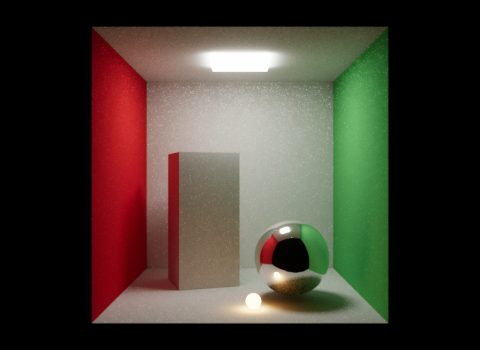
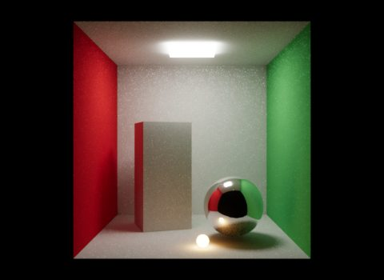

> **Warning:** With the colour limit off, also set **Indirect Light Clamp** to 20 so bounce light keeps its firefly clamp.

> **Showcase:** open `showcase/2026-10-29_17_colour_limit/scene.hip`, compare `eldr_default` vs `eldr_final` vs `karma`, then `limit20` (Karma's default) vs `fullHdr` vs `off`, `karmaName5` (Karma's `karma:global:colorlimit` 5).

## Limitations

- Dome portals, `poleAxis` and shadow colour are ignored.
- Domes and fog ignore light linking.
- IES types A and B are read as type C.
- More details on the [How Eldr works](../features.md#lighting-and-shadows) page.
