# Materials

Eldr renders the materials Houdini makes for Karma: MaterialX (standard_surface, OpenPBR, glTF PBR, Disney principled, unlit), Houdini's Material Library and Karma-context networks, and UsdPreviewSurface. You don't need special Eldr materials. Against Karma, Houdini's 121 basic and quick materials render with a median colour difference of 1.7 dE (barely visible).

> **Where in Houdini:** **Material Library LOP** with a **Karma Material Builder** or MaterialX nodes inside, then **Assign Material LOP**. The Material Palette's Karma materials work as they are.

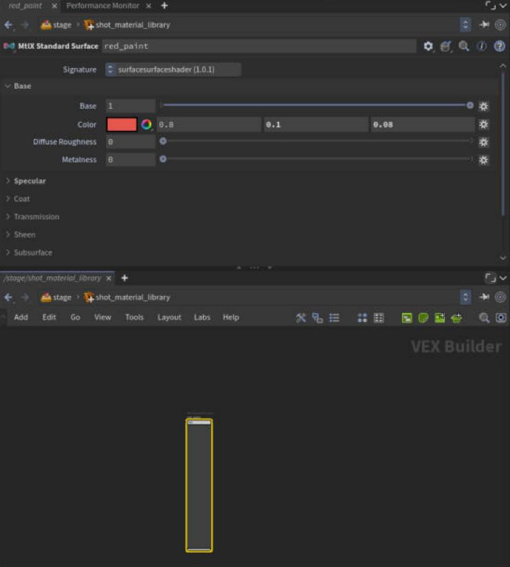

## What is supported

| Material | Support |
|---|---|
| MaterialX standard_surface | Every lobe: base, specular, metal, coat, sheen, thin film, anisotropy, transmission, subsurface, emission, opacity, normal maps, displacement |
| OpenPBR Surface | The same lobes under OpenPBR's names (fuzz, coat, thin film, transmission, subsurface) |
| UsdPreviewSurface | Metallic and specular workflows, clearcoat, ior, opacity and cutouts, displacement, normal maps |
| glTF PBR, Disney principled, surface_unlit | Their lobes mapped to the ones above |
| Karma's own nodes | Karma Ramp Const, Hex-Tiled Texture, Voronoi Noise 3D, Camera Falloff |
| Node graphs | Compiled whole on the GPU: maths, mixes, ramps, noises, textures, compositing, conditionals (**MaterialX Graphs**, on) |
| Volumes | MaterialX `volume` and Karma's `kma_volume`: see [Volumes](volumes.md) |

The [MaterialX coverage page](../materialx.md) has the measured node list.

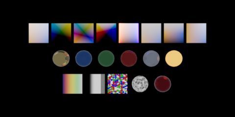
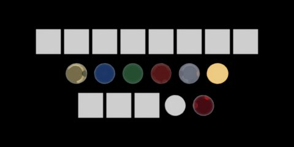

> **Tip:** If a node isn't supported, Eldr bypasses it (as MaterialX does) and counts it. The count shows as an orange **material fallback** warning in Houdini's render stats and in usdview's **Eldr > Render Statistics**.

## Material lobes

Each lobe has its own switch on the Eldr tab (**Advanced > Materials**), so you can see what it adds. Plain materials don't pay for lobes they don't use.

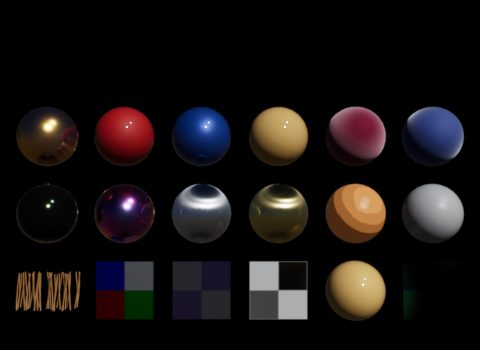
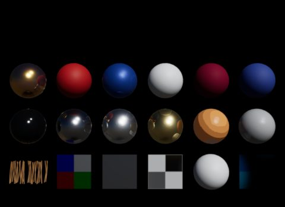

There is also a toon mode, for stylised looks: **Toon Bands** (or `inputs:eldr:toonBands` on one material).

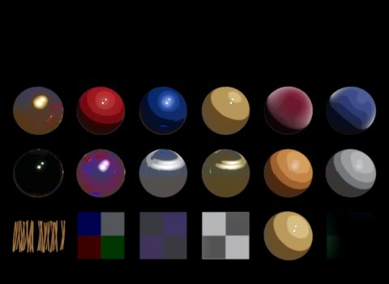

## Subsurface scattering

Skin, wax, jade and leaves: light spreads under the surface and shines through thin parts. Eldr blurs the diffuse light in screen space, per colour channel (red goes furthest). **Subsurface Quality** (or Karma's SSS Quality) adds taps for a smoother blur.

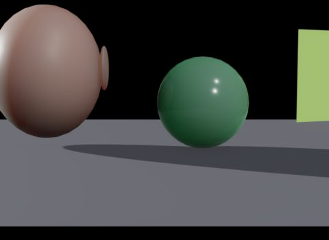
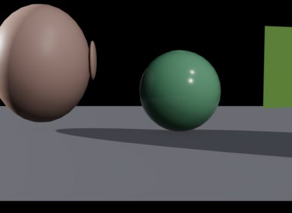

## Displacement

UsdPreviewSurface and MaterialX displacement move the vertices, so shadows, depth and ray tracing all see the new shape. It works best on subdivision surfaces (see [Crowds and performance](performance.md#subdivision-and-dicing)).

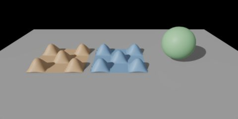
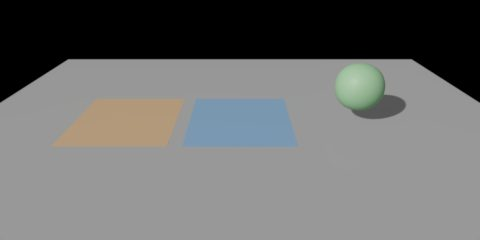

> **Tip:** If a displacement graph outputs more than -1 to 1, set `inputs:eldr:displacementBound` on the shader to its largest offset, so the object isn't culled too early.

## Textures and colour spaces

Textures read through UsdUVTexture or MaterialX `image` and `tiledimage`, with UDIMs (`<UDIM>`), wrap modes and several uv sets. Colour-space tags (ACEScg, sRGB, Rec.2020, P3, ...) convert to Eldr's linear Rec.709. **Texture Anisotropic Filtering** (16) keeps far textures sharp.

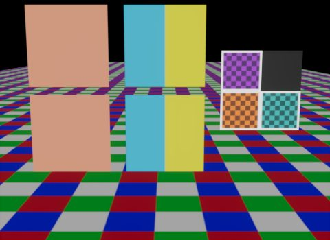

**Texture Compression** (off) packs 8-bit textures into BC7 to save GPU memory on big scenes; Karma never compresses, so it stays off by default.

## Transparency and glass

- **Cutouts** (opacity with a threshold, leaves, fences) are alpha tested in every pass, shadows too.
- **Translucent** surfaces (opacity below 1) blend in depth order.
- **Glass** (transmission or `ior`) refracts the scene behind it. By default this is screen space; **Ray-Traced Refraction** follows rays through the glass. See [Ray-traced effects](ray-tracing.md#refraction-and-glass).
- **Holdouts** (Karma's Holdout Mode on Render Geometry Settings) render black with zero alpha but keep shadows: see [AOVs and output](aovs.md#holdouts-and-shadow-mattes).

## Limitations

- Pure BSDF graphs (a `surface` made of pbrlib BSDF nodes) render grey with a warning.
- Coat has no own normal map or anisotropy.
- Subsurface is a blur, not a random walk: it can't show light deep inside thick objects.
- Karma's Pyro Shader isn't read (volumes render with their density only).
- More on the [How Eldr works](../features.md#materials) page.
