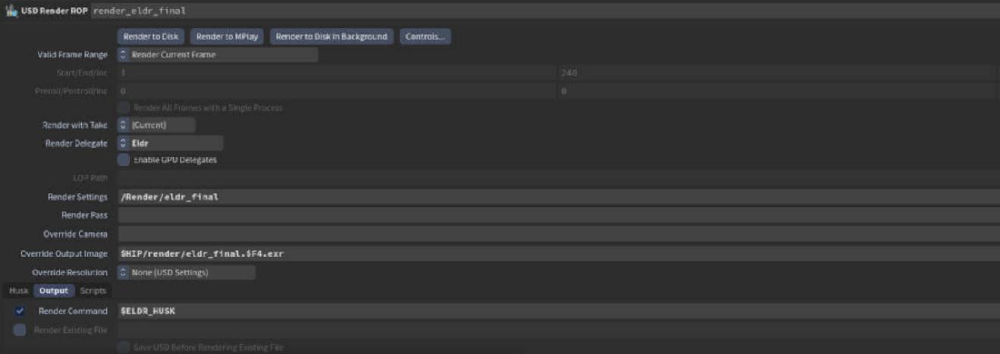
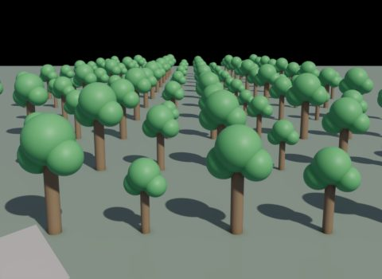
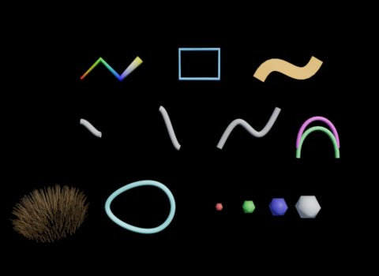
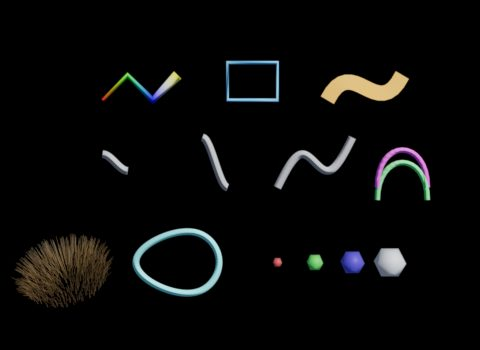

# Crowds and performance

Eldr is GPU-driven: culling, levels of detail and skinning run on the GPU, and identical meshes share memory. A 20,000-agent crowd renders a viewport frame in about 21 ms. This chapter covers big scenes: crowds, instancing, subdivision and memory.

## Crowds: deferred skinning

Houdini writes a crowd as one animated Xform per agent above an instanceable skeleton. By default USD gives every agent its own copy of the mesh. With **deferred skinning**, every agent stays an instance of one mesh, skinned on the GPU per instance:

| crowd_9k, 480x270 | Without | With deferred skinning |
|---|---|---|
| Peak memory | 7.5 GB | 2.4 GB |
| First frame | 81 s | 55 s |
| Each further frame | 23 s | 13 s |

Deferred skinning is USD's switch `HD_ENABLE_DEFERRED_SKINNING=1`, read once when the program starts. Eldr's package gives you a husk wrapper that sets it:

1. On the **USD Render ROP**, set **Render Command** to `$ELDR_HUSK`.
2. Render to disk as usual.

> **Warning:** Don't set `HD_ENABLE_DEFERRED_SKINNING` for a whole Houdini session that also renders with Karma: Karma renders the agents wrongly with it. The `$ELDR_HUSK` wrapper sets it for Eldr's render jobs only.

## Instancing

Point instancers (nested too) and native USD instances render as one draw per prototype. **Small Object Culling** skips instances smaller than a few pixels on screen (0.5 by default).

**Shadow Small Object Culling** does the same in the sun's shadow maps.

> **Showcase:** open `showcase/2026-10-30_20_instancing/scene.hip`, compare `eldr_default` vs `eldr_final` vs `karma`, then `instances` vs `cullSmall`.

## Levels of detail

Meshes of 1000+ triangles get up to three simpler versions, and Eldr draws the coarsest one that still looks the same (under about a pixel of error). On the 9,000-agent crowd this cuts 54.5M triangles to 13.6M. **Level of Detail Bias** -1 keeps more detail; **Levels of Detail** off always draws the full mesh.

## Subdivision and dicing

Subdivision surfaces (`subdivisionScheme` catmullClark, loop or bilinear) are refined with OpenSubdiv.

- **Dicing by Screen Size** (on): each mesh gets the level its size on screen needs, as Karma's dicing quality (**Dicing Quality** per object, 0.5).
- **Subdivision Max Level** (3) caps it everywhere.
- **Subdivision Level** on the Render Geometry Settings LOP's Eldr tab fixes one mesh's level.
- **Render as Subdivision** on the same tab subdivides a polygon mesh without editing it.

> **Where in Houdini:** SOP Import LOP > **Treat Polygons as Subdivision Surfaces** makes a mesh a subdivision surface. Render Geometry Settings LOP > **Eldr** tab > **Subdivision and dicing** sets its level.

> **Showcase:** open `showcase/2026-10-28_01_subdivision_levels/scene.hip`, compare `eldr_default` vs `eldr_final` vs `karma`, then `level3` vs `level1` (`eldr:maxRefineLevel`), `subdivOff` (`eldr:subdivision` off).

> **Showcase:** open `showcase/2026-10-29_04_screen_dicing/scene.hip`, compare `eldr_default` vs `eldr_final` vs `karma`, then `dicing` vs `fixed`.

## Curves and points

Hair and fur (BasisCurves) render as 6-sided tubes with hair shading; **Curves as Camera-Facing Ribbons** draws flat strips instead (2 triangles a step instead of 12). Points render as small spheres, or discs with **Points as Camera-Facing Discs**. Per object: **Render Curves As** and **Render Points As** on the Render Geometry Settings LOP.

> **Showcase:** open `showcase/2026-10-30_19_curves_points/scene.hip`, compare `eldr_default` vs `eldr_final` vs `karma`, then `curves` vs `ribbons`, `sprites`, `hairOff`.

> **Showcase:** open `showcase/2026-10-28_10_curve_styles/scene.hip`, compare `eldr_default` vs `eldr_final` vs `karma`, then `styles` (the per-object values) vs `ribbons` (`eldr:curveRibbons`: every curve without its own style becomes a ribbon); `eldr_default` vs `karma` (Karma reads only the karma names).

## Memory

- Identical meshes (a crowd's agents) share one copy of their data on the GPU.
- Mesh arrays are freed on the CPU once uploaded.
- **Texture Compression** cuts 8-bit texture memory to a quarter (off by default, as Karma never compresses).
- The render stats (Houdini's stats panel, usdview's **Eldr > Render Statistics**) show GPU memory by kind: textures, vertices, volumes, ray-tracing structures.

## Start-up time

The first render with a new combination of features compiles GPU programs (pipelines): seconds, sometimes tens of seconds on a cold start. Eldr keeps them in a cache file (**Pipeline Cache on Disk**, in `%LOCALAPPDATA%\Eldr`), so the next start takes about 2 s. The file is keyed by Eldr's shaders: a build with new shaders starts a fresh cache, other builds keep it.

## First image

From launch to the written EXR, husk (and **Render to MPlay**, which runs husk) goes through these steps. crowd_9k at 2048x1080, default settings, 64 film samples, GTX 1080 Ti, warm cache:

| Step | Time | Whose |
|---|---|---|
| husk starts, loads its plugins | 2.1 s | husk |
| Stage load, Eldr's GPU device | 1.2 s | USD, Eldr (0.3 s) |
| Hydra fills the scene, Eldr syncs the prims | 5.4 s | mostly USD (UsdSkel's crowd poses) |
| Upload to the GPU | 0.3 s | Eldr |
| Up to the first sample: levels of detail, pipelines | 0.5 s | Eldr |
| 64 film samples | 9.0 s | Eldr (the scene's shading and lights) |
| EXR write, exit | 0.7 s | husk |

What Eldr does to start sooner:

- A dome's texture decodes on another thread while the meshes sync.
- Meshes upload on all cores.
- An offline render waits for its levels of detail before the first sample, so no samples are thrown away when they arrive.
- Without subdivision surfaces, the first frame renders straight away; with them, husk syncs once more for **Dicing by Screen Size**.
- The first frame compiles the pipelines the later frames use, so a cold start compiles them once.

**Offline Samples per Execute** (1 s) sets how often husk gets an image back: each update costs about 0.1 s, so a larger value finishes a long render a little sooner and updates MPlay less often.

`HDVK_TIMING=2` prints a timeline on the console (`HdVk mark:` lines, the first commits' parts, each update's GPU passes) and writes the frame timing CSV ([Houdini](../houdini.md)).

## Where the time goes

| Expensive | Typical cost per sample, 1280x720 on a GTX 1080 Ti |
|---|---|
| Ray-traced reflections | Kitchen about 15 ms |
| Ray-traced shadows | Kitchen about 10 ms |
| GI probes | 2-3 ms |
| Volumes | 7-22 ms for a large cloud |
| Caustics | about 7 ms with 65536 photons (at 960x540) |

For a seconds-per-frame render they matter little: turn on what the shot needs.
