# Ray-traced effects

Eldr is a rasterizer at heart: it draws triangles, then shades them with tricks that use what is on screen. On a GPU with Vulkan ray tracing it can also trace rays, which see off-screen objects and give exact shadows, reflections, glass and bounce light. Ray-traced effects are **off by default** (they cost more) and on in the final settings.

> **Where in Houdini:** Render Settings LOP > **Eldr** tab > **Ray Tracing** (shadows, reflections, refraction, final gather, caustics), **Global Illumination** (GI probes) and **Advanced: Ray Tracing**. Settings marked [RT] in the [reference](../settings.md) need ray tracing.

> **Note:** On GPUs without ray-tracing cores (a GTX 1080 Ti, say), Vulkan runs ray tracing in a slower compute fallback. Everything works; finals just take longer.

## Which effect for what

| You see | Turn on | Cost |
|---|---|---|
| Rooms too dark in the corners, no colour bleeding | **Global Illumination**, then **Final Gather** | Medium |
| Soft shadows from big lights, contact shadows | **Ray-Traced Shadows** | Medium |
| Reflections missing what is off screen | **Ray-Traced Reflections** | High |
| Glass that looks flat, or wrong behind other glass | **Ray-Traced Refraction** | Medium |
| Light focused by glass onto a floor | **Caustics** (and mark the glass as a caster) | High |

## Global illumination and final gather

Bounced light: a red wall tints the floor next to it, a sunlit room fills its shadows.

- **Global Illumination** places a grid of light probes in the scene that trace rays and keep the bounced light. Smooth, cheap once settled, but soft: corners don't darken much.
- **Final Gather** (with GI) traces a ray per pixel and sample, shaded at its hit. It gives contact shadows in corners and exact colour bleeding. Denoised while the film is young (**Final Gather Denoise**).
- **Screen-Space GI** works without ray tracing, from what is on screen: near-field bounce, replaces ambient occlusion.

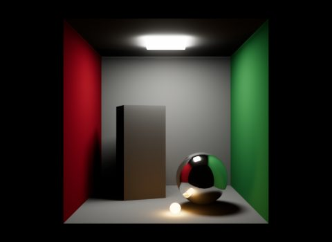
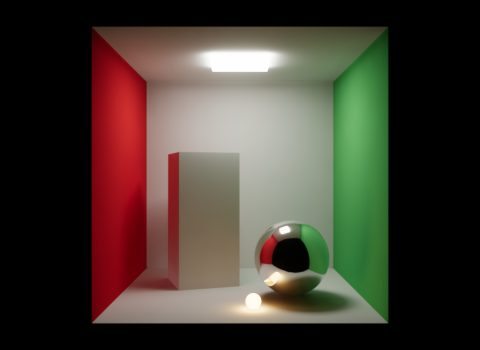
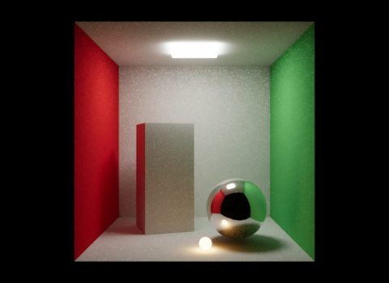
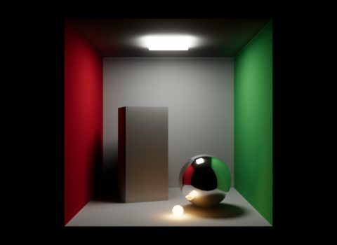

> **Tip:** For interiors, turn on GI and Final Gather together. For exteriors under a dome, GI alone is often enough.

## Ambient occlusion

Without GI, **Ambient Occlusion (GTAO)** darkens the dome's light in corners and gaps. **Ambient Occlusion Radius** sets how far it reaches. SSGI and the final gather replace it.

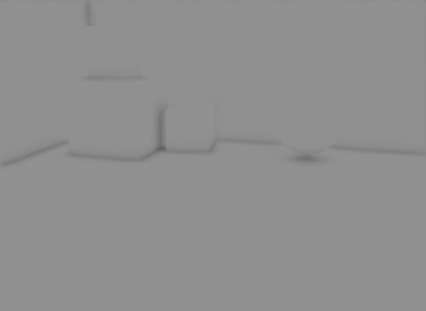

## Ray-traced shadows

**Ray-Traced Shadows** replaces shadow maps for the sun and the brightest lights (**Ray-Traced Shadow Lights**, 4; finals use 16). Shadows are exact and soft from the light's size, also from objects off screen. See [Lights](lights.md#shadows) for all shadow methods.

**Ray-Traced Shadows through Glass and Volumes** lets shadow rays pick up colour from glass and smoke.

## Reflections

Eldr picks the best reflection for each pixel:

| Source | Setting | Good at | Misses |
|---|---|---|---|
| Screen-space (SSR) | **Screen-Space Reflections** (on) | Polished floors, cheap | What is off screen or hidden |
| Reflection probe | **Reflection Probe** | The room around a chrome object | Exact positions |
| Planar mirrors | **Planar Reflections** | Flat mirrors and water | Curved surfaces |
| Ray-traced | **Ray-Traced Reflections** [RT] | Everything, up to roughness 0.7 | Cost |

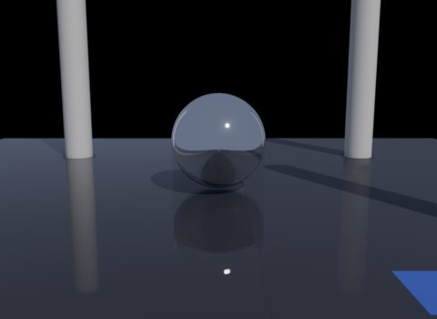
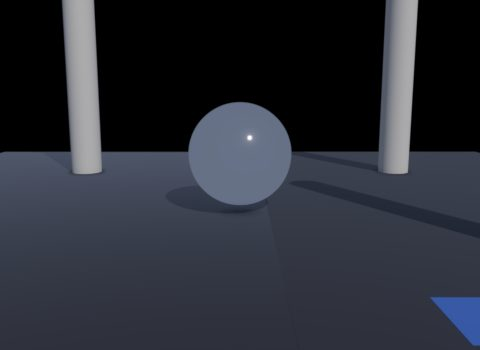

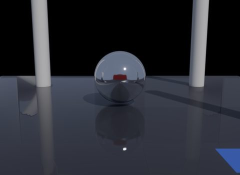
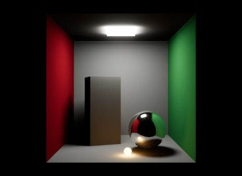

**Ray-Traced Hit Shadows** shadows what a traced reflection sees (the floor in a chrome ball is shadowed too).

## Refraction and glass

Glass bends what is behind it. By default Eldr refracts a copy of the screen (**Refraction**, on): fast, and good for single panes. **Ray-Traced Refraction** follows the ray through the glass, through several surfaces (**Ray-Traced Refraction Interfaces**), with total internal reflection, absorption and rough glass.

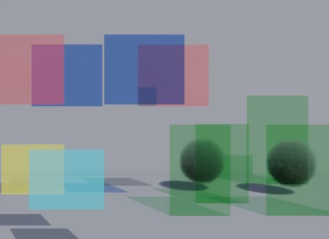
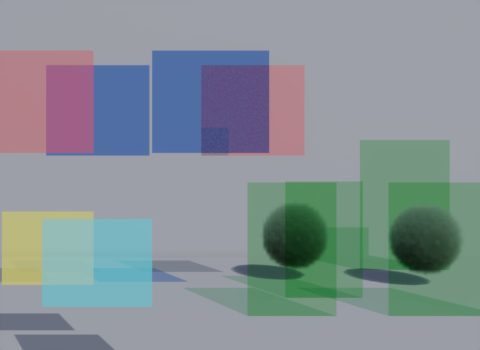

- **Refraction Layers** sets how many layers of glass behind glass the screen-space path handles.
- **Translucent Shadows**: glass casts faint, tinted shadows.

## Caustics

Caustics are the bright patterns light makes after passing through glass or bouncing off metal: the spot under a glass ball, a pool floor's ripples. Eldr shoots photons from the lights through *caster* objects.

1. Turn on **Caustics** on the Eldr tab.
2. Mark the glass objects as casters: Render Geometry Settings LOP > Karma tab > **Enable Caustics** (`karma:object:causticsenable`), or Eldr's tab.
3. Render with enough samples: the patch gets sharper every sample.

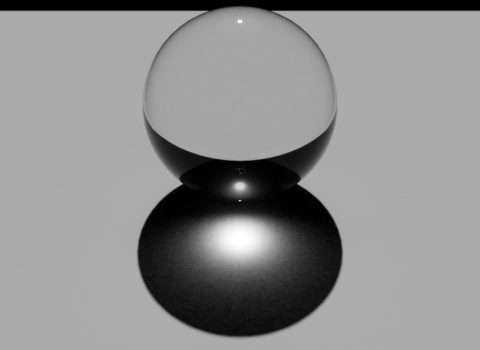
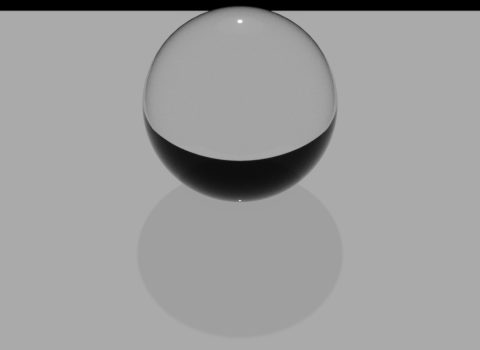

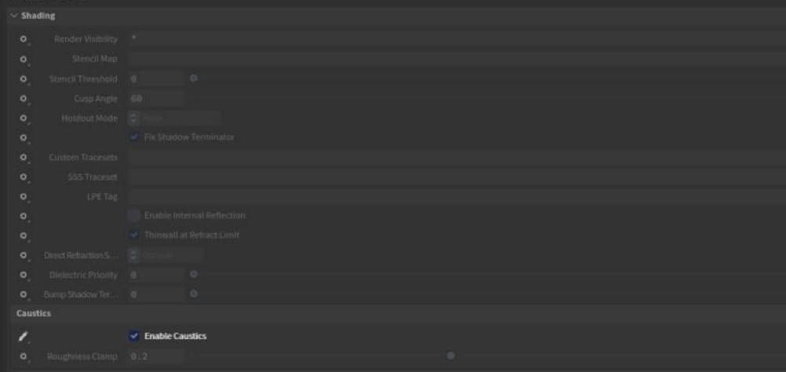

> **Note:** Without caster objects, Caustics costs nothing: there is nothing to trace.

## Limitations

- Ray tracing needs a Vulkan ray-tracing GPU; without one, [RT] settings are ignored.
- Translucent meshes don't block traced rays (they tint shadows and refraction only).
- Skinned instances in ray tracing are capped (**Ray-Traced Skinned Instances**).
- More on the [How Eldr works](../features.md#reflections) page.
