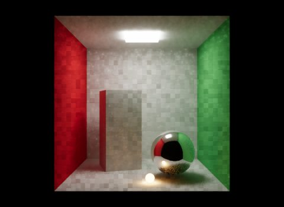
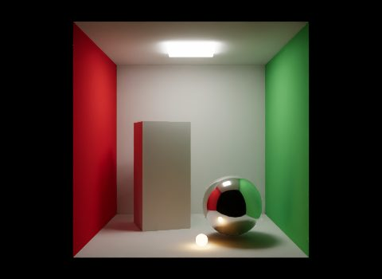
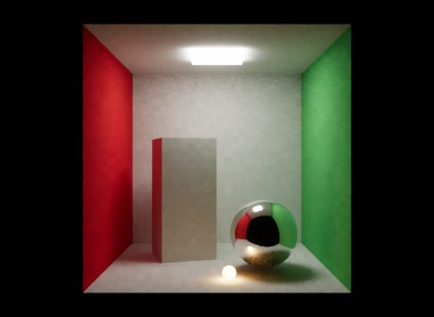

# Sampling and denoising

Eldr builds a still image from many *samples*: each sample renders the whole frame with the camera, lights and rays moved a tiny bit. The *film* averages them. Noise (from soft shadows, depth of field, GI rays) fades as samples add up; when the film has **Film Samples** samples, the image is done (*converged*).

> **Where in Houdini:** Render Settings LOP > **Eldr** tab > **Sampling** (the film and denoising) and **Advanced: Sampling** (adaptive sampling, clamps).

## Film samples

| Film Samples | Good for |
|---|---|
| 16-32 | Quick previews, with the denoiser |
| 64 (default) | Viewport and drafts |
| 256-512 | Finals with ray-traced effects, depth of field or motion blur |

Time grows with the samples: 256 samples take about four times as long as 64.

- **Film Restarts at Once** (off): every change starts a fresh film from sample 1. Off, the viewport shows a fast interactive image while you work and starts the film once things are still for a moment. The final settings turn it on.
- **Film Pixel Filter Radius** (1.5 pixels): the Gaussian that turns samples into pixels. Smaller is sharper but may alias.

## Effect denoising

Ray-traced shadows, reflections and the final gather are noisy for the first samples. Eldr filters each of them on its own, and fades the filter out over the first 64 samples (**Effect Denoise Fade**), so the converged image keeps all its detail.

> **Tip:** If shadows look slightly blurry in a short render, it is the effect filter: render more samples than Effect Denoise Fade.

## OIDN, the final denoiser

**Denoise** (OIDN) runs Intel Open Image Denoise once on the converged image, on the CPU, guided by the albedo and normals. 16 denoised samples beat 64 raw ones. It takes about 1.3 s at 1080p.

- Karma's denoiser settings turn it on too (`karma:hydra:denoise`, or a `denoise` entry in Karma's image filters, as Karma's Render Settings LOP writes it).
- The undenoised image is the `eldr:beautyRaw` AOV, if you want both in the EXR.
- Light AOVs (diffuse, glossy, light groups) stay raw, so they still sum to the raw beauty.

> **Warning:** OIDN can smear very fine detail (hair, small text). Compare with the raw AOV on such shots.

## Adaptive sampling

With **Adaptive Sampling Noise Threshold** above 0 (0.01 is a good start), pixels that are clean stop sampling, and the film converges when 99.9% of pixels stopped (**Adaptive Sampling Converged Pixel Fraction**). 16x16 tiles whose pixels all stopped skip shading and rays (**Adaptive Sampling Skips Stopped Tiles**): Kitchen at 1080p went from 17.4 to 12.8 s with the same image.

Adaptive sampling doesn't run with motion blur time samples: those frames take all their samples.

## Quality multipliers

More film samples clean everything at once. The **quality** settings add rays only to the part that is noisy, as Karma's do:

| Setting | Karma's name | More rays for |
|---|---|---|
| Diffuse Quality | Diffuse Quality | Final gather, GI probes, AO and SSGI |
| Reflection Quality | Reflection Quality | Ray-traced reflections |
| Light Quality | Light Sampling Quality | Ray-traced shadows |
| Subsurface Quality | SSS Quality | Subsurface blur |
| Volume Quality | Volume Quality | Volume shadow steps |

Values below 1 trace every other sample (0.5), values like 1.5 alternate 1 and 2 rays: the converged image is the same, only the noise changes. If you set them on Karma's Render Settings LOP, Eldr reads them there; Eldr's own setting wins.

## Fireflies

Very bright, small light paths make single bright pixels. **Indirect Light Clamp** (Karma's indirect colour limit, 20) limits bounce light; **Direct Light Clamp** (off) limits direct light. See [Lights](lights.md#very-bright-lights-colour-limit).

## Viewport sampling

While the camera or scene moves, Eldr uses a temporal (TAA) image instead of the film: one sample per frame, blended with the frames before. Once still, the film starts. See [Viewport](viewport.md).
