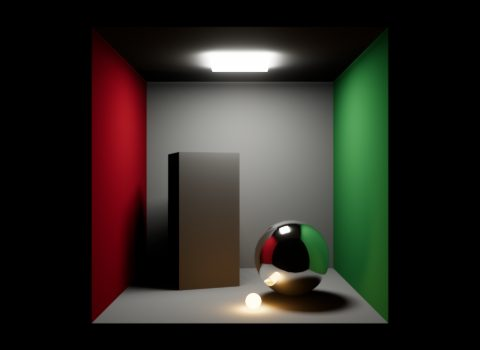
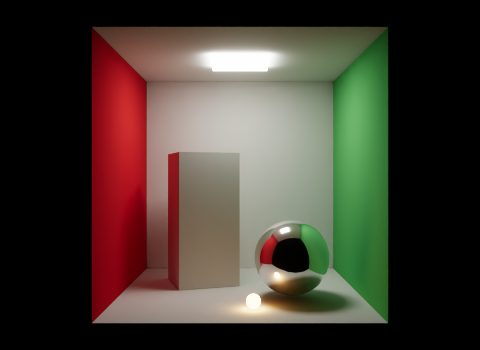
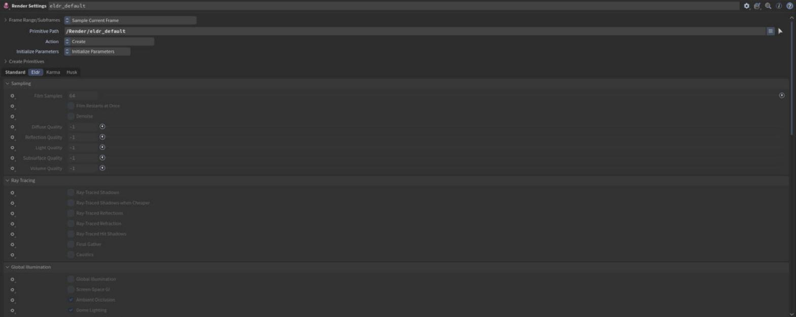
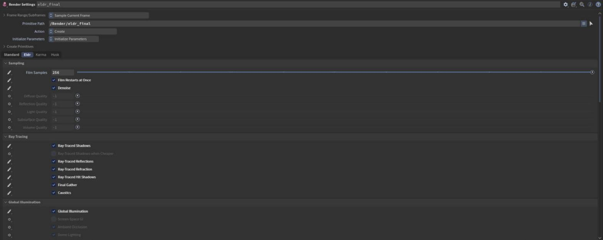
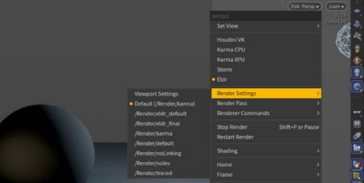
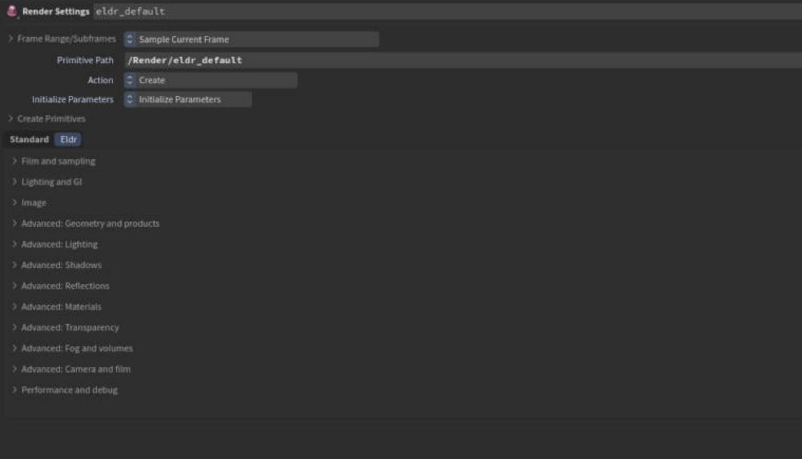
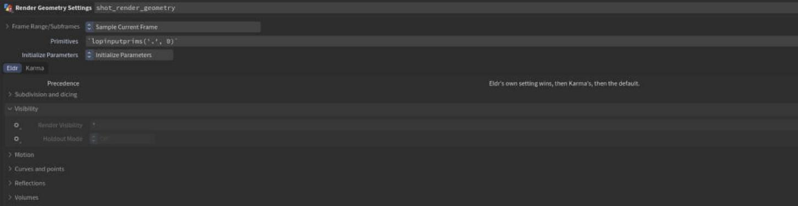
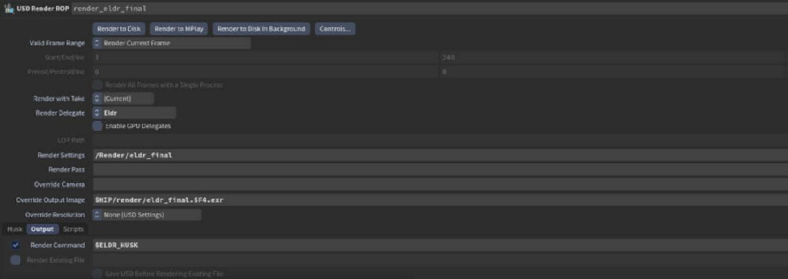

# Rendering in Solaris

In Solaris, everything about a render (camera, resolution, quality) lives on a **Render Settings LOP**. Eldr adds its own tab there. This chapter walks through that tab and the usual draft-to-final workflow.

## Draft and final: two render settings nodes

Eldr has **no quality modes** and no "final quality" button. The viewport, husk and usdrecord all render with the same settings; offline renders are only faster to finish, never different. How good a render is depends on what you tick.

The usual setup is two Render Settings LOPs:

| Node | What you set | Use it for |
|---|---|---|
| Draft (`eldr_default`) | Nothing, or only the camera and resolution | Look development, layout, fast previews |
| Final (`eldr_final`) | The expensive settings ticked one by one | The frames you deliver |

The final node of every showcase ticks these settings. Copy them as a start:

| Setting (label on the Eldr tab) | Value |
|---|---|
| Film Restarts at Once | on |
| Film Samples | 256 (or more) |
| Denoise | on |
| Global Illumination | on |
| Final Gather | on |
| Ray-Traced Shadows | on |
| Ray-Traced Shadow Rays per Light | 1 |
| Ray-Traced Shadow Lights | 16 |
| Ray-Traced Reflections, Ray-Traced Refraction, Ray-Traced Hit Shadows | on |
| Caustics | on (only does anything with caustic casters) |

In USD the same list is `tests/scenes/final_settings.usda`'s `/Render/final`: reference it, or author the `eldr:` attributes on your own settings prim.

> **Where in Houdini:** Render Settings LOP > **Eldr** tab. Each parameter has Karma's menu next to it: **Do Nothing**, **Set or Create**, **Block**. Only parameters set to *Set or Create* go into the prim.

A final node is the same Render Settings LOP with the effects ticked one by one, here the showcase scenes' `eldr_final`:

### See the final in the viewport

The viewport uses its own settings until you look through a render settings prim. Choose the final node's prim in the viewport's **camera / render settings menu** (top right of the viewport). Eldr then reads that prim's `eldr:` settings, while staying an interactive viewport (resolution and products of the prim don't apply).

> **Tip:** The final settings make every still frame slower to converge. Switch back to the draft prim while you work.

## The Eldr tab, group by group

The tab follows the [settings reference](../settings.md), in the same order. The groups you use most are open; the rest are folded under **Advanced**.

### Sampling

How many samples a still frame takes and how clean they are. **Film Samples** is the main quality knob: 64 by default, 256 or more for finals. **Denoise** cleans the converged image. The **Quality** multipliers add rays only where the noise is (see [Sampling and denoising](sampling.md)).

### Ray Tracing

The ray-traced effects, off by default: **Ray-Traced Shadows**, **Reflections**, **Refraction** and **Hit Shadows**, **Final Gather** and **Caustics**. They also run on GPUs without ray-tracing cores (slower). See [Ray-traced effects](ray-tracing.md).

### Global Illumination

Bounced light (**Global Illumination**, **Screen-Space GI**), ambient occlusion, the dome light and its extracted sun. See [Lights](lights.md).

### Camera

What the camera does to the image: **Motion Blur**, **Depth of Field** and **Camera Exposure** (the USD camera's exposure attributes). See [Cameras](cameras.md).

### Image

What the beauty looks like: **Exposure Compensation** and **Linear Beauty** (on: linear colour like Karma's, for comp; off: Eldr's own tonemapper, bloom and auto exposure). See [Cameras](cameras.md).

### Volumes and Fog

**Volumetric Fog**, OpenVDB **Volumes** and whether they scatter light more than once. See [Volumes and fog](volumes.md).

### Viewport

How the interactive viewport behaves. **Film when Still** off keeps TAA instead of switching to the film once the camera stops; **TAA Samples** is how many frames TAA averages. The rest trade sharpness for speed while you tumble (render scale, fewer shadow rays, paused GI probes).

### Advanced

The fine controls of the same topics (sampling, ray tracing, global illumination, lights, shadows, reflections, materials, geometry, volumes and fog, camera and film). You rarely need them; each one is in the [settings reference](../settings.md) with its default and cost.

### AOVs and Products

Extra AOVs, Cryptomatte, per-AOV filters and writing the render products.

### Performance and Debug

Pipeline cache, prewarm, culling and readback. Leave them at their defaults unless you are chasing a speed problem.

## Per-object settings

Settings for one object (subdivision, visibility, motion blur, curve style, volume limit) are primvars, set with a **Render Geometry Settings LOP**. Eldr adds its own tab there; Karma's tab works too. When both set something, Eldr's wins.

> **Where in Houdini:** Render Geometry Settings LOP > **Eldr** tab: Subdivision and dicing, Visibility, Motion, Curves and points, Reflections, Volumes. The full list is on the [Houdini page](../houdini.md#render-geometry-settings).

## Render to disk with the USD Render ROP

1. Add a **USD Render ROP** (in a LOP network: **USD Render ROP** LOP; in /out: **USD Render**).
2. Set **Render Settings** to your final node's prim, and **Renderer** to Eldr if it is asked for.
3. For crowds, set **Render Command** to `$ELDR_HUSK` (see [Crowds and performance](performance.md)).
4. Click **Render to Disk**. husk renders each frame until it converged and writes the EXR.

AOVs come from **Render Var** and **Render Product** LOPs, or from the AOV toggles on Karma's Render Settings LOP: see [AOVs and output](aovs.md).
