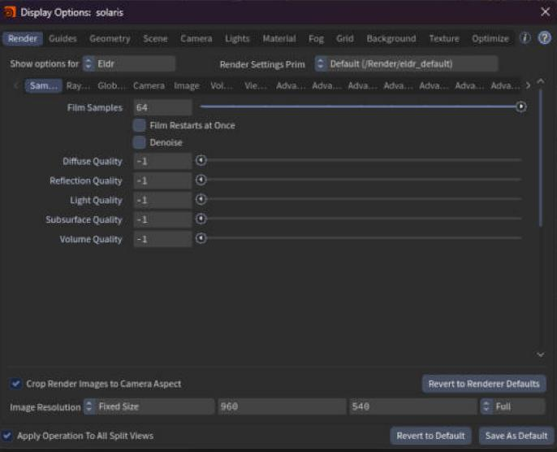
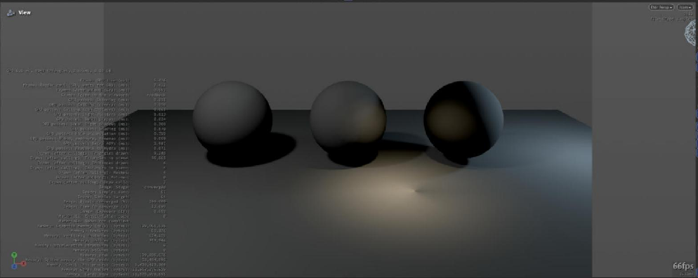

# Viewport

In the Solaris viewport Eldr has two states: **moving** (you tumble the camera or scrub the timeline) and **still** (the film converges). Moving is built for speed, still for the final look.

## While the camera moves

- The image renders at half size (**Render Scale while Moving**, 0.5) and a temporal filter (TAA) rebuilds full resolution from the frames before.
- Traced shadows take one ray per light (**Ray-Traced Shadow Rays while Moving**).
- Settled GI probes pause (**Pause Settled GI Probes while the Camera Moves**).
- Eldr returns a frame while the next one renders (**Overlap Readback while Moving**): smoother tumbling, one frame of lag.

The first still frame is full quality again, and the film starts.

| Kitchen, 1080p, camera moving | Full settings | Moving mode |
|---|---|---|
| Frame time | 21.6 ms | 8.6 ms |

> **Tip:** With heavy final settings in the viewport, moving stays fast; only the still frames take long. Choose the draft render settings prim while you lay out a shot.

> **Showcase:** open `showcase/2026-10-30_01_moving_camera/scene.hip`, compare `eldr_default` vs `eldr_final` vs `karma`, then `moving` (the defaults) vs `full`.

## Choosing what the viewport renders

> **Where in Houdini:** The viewport's **Display Options** (press D over the viewport) have an **Eldr** section for per-viewport settings. The camera menu at the top right picks a render settings prim; its Eldr tab then applies to the viewport.

## Looking at AOVs

The viewport's **Render Outputs** menu lists the render vars of the chosen Render Settings LOP. Pick one to see it: light groups, splits and data AOVs fill as in husk.

> **Note:** The viewport's channel buttons (RGB, R, G, B, A, L) don't affect Eldr's view as far as we know. Use Render Outputs to view one AOV.

> **Showcase:** open `showcase/2026-10-28_05_houdini_render_vars/scene.hip`, compare `eldr_default` vs `eldr_final` vs `karma`, then `default` (writes `renderVars.exr`) vs `viewport` (`houdini:viewport` flag).

## Render statistics

Turn on the viewport's **Show/Hide Render Stats** toolbar button for a line with the stage ("Accumulating 24%"), the samples done and GPU time. The full stats panel (Eldr's own layout) shows memory and time per pass.

> **Showcase:** open `showcase/2026-10-28_08_render_stats/scene.hip`, compare `eldr_default` vs `eldr_final` vs `karma`, then `default` only (no A/B: the feature is metadata).

## Colour in the viewport

The viewport shows linear scene colour, the same values as the EXR, under Houdini's own colour view (OCIO). Eldr adds no tonemap of its own there (**Linear Beauty**, on). If the image looks flat or too bright, check Houdini's view transform, not Eldr.

## Limitations

- The viewport's channel buttons don't apply to Eldr.
- Houdini's guides (light and camera gizmos) can lag one frame behind the image while tumbling with overlap readback on.
