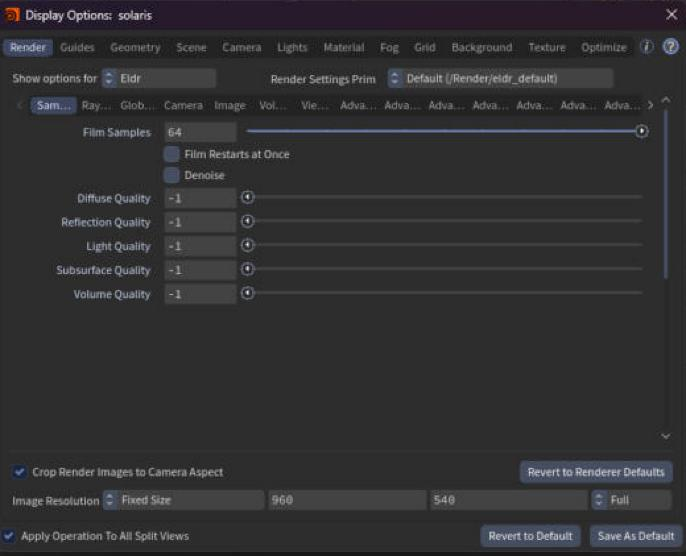
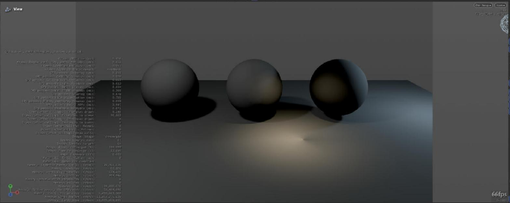

# Viewport

In the Solaris viewport Eldr has two states: **moving** (you tumble the camera or scrub the timeline) and **still** (the film converges). Moving is built for speed, still for the final look.

## While the camera moves

- The image renders as large as fits **Frame Budget while Moving** (33 ms of GPU time per frame) and a temporal filter (TAA) rebuilds full resolution from the frames before. Light scenes stay full size; heavy ones drop as far as needed (to a quarter). Set the budget to 0 for a fixed size (**Render Scale while Moving**, 0.5).
- Traced shadows take one ray per light (**Ray-Traced Shadow Rays while Moving**).
- Settled GI probes pause (**Pause Settled GI Probes while the Camera Moves**).
- Optionally, traced shadows, rough reflections and final gather reuse earlier frames' rays at the same surface point (**Ray-Traced Temporal Reuse**, off by default): penumbrae crawl less, thin contact shadows soften a little.
- Eldr returns a frame while the next one renders (**Overlap Readback while Moving**): smoother tumbling, one frame of lag.

Once the camera has been still for **Still Delay** (0.3 s), quality steps up over **Ramp to Full Quality** (6 frames): size, shadow rays and GI updates rise a little each frame, so no single frame takes the whole cost. Then the film starts from the TAA image (**Film Warm Start**), so the first still frames are as clean as the last moving one. Short pauses mid-navigation stay in moving mode: each paused frame looks and costs the same as a moving one, so moving again shows no change. Raise Still Delay (up to 30 s) if you pause longer between moves, or set 0 to switch on the first still frame. To keep TAA instead of the film (a steady image, no restart when the camera stops), turn off **Film when Still**; it, **TAA Samples**, **Still Delay** and the settings above are in the open **Viewport** group of the Eldr tab.

| Kitchen test scene, 1080p, camera moving | Full settings | Moving mode |
|---|---|---|
| Frame time | 21.6 ms | 8.6 ms |

> **Tip:** With heavy final settings in the viewport, moving stays fast; only the still frames take long. Choose the draft render settings prim while you lay out a shot.

> **Showcase:** open `showcase/2026-10-30_01_moving_camera/scene.hip`, compare `eldr_default` vs `eldr_final` vs `karma`, then `moving` (the defaults) vs `full`.

## While you edit

An edit (a new prim, a light, a material parameter, a setting) shows in the next frame; then the film starts over. Eldr compiles the shader variants your next edits will likely need in the background, so a setting change rarely waits for a compile.

| Edit, 1280x720 viewport, default settings | Kitchen: first frame | crowd_9k: first frame |
|---|---|---|
| A render setting (exposure, a feature on or off) | 10 ms | 37 ms |
| Add, move or change a light | 16-24 ms | 54-66 ms |
| Add a prim, move it | 14-23 ms | 36-83 ms |
| New material, bind it, change a shader input | 11-20 ms | 40-80 ms |
| Hide or show a mesh | 10 ms | 38 ms |
| Move everything (a transform above the whole scene) | 57 ms | 1.5 s |

The film then takes about 67 frames to converge: 0.6 s on Kitchen, 3 s on crowd_9k. A new sphere light with a shadow map adds its shadow draws to every film sample (crowd_9k: 46 to 60 ms a frame).

## Choosing what the viewport renders

> **Where in Houdini:** The viewport's **Display Options** (press D over the viewport) have an **Eldr** section for per-viewport settings. The camera menu at the top right picks a render settings prim; its Eldr tab then applies to the viewport.

## Looking at AOVs

The viewport's **Render Outputs** menu lists the render vars of the chosen Render Settings LOP. Pick one to see it: light groups, splits and data AOVs fill as in husk.

> **Note:** The viewport's channel buttons (RGB, R, G, B, A, L) don't affect Eldr's view. Use Render Outputs to view one AOV.

> **Showcase:** open `showcase/2026-10-28_05_houdini_render_vars/scene.hip`, compare `eldr_default` vs `eldr_final` vs `karma`, then `default` (writes `renderVars.exr`) vs `viewport` (`houdini:viewport` flag).

## Render statistics

Turn on the viewport's **Show/Hide Render Stats** toolbar button for a line with the stage ("Accumulating 24%"), the samples done and GPU time. The full stats panel (Eldr's own layout) shows memory and time per pass.

> **Showcase:** open `showcase/2026-10-28_08_render_stats/scene.hip`, compare `eldr_default` vs `eldr_final` vs `karma`, then `default` only (no A/B: the feature is metadata).

## Colour in the viewport

The viewport shows linear scene colour, the same values as the EXR, under Houdini's own colour view (OCIO). Eldr adds no tonemap of its own there (**Linear Beauty**, on). If the image looks flat or too bright, check Houdini's view transform, not Eldr.

## Limitations

- The viewport's channel buttons don't apply to Eldr.
- Houdini's guides (light and camera gizmos) can lag one frame behind the image while tumbling with overlap readback on.
