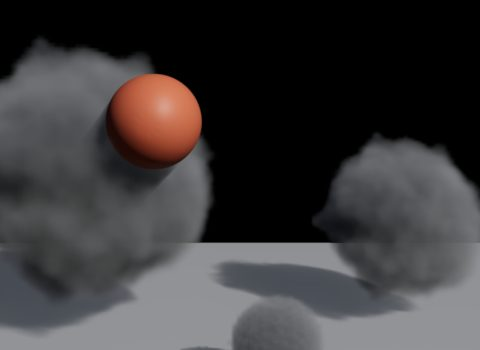
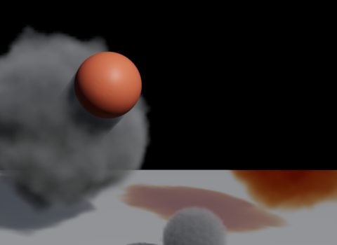
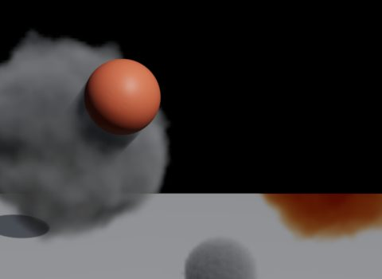
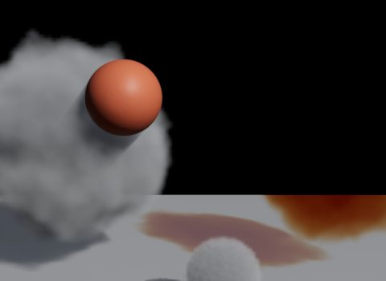
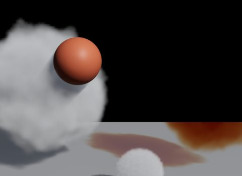
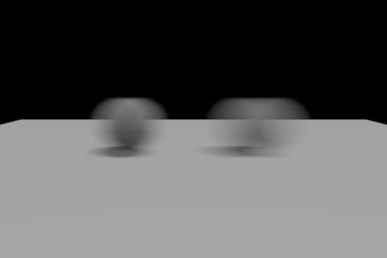
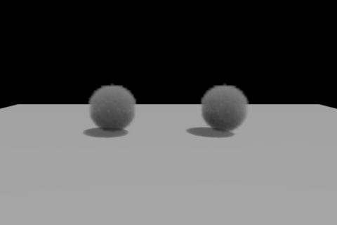
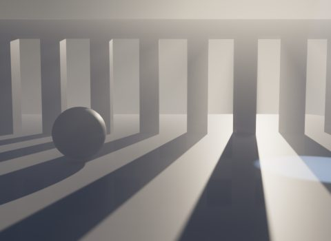
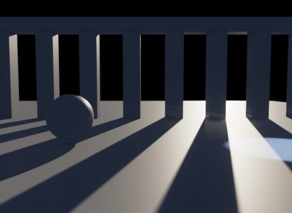
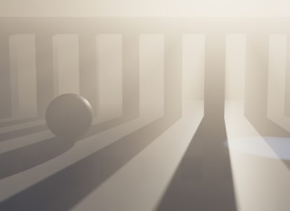

# Volumes

Eldr renders OpenVDB volumes (smoke, clouds, fire, explosions) and a simple height fog. Volumes are marched on the GPU (as NanoVDB), lit by every light, and cast coloured shadows on surfaces, fog and each other.

> **Where in Houdini:** Volumes come in through a **SOP Import LOP** (VDB or Houdini volumes, no files needed) or a **Volume LOP** / Sublayer of `.vdb` files. Materials go on with a **Material Library LOP** (MaterialX `volume`, or Karma's `kma_volume`). Per-volume controls are on the **Render Geometry Settings LOP**.

## Without a material

A volume without a material renders like Karma's: the `density` field scatters white light, no absorption, the same in every direction. That is what you get from a plain SOP Import of a smoke sim.

**Volume Default Fields** also reads `temperature` (as fire), `Cd` (colour) and `emission` without a material.

## With a material

Eldr reads MaterialX `volume` materials (anisotropic_vdf, absorption_vdf, uniform_edf) and Karma's `kma_volume`:

- Constant colours and field reads (`geompropvalue`), multiplied together.
- Ramps and remaps of one field each, up to three per material: Houdini's MtlX Color and Float Ramps, Karma Ramp Const, MaterialX `ramp`, `remap`, `range`, `smoothstep` and maths.
- Blackbody colour from a temperature field: fire.
- Absorption and scattering per colour channel: coloured smoke and coloured shadows.

> **Warning:** Karma's **Pyro Shader** isn't read. Eldr renders such a volume with its density only and warns. Build the look with a MaterialX volume or Karma Volume material instead.

## Multiple scattering: Volume Limit

Bright clouds get their glow from light that bounces many times inside. Karma controls that with **Volume Limit** (Render Geometry Settings, `karma:object:volumelimit`); Eldr reads the same value and fits its look to Karma's at that limit. **Volume Multiple Scattering** on the Eldr tab does the same for all volumes.

## Velocity blur

A volume with **Velocity Blur** on (Render Geometry Settings) blurs along its `vel` field when motion blur samples run: a vector VDB, or Houdini's `vel.x`, `vel.y`, `vel.z`. **Volume Velocity Blur Scale** strengthens or weakens it.

## Fog

**Volumetric Fog** (off) fills the scene with height fog: thicker near the ground, lit by every light, with god rays from the sun and cones from spots. Set **Fog Density**, **Fog Height Falloff** and **Fog Color**. There is no USD fog prim, so fog lives only in the render settings.

## Speed

Volumes can be the slowest part of a frame. To speed them up:

| Setting | Effect |
|---|---|
| **Volume Resolution** 2 | March at half resolution: about 3x cheaper, slightly softer edges |
| **Volume Step Size** | Longer steps are faster, but thin wisps may vanish |
| **Volume Shadow Grid** (on) | Each volume's shadowing is kept on a small grid instead of marched every step: 3-4x cheaper |
| **Volume Quality** | Fewer or more shadow steps (Karma's Volume Quality) |

## Limitations

- Volumes aren't pickable in the viewport.
- `op:` paths from SOP Import resolve only inside Houdini: for husk on a saved file, write the stage with a USD ROP first (volumes go to `.vdb` files next to it).
- Multiple scattering reaches the sun and the dome, not local lights.
- More on the [How Eldr works](../features.md#volumes-and-fog) and [Houdini](../houdini.md#volumes) pages.
